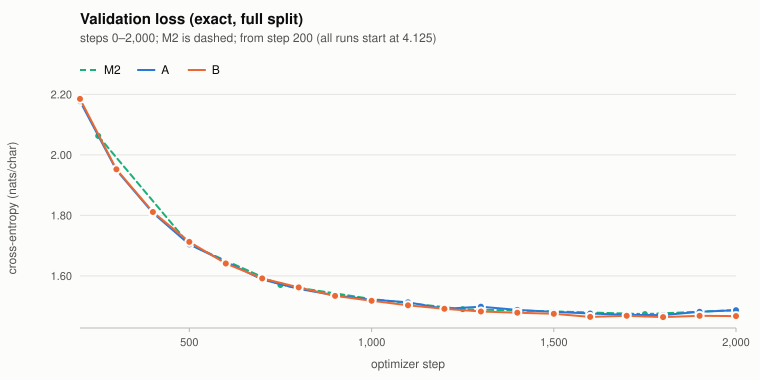
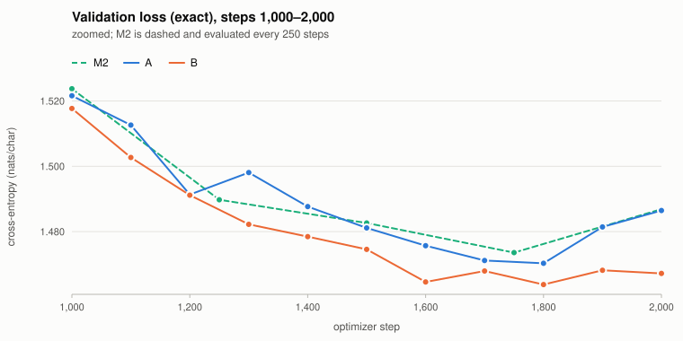
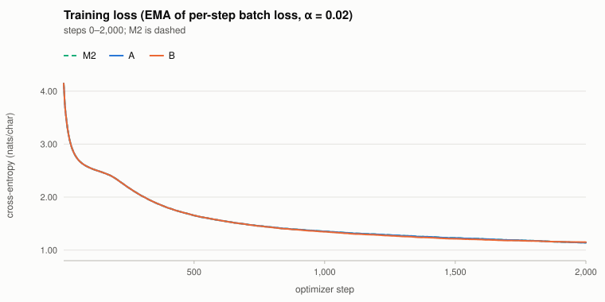
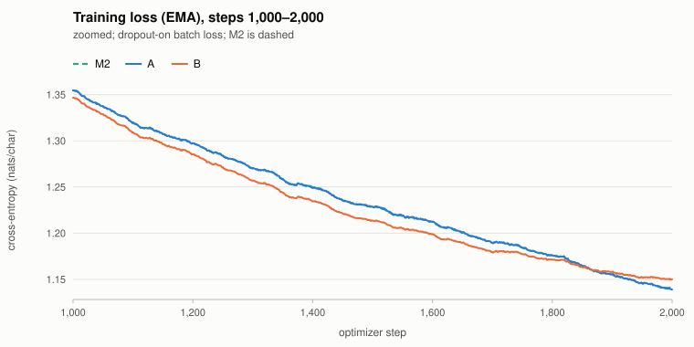
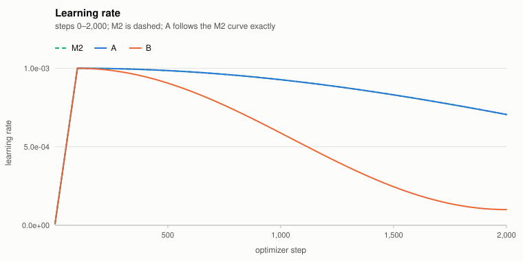
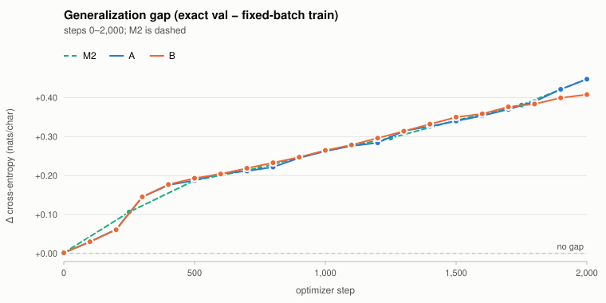
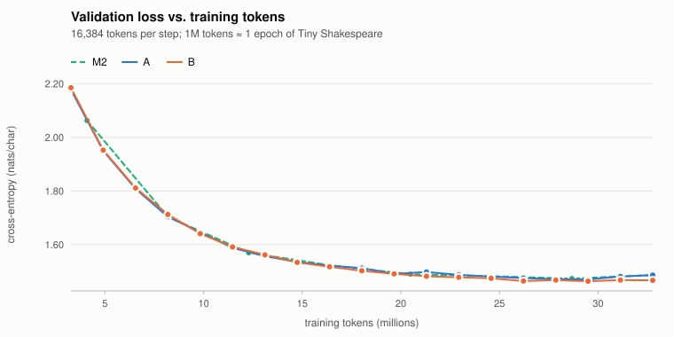

# M2.1 report: learning-rate schedule ablation

**Status:** complete, awaiting review. The changes are uncommitted on
`milestone-2-pretraining`, on top of `8d6143f` (M2). Nothing has been pushed.

## Question

M2 reached its best validation loss (1.4736) at step 1750, with a cosine schedule
whose horizon was 5,000 steps. At that point the learning rate was still 7.8e-4, 78%
of peak. Two hypotheses could explain where the benefit comes from:

- **Early stopping:** stopping near step 2000 is all that matters.
- **Annealing:** finishing the LR decay before overfitting begins gives a better model.

The experiments below separate the two:

| | optimizer steps | cosine horizon | what it isolates |
|---|---|---|---|
| **M2** (baseline, existing run) | 5000 | 5000 | |
| **A**: original schedule, early stop | 2000 | 5000 | early stopping alone; follows M2's LR curve exactly |
| **B**: compressed schedule | 2000 | 2000 | early stopping plus annealing to lr_min by step 2000 |

## Summary

- **A reproduces M2.** It follows M2's LR curve exactly. Its validation losses at the
  steps both runs evaluated differ by at most 0.0021, and its per-step training
  losses are equal to about 5e-8 for the first 100 steps.
- **B achieved the lowest validation loss of the three runs:** best 1.4638 (A 1.4703,
  M2 1.4736) and final 1.4672 (A 1.4865).
- **Early stopping explains almost all of the improvement over M2's final
  checkpoint.** It accounts for −0.254 nats; the compressed schedule adds a further
  −0.019.
- **For the best checkpoint, the gain from compression is small: −0.0065 nats.** That
  is about 3× the largest A–M2 difference attributable to MPS nondeterminism. It is a
  single run per configuration, so **no significance is claimed**.

## 1. Changes made

- **`TrainingConfig.lr_schedule_steps`** (new, optional) decouples the cosine
  horizon from `max_steps`. `None`, the default, means `max_steps`, so every
  existing config, run and checkpoint behaves exactly as before; this is tested.
  - A horizon longer than `max_steps` stops training early on the same LR
    trajectory.
  - A shorter horizon holds lr_min after it ends.
  - `learning_rate()` uses `cfg.schedule_horizon`.
  - The value is validated: it must be a positive integer and at least
    `warmup_steps`.
- **`scripts/verify_ablation.py`** runs the eight pre-flight validity checks (§2)
  and writes `verification.json`.
- **`scripts/compare_runs.py`** builds the comparison table, recomputes exact losses
  from the checkpoints, analyzes reproduction and noise, writes the overlay plots,
  and generates matched samples.
- **`scripts/stability_check.py` and `scripts/train.py`** understand the horizon;
  `--lr-schedule-steps` is available as an override.
- **Configs:** [`gpt_10m_m2_1_a.toml`](../../configs/gpt_10m_m2_1_a.toml) and
  [`gpt_10m_m2_1_b.toml`](../../configs/gpt_10m_m2_1_b.toml).
- **Tests:** 9 new (151 total).
  - Default horizon equals `max_steps`.
  - A longer horizon reproduces the longer run's LRs.
  - A shorter horizon holds lr_min.
  - Horizon validation.
  - M2-era configs without the field still load.
  - A run that stops early on a longer horizon is a bit-exact prefix of the full run
    (CPU).
  - Changing eval frequency or `exact_val_eval` leaves training bit-identical (CPU),
    which is the RNG-isolation requirement.

## 2. Validity checks (before training)

These are from `runs/m2_1_verification-20261112-185808/verification.json`, run on MPS.
All of them passed.

| check | result |
|---|---|
| A, B and M2 begin with identical weights | bitwise equal state dicts |
| identical first training batch (64 × 256) | equal for A, B and M2 (drawn from copies of the data generators) |
| identical initial exact validation loss | A = B = 4.124992488992625, the M2 run's logged value to every digit |
| A's LR for steps 0–2000 equals M2's | exactly equal (max difference 0.0). It also equals every LR logged in M2's `metrics.jsonl` for steps 1–2000. |
| B's LR reaches lr_min at its horizon | lr(2000) = 1.0e-4. B's last update (step 1999) uses 1.0000006e-4. |
| identical warmup | 100 steps, identical values |
| identical settings | weight decay 0.1, accumulation 1, warmup 100, peak 1e-3, min 1e-4, β (0.9, 0.99), clip 1.0, batch 64, seed 1337, float32, MPS, eval every 100 with 50 batches plus exact val |
| identical optimizer hyperparameters | AdamW parameter groups equal (decay 0.1 / 0.0, eps 1e-8) |
| config diff A vs B | **only** `training.lr_schedule_steps` (5000 vs 2000), plus `name` and `description` |
| config diff A vs M2 | `max_steps` 5000→2000, `lr_schedule_steps` (None→5000, same horizon), `eval_interval` 250→100, `checkpoint_interval` 250→500, plus `name` and `description` |

**Seeds and RNG.**

- Global seed 1337. Initialization uses `torch.manual_seed(1337)` on the CPU, then
  moves to MPS.
- Training batches come from a dedicated CPU generator seeded 1337.
- Evaluation batches use a separate generator seeded 1337 + 1,000,003 and recreated
  at every eval, so evaluation never consumes training randomness.
- Dropout uses the MPS RNG.

**Environment.** Apple M6, macOS 27.0.1, Python 3.15.2, PyTorch 2.15.0, MPS,
float32, SDPA attention. Code is `8d6143f` plus the uncommitted M2.1 changes
(`git_dirty: true` in each run's `environment.json`).

**Runs** (git-ignored, 618 MB each):

- A: `runs/gpt_10m_m2_1_a-20261112-185842`
- B: `runs/gpt_10m_m2_1_b-20261112-191929`

They were run one after the other under a single `caffeinate -i`, with B starting
only after A exited successfully. Each run has `best.pt`, checkpoints at steps
500/1000/1500, a `final` checkpoint at step 2000, `metrics.jsonl`, the CSVs,
`config.json`, `environment.json` and a summary.

## 3. Results

All losses are in nats/char. *Exact* means a full pass over the split with dropout
off, recomputed from the checkpoints by `compare_runs.py`. "n/a" marks a step at which
the run did not evaluate: M2 evaluated every 250 steps; A and B every 100.

| | M2 | A | B |
|---|---|---|---|
| schedule horizon / steps run | 5000 / 5000 | 5000 / 2000 | 2000 / 2000 |
| **best val (exact) [step]** | 1.4736 [1750] | 1.4703 [1800] | **1.4638 [1800]** |
| val at step 500 | 1.7042 | 1.7041 | 1.7123 |
| val at step 1000 | 1.5237 | 1.5216 | 1.5177 |
| val at step 1500 | 1.4826 | 1.4811 | 1.4746 |
| val at step 1750 | 1.4736 | n/a | n/a |
| val at step 2000 | 1.4869 | 1.4865 | **1.4672** |
| **final val** [step] | 1.7402 [5000] | 1.4865 [2000] | **1.4672** [2000] |
| train at best checkpoint (exact) | 1.0928 | 1.0816 | 1.0813 |
| train at step 2000 (exact) | 1.0415 | 1.0420 | 1.0618 |
| train at final checkpoint (exact) | 0.5862 | 1.0420 | 1.0618 |
| train estimate at 1000 / 1500 / 2000 (fixed batches) | 1.2603 / 1.1414 / 1.0388 | 1.2592 / 1.1414 / 1.0392 | 1.2531 / 1.1247 / 1.0594 |
| batch loss, mean of the last 50 steps to 2000 (dropout on) | 1.1373 | 1.1357 | 1.1493 |
| gap at best (exact val − exact train) | +0.3808 | +0.3887 | **+0.3825** |
| gap at step 2000 | +0.4454 | +0.4445 | **+0.4054** |
| gap at final | +1.1539 | +0.4445 | +0.4054 |
| val perplexity, best / final | 4.365 / 5.698 | 4.351 / 4.421 | **4.322 / 4.337** |
| val bits/char, best / final | 2.1259 / 2.5105 | 2.1212 / 2.1445 | **2.1118 / 2.1167** |
| tokens processed | 81.9M | 32.8M | 32.8M |
| optimizer-step time | 43.2 min (17.1 to step 2000) | 16.6 min | 16.8 min |
| wall-clock, first to last eval | 47.3 min (18.8 to step 2000, 9 evals) | 20.5 min (21 evals) | 20.7 min (21 evals) |
| mean throughput (tokens / step time) | 31.6k tok/s (31.9k to 2000) | 32.9k tok/s | 32.5k tok/s |
| steps/s (training only) | 1.93 | 2.01 | 1.99 |
| max grad norm after warmup, to step 2000 | 1.529 (step 177) | 1.529 (step 177) | 1.788 |
| median grad norm, to step 2000 | 0.375 | 0.376 | 0.393 |
| MPS allocated after forward / Metal pool / RSS | 4.05 / 5.57 / 0.57 GB | 4.05 / 5.57 / 0.57 GB | 4.05 / 5.57 / 0.54 GB |
| non-finite values | none | none | none |

Full validation series from step 1000 (exact):

| step | 1000 | 1100 | 1200 | 1300 | 1400 | 1500 | 1600 | 1700 | 1800 | 1900 | 2000 |
|---|---|---|---|---|---|---|---|---|---|---|---|
| A | 1.5216 | 1.5126 | 1.4913 | 1.4981 | 1.4877 | 1.4811 | 1.4757 | 1.4712 | **1.4703** | 1.4814 | 1.4865 |
| B | 1.5177 | 1.5027 | 1.4912 | 1.4822 | 1.4785 | 1.4746 | 1.4646 | 1.4680 | **1.4638** | 1.4682 | 1.4672 |
| B's LR | 5.9e-4 | 5.1e-4 | 4.3e-4 | 3.6e-4 | 3.0e-4 | 2.5e-4 | 1.9e-4 | 1.5e-4 | 1.2e-4 | 1.1e-4 | 1.0e-4 |
| A's LR | 9.3e-4 | 9.1e-4 | 8.9e-4 | 8.7e-4 | 8.5e-4 | 8.3e-4 | 8.1e-4 | 7.8e-4 | 7.6e-4 | 7.3e-4 | 7.1e-4 |

## 4. Learning curves









In the LR plot, A's curve covers M2's dashed one; they are identical. In the training
loss plots, M2 and A overlap almost entirely. The token axis is the step axis times
16,384, because all runs use the same batch.

## 5. Diagnostic interpretation

**1. Does A reproduce the original M2 trajectory? Yes, within MPS nondeterminism.**

- The LRs are identical.
- The per-step batch loss matches M2 to a mean of 4.5e-8 over steps 1–100. The
  difference then grows, as two runs of a nondeterministic backend do: mean 0.0017
  over all 2000 steps, 0.0030 over the last 100, max 0.012.
- Exact val differences at the shared eval steps are 0, −0.00004, −0.0021, −0.0015
  and −0.0004 (steps 0, 500, 1000, 1500, 2000).
- The weights are far apart by step 2000: the median relative L2 difference per
  tensor is 14%, the maximum 63%. Yet the losses agree, which suggests the two runs
  reach different but equally good parameters.
- Gradient-norm extremes also coincide: both runs peak at 1.529 at step 177, while
  their trajectories are still nearly identical.

**2. Does B achieve lower validation loss? Yes, in this single run.**

- Best: 1.4638 vs 1.4703 for A, a difference of −0.0065 (−0.44%).
- At step 2000: 1.4672 vs 1.4865, a difference of −0.0193.
- B is lower than A at every eval from step 1000 on, and higher before (1.7123 vs
  1.7041 at step 500). The early deficit fits B's faster LR decay: by step 500 it is
  already at 9.1e-4 against 9.85e-4.

**3. Does B converge earlier?** It reaches A's best value (1.4703) by step 1600,
200 steps before A gets there. Both runs place their best eval at step 1800. B is
flat from step 1600 to 2000 (1.4638–1.4682), whereas A turns upward after 1800
(+0.016 by step 2000). B therefore *plateaus* rather than turning upward within the
window.

**4. Does B reduce the generalization gap?**

- At the best checkpoint, only marginally: +0.3825 vs +0.3887. Both best checkpoints
  have practically the same exact train loss (1.0813 vs 1.0816), but B's validation
  loss is lower.
- At step 2000, clearly: +0.4054 vs +0.4445. B keeps a higher train loss (1.0618 vs
  1.0420) *and* a lower validation loss.

**5. Is the improvement in the best checkpoint or the final checkpoint?** Mostly in
the final checkpoint.

| | B − A |
|---|---|
| best checkpoint | −0.0065 |
| final checkpoint | **−0.0193** |
| final − best, A | +0.0162 |
| final − best, B | +0.0034 |

With the compressed schedule, the last checkpoint is nearly as good as the best, so
precise checkpoint selection matters much less.

**6. Does the compressed schedule underfit compared with A?**

- In training-loss terms, slightly: B's exact train loss at step 2000 is 0.020
  higher than A's, and its batch loss crosses above A's after about step 1850.
- In validation terms, no: B's validation loss is lower at every step from 1000 on.
- There is no sign of harmful underfitting within 2000 steps. B may simply be leaving
  less room to overfit.

**7. Does early stopping alone explain most of the benefit?** For the *final*
checkpoint, yes.

| step | change in final val |
|---|---|
| M2 → A (early stopping only) | 1.7402 → 1.4865 (−0.2537) |
| A → B (compressed schedule) | 1.4865 → 1.4672 (−0.0193) |

Early stopping accounts for about 93% of the total improvement (−0.2730).

For the *best* checkpoint, the total M2 → B change is only −0.0098:

- M2 → A: −0.0033. This reflects A's finer evaluation grid (it evaluated at step
  1800, M2 did not) plus run-to-run noise.
- A → B: −0.0065, attributable to the schedule if it is real.

**8. How much is plausibly MPS nondeterminism?**

- A vs M2 (identical except eval frequency, which is proven not to affect training on
  CPU) bounds same-config differences at matched steps at about **0.002 nats** of val
  loss.
- Within a single run, consecutive evals can move by +0.007 (A: 1.4913 at step 1200,
  1.4981 at 1300, 1.4877 at 1400).
- B − A at the best checkpoint (−0.0065) is about 3× the matched-step A–M2 difference
  and comparable to within-run eval wiggles. B − A at step 2000 (−0.019) is about 9×.
- MPS nondeterminism is only one component of variance. **Seed variance** (different
  initialization and batch order) was not measured and is likely larger. With one run
  per configuration, these differences are suggestive, not statistically
  established.

**Hypotheses (not established by this experiment):**

- Annealing gives the model a period of low-noise updates that consolidates
  generalizable structure before memorization dominates. That would explain the lower
  validation loss at an equal training loss at the best checkpoint.
- The compressed schedule's plateau suggests that at lr ≈ 1e-4 the model moves too
  little per step to overfit quickly within 400 steps. A longer run held at lr_min
  would probably start rising.

## 6. Generated text (best checkpoints)

Settings: prompt `ROMEO:\n`, temperature 0.7, top-k 40, 500 new characters, the same
five seeds (1–5) for every model. All 15 samples are in
[`m2_1/samples.md`](m2_1/samples.md).

| best checkpoint | longest verbatim training match: mean / max | 32-char windows copied | valid ≥4-letter words | word-trigram repetition | speaker labels that are real |
|---|---|---|---|---|---|
| M2 (step 1750) | 20.0 / 23 chars | 0% | 96.7% | 0.0% | 95% |
| A (step 1800) | 23.2 / 25 chars | 0% | 97.0% | 0.2% | 88% |
| B (step 1800) | 21.0 / 26 chars | 0% | 95.6% | 0.2% | 96% |

For reference, held-out Shakespeare shares at most 24 characters (mean 20) with the
training text by coincidence (M2 report).

Seed 3 from each model:

```text
M2: ROMEO:
    Then is not so I that beat not straight, not for this world.

    BENVOLIO:
    What then?

    BRUTUS:
    Well, sir: it is this noble man, comes so.

A:  ROMEO:
    Then it be gone:
    He will make his hands, and fear him he be found.

    DUKE VINCENTIO:
    But who would shall descend you what you company?

B:  ROMEO:
    Then it be that Romeo shall be straight,
    The fearful shadow of the helm of the earth.

    BENVOLIO:
    And there long you were subjects to the rest.
```

Seed 2:

```text
M2: ROMEO:
    O my name, my lord! I would not speak to another.
A:  ROMEO:
    O my true Romeo!
B:  ROMEO:
    O my tale, my lord!
```

**Observations:**

- **Shared openings.** The three models often begin the same seed the same way
  ("Then …", "O my …", "Ay, …", "What …"). They share the sampling RNG stream and
  have similar next-character distributions, so they draw the same high-probability
  first tokens and diverge after a few words.
- **Repetition.** No sample shows the greedy-style loops seen in M2. Repeated word
  trigrams are 0–1% for every model.
- **Grammar and coherence.** The three models look the same: locally well-formed
  clauses and verse lineation, real speaker turns, no sustained meaning or topic.
  With five samples each, no qualitative difference is distinguishable. The
  validation-loss differences of 0.003–0.01 nats (≤ 0.7%) are far below what one
  could see in samples.
- **Speaker choice.** B's samples more often stay within one play's cast (seeds 3–4:
  ROMEO, BENVOLIO, MERCUTIO, JULIET, LADY CAPULET, Nurse), but that is n = 5.
- **Memorization.** No model copies a 32-character window from training data. The
  longest verbatim spans (23–26 chars) are at the level of coincidental overlap in
  real held-out text. There is no evidence that any of the three best checkpoints
  memorizes more than the others.

## 7. Verification

| check | result |
|---|---|
| pytest | 151 passed (9 new) |
| ruff check, ruff format --check, mypy | clean |
| scheduler correctness | unit tests (default horizon, longer and shorter horizons, validation). Pre-flight: A's 2,001 LRs equal M2's, and logged LRs equal the schedule for all 2000 steps of A and B. |
| early-stop prefix and RNG isolation | bit-exact CPU tests |
| checkpoint loading | all 5 checkpoints of A and B (plus `best.pt`) load with `weights_only=True`. Each `step` equals the metadata step and the `loss_history` length. M2-era configs without `lr_schedule_steps` load. |
| best-checkpoint selection | `best.pt` is the exact-val argmin of all 20 evals in both runs (step 1800), and its sidecar `val_loss_exact` equals the logged value |
| artifact integrity | A and B: train steps 1–2000 contiguous, evals 0–2000 every 100, kinds periodic×3 + final, no `failure.json`, CSVs present. **The M2 run directory is unchanged:** SHA-256 of all 50 files is identical before and after M2.1. |

## 8. Limitations

- One run per configuration. Seed variance is unmeasured, and MPS kernels are not
  bit-reproducible.
- The best step is quantized to the 100-step eval grid (250 for M2). M2 had no eval
  at step 1800, and A/B none at 1750.
- The fixed-batch train estimates and gap curves use 50 random batches. Exact train
  losses were computed only for checkpoints (best and steps 500/1000/1500/2000).
- B decays to lr_min *at* step 2000. Whether its plateau would persist, or begin to
  rise, beyond 2000 at lr_min was not tested.
- The sample comparison uses five samples per model and surface statistics only.
- Throughput differences of up to 3% between runs are within machine-state variation.
  An unrelated `website/` install overlapped part of M2, as noted in the M2 report.

## 9. Recommendations

1. **Repeated seeds before any causal claim.** Run A and B with three or more seeds
   each (for example 1337, 1338, 1339; about 21 min per run, about 2 h for 3 + 3).
   Report the mean ± spread of the best and final val. Treat B's −0.0065 best-val
   advantage as real only if it exceeds the seed spread.
2. **If B's advantage holds,** use a schedule whose horizon equals the intended
   training length as the default for small-data runs. Pick that length from where
   val loss turns up (about 1,800–2,000 steps here, roughly 30 epochs).
3. **One variable at a time, after the seed study:**
   - horizon sweep at a fixed 2000 steps (horizon 1500/2000/3000);
   - dropout 0.3 with the B schedule;
   - weight decay 0.2;
   - a held-at-lr_min tail (B schedule continued to 2500) to test whether the plateau
     breaks.
4. Keep `eval_interval = 100` near the expected minimum: the best step moved from
   1750 (M2 grid) to 1800, and the grid alone accounted for about 0.003 nats.
5. Beyond schedule tuning, the overfitting limit is set by the data: about 1M
   characters for 10.8M parameters. The larger gains are expected from more data
   (BPE plus a bigger corpus), which stays out of scope until approved.
