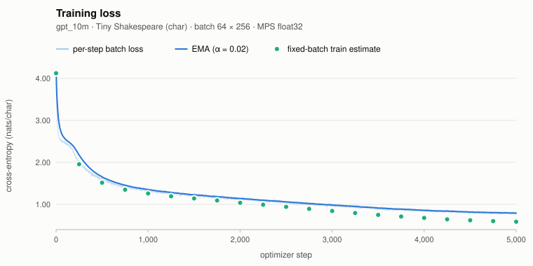
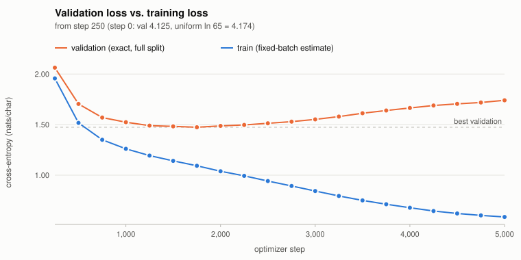
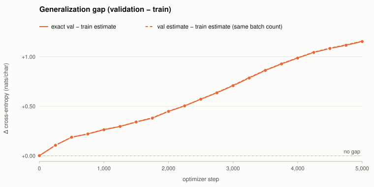
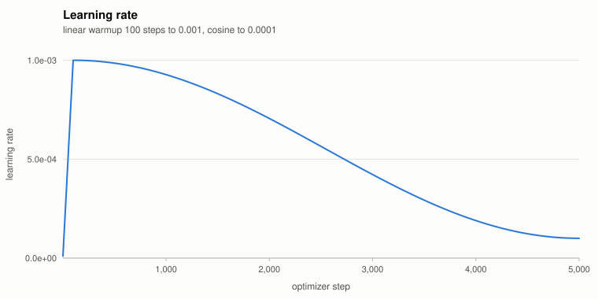
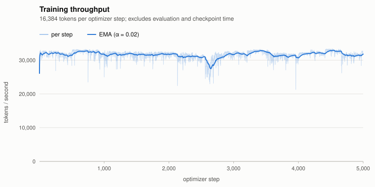

# M2 report: first full pretraining run (gpt_10m, Tiny Shakespeare, char-level)

**Status:** complete, awaiting review. The M2 code changes are uncommitted on
`milestone-2-pretraining`; nothing has been pushed beyond the M0–M1 baseline.

## Summary

- **Training was stable.** The 10.77M-parameter model trained for 5,000 steps
  (81.9M tokens, ~82 epochs) on MPS in float32. There were no non-finite values
  and no restarts. Training took 47.3 min of wall-clock: 43.2 min of optimizer
  steps and 4.1 min of evaluation and checkpointing.
- **Best validation loss: 1.4736 nats/char** (2.126 bits/char, perplexity 4.36)
  at **step 1750**, measured as the exact loss over the full validation split.
- **Final validation loss: 1.7402** (2.511 bits/char, perplexity 5.70) at step
  5000. Training loss kept falling to 0.586, so the final gap is **+1.154 nats**.
  The model overfits strongly after about step 1750 (~29 epochs).
- **Form of the samples.** Recognizable English words dominate from about step
  500. Speaker labels with Shakespeare-style dialogue layout appear from step 250,
  and real character names from step 500. Samples are locally grammatical
  fragments with no sustained meaning.
- **Memorization.** There is no long verbatim regurgitation from either checkpoint.
  Training-text-specific copying measurably increases as the model overfits: the
  extraction probe's matched prefix rises from 2.7 to 5.4 chars on training passages
  but stays at 2.0–2.1 on validation passages. Free samples from the final model
  contain verbatim spans of up to 55 chars, against a 24-char maximum for real
  held-out text.

## 1. Configuration and environment

| | |
|---|---|
| Config | [`configs/gpt_10m_m2.toml`](../../configs/gpt_10m_m2.toml). This is `gpt_10m.toml` with only bookkeeping changed: checkpoint every 250 steps, keep all, `save_best`, `exact_val_eval`, `device = "mps"`, `log_interval = 50`. |
| Model | GPT-2-style pre-LN decoder, 6 layers / 6 heads / 384 d, context 256, tied embeddings, bias, SDPA attention. **10,770,816 parameters.** |
| Data | Tiny Shakespeare, character tokenizer (V = 65). Contiguous split: 1,003,854 train / 111,540 val tokens. |
| Optimization | AdamW (β = 0.9, 0.99; weight decay 0.1 on ≥2-D tensors), grad clip 1.0, dropout 0.2. LR: linear warmup to 1e-3 over 100 steps, then cosine to 1e-4 at step 5000. |
| Batch | 64 × 256 = 16,384 tokens per step, no accumulation. Seed 1337. |
| Evaluation | Every 250 steps and at step 0: fixed-batch estimates (50 batches per split) plus the **exact** full-split validation loss, which selects `best.pt`. |
| Hardware | Apple M6, 16 GiB unified memory, 12-core GPU. macOS 27.0.1, Python 3.15.2, PyTorch 2.15.0, MPS, float32. |
| Code | Baseline commit `d49fa80` plus the uncommitted M2 working tree (`environment.json` for this run predates the new `git_dirty` field). |
| Run dir | `runs/gpt_10m_m2-20261112-174425/` (git-ignored, 2.5 GB: 20 periodic checkpoints, `best.pt`, `metrics.jsonl`, CSVs, summary) |
| Commands | `scripts/stability_check.py --steps 300`, then `caffeinate -i scripts/train.py --config configs/gpt_10m_m2.toml --full-eval`, then `scripts/analyze_run.py` and `scripts/memorization_probe.py` |

**Pre-flight stability check** (`runs/gpt_10m_m2_stability-*`; first 300 steps of the
real schedule, no checkpoints):

- The LR matched the closed-form schedule exactly at every one of the 5,001 steps
  (max error 0.0), and the LRs used in training matched too (error 0.0).
- Loss fell from 4.12 to 1.95 val. The gradient norm was 10.5 at step 1 (clipped),
  then about 0.55.
- Median step time was 503 ms, giving a projected 48.6 min for the full run. The
  actual run took 47.3 min.

## 2. Metrics

Exact losses come from a full pass over each split with non-overlapping 256-token
windows. They are recomputed by `analyze_run.py` from the checkpoints, and match the
values logged during training to every printed digit.

| | init (step 0) | **best (step 1750)** | final (step 5000) |
|---|---|---|---|
| train loss (exact, dropout off) | 4.1230 | 1.0928 | 0.5862 |
| **val loss (exact)** | 4.1250 | **1.4736** | 1.7402 |
| generalization gap (val − train) | +0.002 | +0.381 | **+1.154** |
| val perplexity | 61.9 | **4.36** | 5.70 |
| val bits/char | 5.951 | **2.126** | 2.511 |
| train bits/char | 5.948 | 1.577 | 0.846 |
| tokens seen | 0 | 28.7M (28.6 epochs) | 81.9M (81.6 epochs) |

Reference points:

- A uniform predictor scores ln 65 = 4.174, and the initialization sits just below
  it at 4.125.
- The M1 smoke run reached val 2.506 after 100 steps at batch 8.
- Public runs of this configuration report a validation loss of about 1.47–1.5.
  Our 1.4736 is consistent with that.

**Throughput and time**

| | |
|---|---|
| median step | 514 ms (31.9k tokens/s). Mean 518 ms; min/max 491/769 ms. |
| optimizer-step time | 43.2 min for 5,000 steps |
| eval + checkpoint overhead | about 11.5 s per eval (21 evals: two 50-batch estimates, an exact val pass, and a 129 MB checkpoint, plus `best.pt` while improving) |
| wall-clock | 47.3 min from the step-0 eval to the final eval. The process ran about 48 min including startup and the summary. |

**Memory** (MPS has no peak counter; see `docs/training_plan.md`, "Memory counters")

| counter | max observed |
|---|---|
| `mps_current_allocated` after the last forward pass (activations live) | 4.05 GB |
| `mps_current_allocated` after an optimizer step | 0.18 GB |
| `mps_driver_allocated` (Metal pool; ≈ peak reserved) | **5.57 GB** |
| process RSS high-water mark | 0.57 GB |

The pool reached 5.57 GB, against 4.49 GB in the training-only stability check.
*Hypothesis:* the extra ~1.1 GB comes from the evaluation passes (batch-32 exact val
and batch-64 estimates) adding allocations to the pool. This was not isolated.

**Gradient norm (pre-clip):**

- Step 1: 10.5.
- Steps 100–1000: median 0.46, max 1.53 (step 177).
- Steps 1000–2000: median 0.34.
- Steps 4000–5000: median 0.47.
- After warmup, only 0.12% of steps exceeded the clip threshold of 1.0.
- No NaN or Inf values occurred.

*Observation:* the median norm drifts upward in the second half while the LR decays.
It was not investigated.

**Throughput dip:** the median fell to about 28.4k tok/s between steps 2550 and 2700,
with a minimum of 23.0k, and then recovered. Nothing else was launched during that
window by this experiment. *Likely cause, not verified:* the window (about
13:08–13:10 local time) coincides with the creation of an unrelated untracked
`website/` JavaScript project in the repository (files dated 13:08–13:19, including
`node_modules`). That project is not part of M2. A package install and build would
compete for CPU and memory bandwidth.

## 3. Learning curves



The per-step batch loss is computed in train mode with dropout 0.2. It sits about
0.2 nats above the fixed-batch train estimate, which is computed in eval mode with
no dropout. The plateau near 2.5 at steps 30–180 corresponds to unigram/bigram
statistics. The second drop after about step 180 is when the model starts using
longer context.









Raw data: `runs/gpt_10m_m2-20261112-174425/{train,eval,memory}_metrics.csv`.

## 4. Generated text

All samples use seed 1337 and 500 new characters. The decoding settings are
temperature 0.7 with top-k 40, temperature 0.9 with top-k 40, and greedy. All 30
samples (best and final, five prompts each, three decodings) and the progression set
are in [`m2/samples.md`](m2/samples.md). `To be, or not` does **not** occur in Tiny
Shakespeare, which has no *Hamlet*, so it is an out-of-corpus prompt.

### Best checkpoint (step 1750): five samples, temperature 0.7, top-k 40 (excerpts)

```text
ROMEO:
Then are comes a man or like to be a whippiness, a
point of the steel, a main of my country: a
gentleman of brave a scandem-poor friend, a
shall though the mistress of the gentleman: he
will place to our reasons sink him.
```

```text
JULIET:
Canst thou denied the room of thy father's gentleman bottom,
Thou tell'st me seek to the friends and my soul.

CAPULET:
Heaven how the news, hath power the city
Hath strengthen and suffer'd his place of heaven shows,
```

```text
First Citizen:
Cannot cock the citizens
To see him to the gentleman of this wars:
With a poor simple seven graves of your senate,
To lay a proportion of desires to the people,
```

```text
KING RICHARD III:
Cannot this enemy is like that heaven cannot play thee
Thou wish the bank of senses of thy head;
Nor my mother, so cold that speaks not my son.

QUEEN ELIZABETH:
My lord, there at my heart prosperous is bring.
```

```text
To be, or not promotion denied and rob the earth
Of the seatenious issue, whose field sound
That confiscate, that my soul shall company
By those news of law to them and mine own.

FRIAR LAURENCE:
Marry, I see the prince, I should have made this eyes.
```

### Best checkpoint, greedy (excerpt): repetition loops

```text
JULIET:
O my lord, I will not speak the world of the world,
That I may not see the sea of the sea
Of the seat of the seat of the sea
Of the sea-shearing steeling for the sea
```

### Final checkpoint (step 5000), temperature 0.7, top-k 40 (excerpt)

```text
ROMEO:
Come, here's no more.

MERCUTIO:
Good heart, Tybalt, the bitter was a prisoner.

ROMEO:
Why, then, I must die to-morrow;
And I will not speak with me alone.
```

### Beginning, middle, end (prompt `ROMEO:\n`, temperature 0.7, top-k 40)

| step | val loss | excerpt |
|---|---|---|
| 0 | 4.125 | `-pz?YoF ;czdddQQZyT,yzrzPG3'QYwNMGB` (uniform noise; greedy prints `dddd…`) |
| 250 | 2.063 | `Cars an the ence in throw liage weith him and this pairst in with this bathens` / `IS MENIUS:` |
| 500 | 1.704 | `Care an thee, pare on to sun heaven` / `POLIXENES:` / `Ay, and sir, you will you come too you.` |
| 1000 | 1.524 | `Carl me thee, pardon me, such a wain,` / `CAPULET:` / `Heavy comfort in her brangs,` |
| 1750 (best) | 1.474 | see above |
| 5000 (final) | 1.740 | see above |

## 5. Analysis

Statistics come from `scripts/analyze_run.py`. For every checkpoint it draws four
1,000-character samples from a newline prompt, both at temperature 0.7 with top-k 40
and at temperature 1.0 with no top-k (the model's own distribution). A word counts
as "valid" if it occurs anywhere in the training text. A speaker label is a line
`Name:`; it counts as "known" if that speaker exists in the training text.

| step | val (exact) | valid words (T0.7) | valid ≥4-letter words (T0.7) | valid ≥4-letter (T1.0) | speaker labels (T0.7) | labels known (T0.7) | longest verbatim train match (T0.7) |
|---|---|---|---|---|---|---|---|
| 0 | 4.125 | 8% | 0% | 0% | 0 | n/a | 5 |
| 250 | 2.063 | 62% | 39% | 19% | 22 | 14% | 25 |
| 500 | 1.704 | 91% | 84% | 62% | 33 | 85% | 28 |
| 1000 | 1.524 | 97% | 95% | 80% | 53 | 85% | 24 |
| 1750 | 1.474 | 98% | 95% | 90% | 35 | 94% | 24 |
| 2500 | 1.513 | 99% | 99% | 92% | 43 | 98% | 31 |
| 3750 | 1.639 | 100% | 100% | 93% | 40 | 95% | 39 |
| 5000 | 1.740 | 99% | 98% | 97% | 40 | 97% | 38 |
| *held-out val text* | | *94%* | *89%* | | | *36%* | *24 (mean 20)* |

### Observations (measured)

1. **Words.** At step 250, frequent short words are already present (`the`, `and`,
   `his`, `heart`) but most longer tokens are not words: 39% of ≥4-letter tokens
   are valid at temperature 0.7. By step 500 (8.2M tokens) 84% are, and by step 1000,
   95%. At temperature 1.0 the same milestones come later (62% at 500, 80% at 1000,
   90% at 1750).
2. **Speaker labels and dialogue layout.** `NAME:` lines followed by verse lines and
   blank-line turn breaks appear at step 250, which is before most words are spelled
   correctly. The names are mostly invented then (`IS MENIUS`, `OLISSSS`). By step
   500, 85% of labels are real speakers. Later samples alternate plausibly between
   characters of one play (ROMEO/MERCUTIO; KING RICHARD III/QUEEN ELIZABETH).
3. **Fragments.** From about step 1000, samples contain locally well-formed clauses
   (`Thou tell'st me seek to the friends and my soul`; `Why, then, I must die
   to-morrow;`). Multi-line coherence, consistent topic, and meaningful answers to a
   previous speaker are absent at every checkpoint.
4. **Validation plateau, then increase.** Exact val loss is nearly flat between steps
   1250 and 1750 (1.490 → 1.474) and rises monotonically after that, to 1.740 at step
   5000. Train loss falls monotonically throughout. The gap grows from +0.38 at the
   best step to +1.15.
5. **Greedy decoding** degenerates into loops at every checkpoint (`the the the`,
   `thee thee`, `of the sea / Of the seat of the sea`). Sampling with temperature
   0.7–0.9 and top-k 40 avoids this.
6. **Verbatim overlap in free samples.**
   - Best checkpoint, all 15 samples: longest training match 16–28 chars, and no
     32-char window copied (0%). This is close to real held-out text, whose
     1,000-char chunks match training text for at most 24 chars (mean 20), because
     common phrases and speaker transitions recur in Shakespeare.
   - Final checkpoint: matches of up to 55 chars. In the greedy `JULIET` sample, 17%
     of 32-char windows occur in training. The longest span is the *Romeo and
     Juliet* passage `Nurse:\nO lamentable day!\n\nLADY CAPULET:\nWhat is the`,
     which appears twice in the corpus.
7. **Extraction probe** (`m2/memorization_probe.json`). 64 random 128-char training
   passages and 64 validation passages are used as prompts; the model decodes
   greedily, and we count how many characters of the true next 128 it reproduces.

   | checkpoint | train: mean / median / max matched prefix | val: mean / median / max |
   |---|---|---|
   | step 500 | 1.7 / 1 / 14 | 1.5 / 1 / 8 |
   | step 1000 | 2.0 / 1 / 14 | 1.5 / 1 / 9 |
   | best (1750) | 2.7 / 2 / 14 | 2.0 / 1 / 8 |
   | step 2500 | 2.7 / 2 / 15 | 2.0 / 1 / 8 |
   | final (5000) | **5.4** / 3.5 / **35** | 2.1 / 1 / 11 |

   No passage was continued for 64 or more chars by any checkpoint.

### Interpretation (hypotheses, not established)

- **Overfitting is memorization of training-specific statistics, not wholesale text
  copying.** Train loss of 0.59 nats/char means the final model assigns about 55%
  average probability to each next training character, against about 18% on
  validation. The probe shows the effect growing between best and final (train
  prefix 2.7 → 5.4, val flat). At 10.8M parameters and about 1M training characters,
  the model has the capacity to fit training text far better than it generalizes.
- **Part of the gap may be distribution shift, not only overfitting.** The validation
  split is the last 10% of the file: different plays, with mostly different
  characters (only 36% of held-out speaker labels exist in training). Some of the
  gap, even at the best step, may reflect that shift. This is untested; a
  shuffled-by-play split would test it.
- **The cosine schedule anneals too late for this dataset size.** Most of the
  low-LR phase happens after validation loss has turned up. A schedule that ends
  near step 2000 might reach a lower minimum. This is a prediction for the next
  experiment.
- **None of this indicates understanding.** The measures above are surface
  statistics: real words, real names, layout, n-gram overlap. A 98% valid-word rate
  is a property of spelling and frequency. The samples contradict themselves
  ("Thou wish the bank of senses of thy head") and do not carry meaning across
  lines. The valid-word rate even exceeds that of real held-out Shakespeare (94%),
  because the model prefers common words and real text contains rarer and new ones.

## 6. Verification

| check | result |
|---|---|
| test suite | 142 passed, 16 of them new in M2 (12 infrastructure, 4 analysis) |
| ruff check + format, mypy | clean |
| checkpoint compatibility | an actual M1 checkpoint (`runs/bench_10m_b8-…/step_00000100.pt`) loads into the M2 trainer and reproduces its full-val loss of 2.5056. A unit test covers synthetic M1-format checkpoints. |
| best-checkpoint selection | `best.pt` is step 1750, the argmin of exact val over all 20 evaluations. Its sidecar `val_loss_exact` equals the logged value. Unit-tested on CPU, including the exact-val variant. |
| exact validation | the exact val loss recomputed from `best.pt` and from step 5000 equals the in-training values (1.4735867, 1.7401598) |
| scheduler | all 5,001 LRs match the closed-form schedule (error 0.0), and the logged LR for each step equals `learning_rate(step-1)` (unit test) |
| generation from checkpoints | `scripts/generate.py` on `best.pt` works, and `analyze_run.py` sampled from all 21 checkpoints |
| resume | CPU bit-exact for both periodic and `request_stop` interruptions (tests). `--max-steps` changes on resume are refused without `--extend-schedule`, verified on the CLI. This run did not need a resume. |

## 7. Limitations

- **One seed and one run.** Run-to-run variance of the best val loss was not
  measured, and MPS is not bit-deterministic.
- **The best step is quantized to the 250-step eval interval.** The true minimum lies
  somewhere in steps 1500–2000.
- **The fixed-batch estimates overlap heavily on validation**: 50 × 64 × 256 tokens
  are sampled from a 111k-token split. The exact pass is the reported number.
- **Emergence statistics are coarse.** There are four 1,000-character samples per
  checkpoint with one seed, the word test is membership in the training vocabulary,
  and the speaker regex misses inline labels.
- **The verbatim-overlap baseline** uses eight held-out chunks and is small.
- **Memorization testing** covers greedy continuation of 128 random passages only.
  Frequently repeated passages, such as speaker transitions and refrains, were not
  targeted specifically.
- **Memory** is reported as probes and pool size, not a true MPS peak.
- **This run's `environment.json`** records `d49fa80` without a dirty flag. The flag
  was added after the run.

## 8. Recommended next experiment (not started; needs approval)

**Shorter schedule to match the overfitting onset.** Run the same config with
`max_steps = 2000`, so the cosine decays fully to 1e-4 by step 2000 (warmup 100), and
evaluate every 100 steps.

- **Hypothesis:** annealing before overfitting gives a lower minimum validation loss
  than 1.4736, and finishes in about 19 min.
- **Variable changed:** only `max_steps` (and `eval_interval`, for resolution).

Follow-ups, one variable each:

1. Dropout 0.3 at 5,000 steps.
2. Weight decay 0.2.
3. A split by play, to separate distribution shift from memorization.

The larger lever is more data, through the BPE tokenizer and a bigger permissively
licensed corpus. That requires approval for the download.
