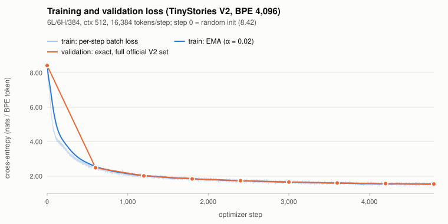
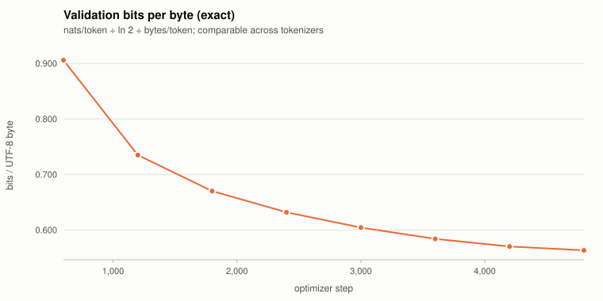
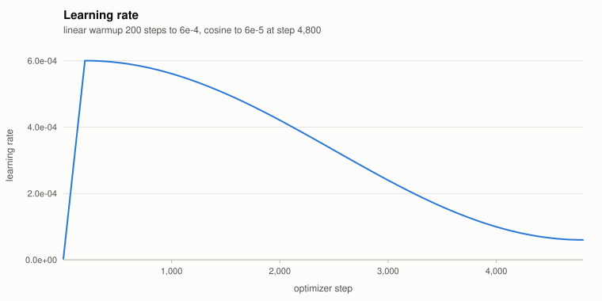
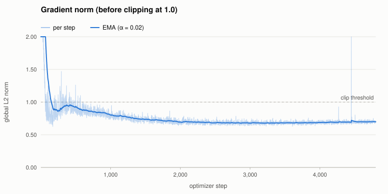
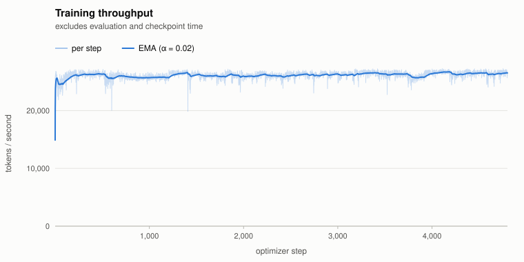
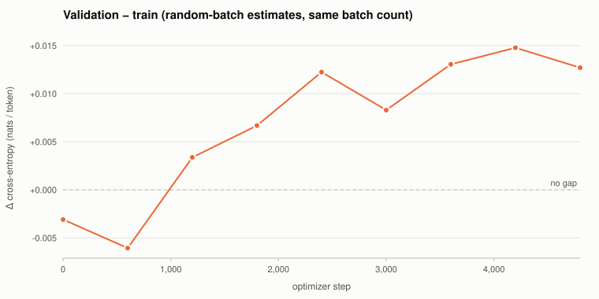

# M3.1 report: TinyStories pretraining (first BPE model)

**Status:** complete, awaiting review. The work is uncommitted on
`milestone-3-dataset-research` (on top of `8d8d7c0`). Nothing has been pushed. Raw
data and run artifacts live in git-ignored `data/` and `runs/` directories.

## Summary

- **Training:** a 12,417,024-parameter decoder-only GPT (unchanged 6L/6H/384
  architecture, BPE vocabulary 4,096, context 512), trained from random
  initialization on **98.2M unique TinyStories-V2 tokens** for 4,800 steps. That is
  **78.6M token presentations, 0.80 of an epoch**, in **56.5 min** on MPS (float32).
  There were no instabilities.
- **Result:** validation loss **1.5455 nats/token = 0.5633 bits/byte**, perplexity
  4.69 per BPE token, on the full official V2 validation set (5.58M tokens). It was
  still improving at the last evaluation, so **best = final** (step 4800).
- **Generalization:** with less than one epoch, validation (1.5455) and an
  in-distribution held-out training split (1.5453) are equal. A slice of training
  tokens the model has partly seen is only 0.017 nats lower. There is no sign of
  overfitting, in contrast to M2.
- **Stories:** at temperature 0.7 the best checkpoint writes grammatical,
  multi-sentence stories that end on their own (100% emit `<|endoftext|>`, against
  20% for the random model). Rubric score 69% (subjective; §7). The main weaknesses
  are character consistency (for example, an owl thanked as "Mr. Frog") and weak
  cause and effect.
- **Memorization:** generated text shares 16-token spans with the training data at
  the same rate as real held-out stories (2.9% vs 2.7%), no 32-token span, and
  greedy continuation of training-story prefixes is barely better than of
  validation prefixes (2.2 vs 1.6 tokens).

## 1. Dataset: provenance, acquisition, manifest

| | |
|---|---|
| Source | Hugging Face `roneneldan/TinyStories`, **commit `f54c09fd23315a6f9c86f9dc80f725de7d8f9c64`** (repo last modified 2024-08-12; the V2 files last changed in commit `b7f09a3d`, 2023-05-19). Every URL is pinned to this revision. |
| License | **CDLA-Sharing-1.0.** Sharing the data requires the same license; models and analyses ("Results") are unrestricted (§3.5). The stories are **GPT-4 outputs**, so OpenAI's terms on outputs are a policy question for downstream use (see the M3 report). The raw data is not redistributed: it stays git-ignored and only hashes and statistics are committed. |
| Paper | Eldan & Li 2023, arXiv:2305.07759 |
| Training file | `TinyStoriesV2-GPT4-train.txt`, 2,227,753,162 bytes, upstream LFS SHA-256 `6418d412…dec90443`. **Not downloaded in full.** |
| Validation file | `TinyStoriesV2-GPT4-valid.txt`, 22,502,601 bytes, downloaded whole. **SHA-256 verified** equal to the upstream LFS oid `6874bae9…80c0585d`. |
| Fetch method | 8 non-overlapping HTTP byte ranges of 50,000,000 bytes, one per equal eighth of the file at a seeded offset (seed 2026): **400,000,000 bytes, 17.96% of the file**. Every response was **HTTP 206 with `Content-Range: bytes start-end/2227753162`** exactly as requested, and its length was checked. 2–9 s per range. |
| Boundaries | Raw bytes are split on `<|endoftext|>` before decoding, so a multi-byte character can never be cut. The partial story at each range edge is dropped: 3,531 bytes at heads and 2,863 at tails. Decoding is strict UTF-8 (0 failures). Surrounding whitespace is stripped (43 empty pieces dropped). No Unicode normalization. |
| Deduplication | exact (SHA-256) plus near-duplicate MinHash (word 5-grams, 128 permutations, 16 × 8 LSH bands, estimated Jaccard ≥ 0.8), run over train and validation together |
| Dedup results | **0 exact, 0 near-duplicates, 0 train stories matching validation (exact or near), 0 duplicates inside validation**, out of 487,541 train and 27,630 validation stories. Verified against planted duplicates on a 30k-story sample: 100/100 exact, 200/200 one-word edits and 50/50 validation look-alikes were caught. |
| Splits | **validation = official V2 file**, untouched. Train-distribution **holdout = 1%** of training stories by hash (`int(sha256[:8],16) % 10000 < 100`). Tokens: before deduplication 99,201,472 = after (dedup removed nothing). |

| stream | stories | tokens (incl. one EOT per story) | UTF-8 text bytes | bytes/token | tokens per story: mean / median / p95 / max | stories > 512 tokens |
|---|---|---|---|---|---|---|
| train | 482,562 | **98,200,365** | 388,520,869 | 3.956 | 203.5 / 180 / 384 / 1,876 | 9,239 (1.9%) |
| holdout | 4,979 | 1,001,107 | 3,962,532 | 3.958 | 201.1 / 180 / 366 / 1,104 | 62 |
| validation | 27,630 | 5,577,780 | 22,077,118 | 3.958 | 201.9 / 180 / 376 / 1,176 | 479 |

The full manifest (per-range offsets, status, `Content-Range`, ETag, SHA-256, story
counts, parsing and dedup decisions, stream hashes, tokenizer statistics) is in
[`m3_1/dataset_manifest.json`](m3_1/dataset_manifest.json), and the integrity
metadata is in [`m3_1/dataset_meta.json`](m3_1/dataset_meta.json). Token file
SHA-256s:

| file | SHA-256 |
|---|---|
| train.bin | `8f0473ad…452fd095e` |
| val.bin | `0a286be5…676bfad7a` |
| holdout.bin | `0ced756b…3547a8b9` |

Reproduce with `scripts/prepare_tinystories.py --ranges 8 --range-mb 50 --vocab 4096`
(137 s end to end).

## 2. BPE-4096 tokenizer

Our byte-level BPE from M3, trained on the **training stories only** (388.5 MB).

| | |
|---|---|
| vocabulary | 4,096 = 256 bytes + 3,839 merges + `<|endoftext|>` (id 4095) |
| fingerprint | `906bf77c4f604b6df2c176af3e6646365741790bf04fda854bce5beef3721b15` (saved with the dataset and copied into the run directory; evaluation checks they match) |
| training time | 10.7 s (33,630 unique pre-tokens) |
| encoding throughput | **30–31 MB/s** (7.6M tokens/s) on the full corpus; 12.9 s for all training text |
| compression | 3.956 bytes/token (3.943 on validation without EOT) |
| round-trip | exact, by construction (byte-level); `ByteBPETokenizer` passes 38 unit tests |
| longest tokens | " uncomfortable", " compassionate", " disappointed", " enthusiastic", " embarrassed", " caterpillar", … |
| most frequent | `.` 7.4M, `,` 4.1M, " the" 3.7M, " and" 3.5M, " a" 2.7M, " to" 2.7M, " was" 1.9M, `\n` 1.6M |
| concentration | top 10 tokens = 30.0% of all tokens; top 100 = 62.3%; top 1,000 = 90.9% |

**Rare-token problem (M3 concern):**

| tokenizer, counted on this 98M-token training corpus | vocab used | merged tokens never used | used < 10× | used < 100× | median count of a merged token |
|---|---|---|---|---|---|
| **M3.1** (fitted on 388.5 MB of V2) | 3,981 (97.2%) | **19** | **60** | 271 | 3,477 |
| M3 sample tokenizer (fitted on 4.8 MB of the original mixture) | 3,943 (96.3%) | 57 | 115 | 299 | 3,601 |
| *For reference, M3's own count on its 4.8 MB sample* | | *169* | *490* | | |

**Finding:** the large rare-token counts in M3 (490 tokens used fewer than 10 times)
were mainly a small-sample counting artifact. Measured on the 98M-token corpus,
even the M3 sample tokenizer has only 115. The full-corpus tokenizer halves that
again, to 60 tokens, 1.5% of the vocabulary. The two vocabularies share 3,213 of
3,839 merged strings.

**Text:** V2 contains curly quotes and apostrophes (“ ” ’: about 4,500 in
validation), em dashes and ellipses. 0.02% of characters are non-ASCII, and 160
of the 256 byte tokens are used.

## 3. Data pipeline

- **Storage:** `train.bin`, `val.bin` and `holdout.bin` are uint16 little-endian
  token streams. Each story is followed by `<|endoftext|>`, and stories are
  concatenated in source order.
- **Loading** (`data/prepare.load_prepared`):
  - BPE datasets are memory-mapped copy-on-write and wrapped zero-copy as uint16
    tensors. The 196 MB of training tokens are never expanded to int64; batches
    are converted per step.
  - At load it verifies the file SHA-256, the token count, the tokenizer
    fingerprint, and that all ids are below the vocabulary size.
  - Corruption of each kind is tested, and a test confirms that loading never
    writes to the file.
- **Batching:** `get_batch` draws random window offsets from a dedicated CPU
  generator (seeded, checkpointed), so batch selection is deterministic and
  independent of evaluation.
- **Document boundaries:** windows may span stories, as in GPT-2-style packing. The
  `<|endoftext|>` token marks the boundary, and the model learns to emit it.
  Attention is not masked across stories (a documented limitation).
- **No leakage:**
  - validation is a separate upstream file;
  - exact and near-duplicate overlap between train and validation was checked
    (none found);
  - the tokenizer was fitted on training stories only;
  - the holdout is disjoint from training by construction.
- **Unique vs presented tokens:** 98,200,365 unique training tokens; 4,800 × 16,384
  = **78,643,200 presentations = 0.80 epochs**.
- **Shakespeare compatibility:** character-level datasets still load into int64
  tensors through the original code path. All M0–M2.1 tests pass, and the M2 and
  M2.1 best checkpoints reproduce their validation losses (§10).

## 4. Model and training configuration

| | |
|---|---|
| model | GPT-2-style pre-LN decoder, **6 layers, 6 heads, 384 wide**, MLP 4×, bias, tied embeddings, learned positions, SDPA attention, **context 512**, **vocabulary 4,096**, **dropout 0**. Architecture unchanged from M1/M2. |
| parameters | **12,417,024** (analytic count equals `GPT.num_parameters`): 10,647,552 non-embedding, 1,572,864 token embedding, 196,608 position embedding |
| config | [`configs/tinystories_s_bpe4096.toml`](../../configs/tinystories_s_bpe4096.toml) |
| batch | 32 × 512 = **16,384 tokens per optimizer step**, no accumulation. This is the same tokens/step as M2; throughput saturates from batch 8 (M3). |
| steps | **4,800**, chosen from the M3 measurement of 626 ms/step to target about 1 h including evaluation |
| optimizer | AdamW, β = (0.9, **0.95**), ε = 1e-8, weight decay 0.1 on ≥ 2-D tensors, gradient clip 1.0 |
| LR schedule | linear warmup over 200 steps to **6e-4**, cosine to **6e-5** at step 4,800 (horizon = max_steps, the M2.1 recommendation) |
| evaluation | every 600 steps plus step 0: the **exact loss over the entire official validation set** (5.58M tokens, about 46 s) and 10-batch train/val estimates. `best.pt` is selected on the exact validation loss. |
| checkpoints | every 600 steps (all kept, 8 × ~150 MB), plus `best.pt` and the final checkpoint. Each contains model, AdamW state, RNG and data-generator state, and the loss/eval histories. |
| seeds | 1337: initialization on the CPU RNG, data-sampler generator 1337, evaluation generator 1337 + 1,000,003 |
| precision / device | float32 / MPS (PyTorch 2.15.0, Apple M6). No pretrained weights. |

**Why this learning rate:**

- M2 trained the same width and depth stably at 1e-3, but with dropout 0.2, a
  65-token vocabulary and β₂ = 0.99. With a 63× larger embedding matrix and no
  dropout, I chose a step below that: 6e-4, the value used for GPT-2-small-shaped
  models in nanoGPT, close to the 5e-4 that llama2.c uses for its about 15M-parameter
  TinyStories model.
- β₂ = 0.95 is the common choice for LM pretraining stability (GPT-3 and llama2.c
  configurations).
- The warmup of 200 steps (3.3M tokens) is about 4% of training.
- These references come from public training configurations, not experiments here.
  We ran **one** schedule, so its optimality is untested.

**Pre-run budget, with actuals:**

| | planned | actual |
|---|---|---|
| tokens / step | 16,384 | 16,384 |
| token presentations | 78.6M | 78,643,200 |
| fraction of one epoch | 0.80 | 0.80 |
| step time | 0.63–0.64 s | median 0.625 s, mean 0.628 s |
| optimizer-step time | ~51 min | 50.2 min |
| evaluation + checkpoint overhead | 9 × ~45 s ≈ 7 min | 8 × 46–48 s + step 0 ≈ 6.3 min |
| total wall-clock | ~58 min | **56.5 min** (first to last eval) |
| MPS memory | ~4.4 GB allocated, ~6.7 GB pool | 4.37 GB allocated after forward, **6.66 GB** Metal pool, 0.79 GB process RSS |

## 5. Preflight and stability (all passed before the full run)

| check | result |
|---|---|
| tokenizer and data-integrity tests | 38 BPE tests plus 22 pipeline tests (range verification, boundary recovery, dedup, splits, memmap integrity) |
| parameter count | 12,417,024 (analytic = model) |
| forward/backward on MPS | initial loss 8.40 against the uniform ln 4096 = 8.32 |
| single-batch overfit (4 × 512 real tokens) | 8.40 → 0.64 (step 50) → 0.017 (step 200) |
| gradient flow | every parameter finite and non-zero. Norms: embedding 1.37, attention-out 1.45–1.96, MLP-proj 1.62–3.14, LayerNorms 0.008–0.08 |
| checkpoint save/load | reloaded logits identical (maximum difference 0.0) |
| resume | parameter difference 5.5e-7, equal to an uninterrupted rerun's 5.5e-7 (MPS noise) |
| 300-step stability check (real schedule) | LR equal to the closed form (error 0.0). Loss 8.43 → 3.22, validation 8.42 → 3.20. Gradient norm 8.9 at step 1, then about 1.0. Median 644 ms/step (25.4k tok/s). |

## 6. Results



| step | tokens seen | **val loss (exact)** | val bits/byte | val ppl/token | train estimate | val − train (estimates) |
|---|---|---|---|---|---|---|
| 0 | 0 | 8.4236 | 3.0704 | 4553 | 8.4258 | −0.003 |
| 600 | 9.8M | 2.4847 | 0.9057 | 12.00 | 2.4843 | −0.006 |
| 1200 | 19.7M | 2.0160 | 0.7348 | 7.51 | 2.0068 | +0.003 |
| 1800 | 29.5M | 1.8382 | 0.6700 | 6.28 | 1.8269 | +0.007 |
| 2400 | 39.3M | 1.7334 | 0.6318 | 5.66 | 1.7174 | +0.012 |
| 3000 | 49.2M | 1.6577 | 0.6042 | 5.25 | 1.6430 | +0.008 |
| 3600 | 59.0M | 1.6019 | 0.5839 | 4.96 | 1.5821 | +0.013 |
| 4200 | 68.8M | 1.5641 | 0.5701 | 4.78 | 1.5430 | +0.015 |
| **4800** | **78.6M** | **1.5455** | **0.5633** | **4.69** | 1.5245 | +0.013 |

Bits per byte = (nats/token ÷ ln 2) ÷ 3.958 UTF-8 bytes per token. This counts the
`<|endoftext|>` predictions while counting only story-text bytes.

**Exact losses for the evaluated checkpoints**, recomputed independently
(`scripts/evaluate_tinystories.py`):

| checkpoint | val (official) | holdout (1% of train distribution, unseen) | train slice (first 5M training tokens, partly seen) | val − train slice |
|---|---|---|---|---|
| random init | 8.4236 | 8.4235 | 8.4239 | −0.000 |
| intermediate (step 2400) | 1.7334 | 1.7336 | 1.7258 | +0.008 |
| **best = final (step 4800)** | **1.5455** (0.5633 bpb, ppl 4.69) | 1.5453 | 1.5286 | **+0.017** |







**Observations (measured):**

- **Loss** fell fastest in the first 600 steps (8.42 → 2.48) and was still
  decreasing at the end: −0.019 over the last 600 steps, as the LR annealed to 6e-5.
- **The validation curve never turned up**, so the best checkpoint is the last.
  This suggests the run was compute-limited rather than data-limited.
- **Gradient norm:**
  - Steps 1–8 were 4–9 (clipped), the expected start-up transient.
  - After warmup the median was 0.70, and 68 steps (1.5%) exceeded the clip value,
    mostly before step 600.
  - One isolated spike at **step 4450** (norm 2.12, batch loss 1.60 against about
    1.51 for its neighbours) was clipped and had no lasting effect. The next step
    was back to 0.70, and validation kept improving.
  - No NaN or Inf values occurred.
- **Throughput:** median 26.2k tok/s (0.625 s/step), steady between 25.8k and 26.4k
  across every 600-step block. That is about 104 kB of text per second.

## 7. Generated stories

**Settings:**

- the 5 prompts from the brief;
- temperature 0.7, top-k 40, up to 300 new tokens, stopped at `<|endoftext|>`;
- seed 1 for every checkpoint, plus seeds 2 and 3 for the best checkpoint, plus
  greedy decoding.

All 45 stories are reproduced verbatim in [`m3_1/stories.md`](m3_1/stories.md).
Best and final are the same checkpoint, so their seed-1 stories are identical.

**Random initialization (step 0), seed 1** (excerpt):

```text
Once upon a time, there was a little girl named Lily. town town sometimes peachndma sneezembre war drink rest pasta What laughed girirthadooggy twist fleood skull repairady ...
```

**Intermediate (step 2400), seed 1:**

```text
A small dragon lived in a forest. He was a fierce dragon, but he was scared of the dark. The dragon smiled and said, "Let's go to the dark."
The dragon and the dragon went to the dark cave. But when they got there, they saw that the dragon needed to go back home. The dragon said, "Let's leave the cave, and we can't be friends again."
...
```

**Best = final (step 4800), seed 1:**

```text
Once upon a time, there was a little girl named Lily. She had a big, round heart. Lily liked to help her mom in the kitchen.
One day, Lily's mom was making cookies. Lily wanted to help. She asked her mom, "Can you help me make cookies, please?" Her mom said, "Yes, Lily. You can help me."
Lily and her mom made cookies together. They mixed the cookies and put them in the oven. They waited for the cookies to come. When the cookies were done, they took them out of the oven. Lily's mom was very happy.
The moral of the story is that helping others can make things better.
```

```text
Tom wanted to help his friend. He picked up a big stick and tried to cut it with the stick. But the stick was too high for him, and it fell down. Tom felt sad because his friend was not happy.
Tom saw his friend, the wise old owl, and asked, "Why are you sad, Tom?" The owl said, "I can't cut my nest to be strong. I am too small." Tom thought for a moment and said, "I will help you."
The owl took Tom's long stick and cut it into small pieces. Tom was happy and said, "Thank you, Mr. Frog!" They all worked together and made their nest strong. From that day on, Tom and his friend were the best of friends, and they always helped each other.
```

```text
One day, a boy found a strange box. He did not know what was inside. He opened the box and found a big, shiny ball. The boy was so happy. He put the ball in his pocket and went home.
The boy showed his mom the big, shiny ball and the pretty ball. His mom said, "Wow, that's a cool ball! Can I play with it?" The boy smiled and said, "Yes, you can play with my ball!" They played with the ball all day and had lots of fun.
```

```text
A small dragon lived in a forest. The dragon was very nice and liked to help others. One day, the dragon saw a cat and wanted to play. The dragon tried to catch the cat, but it was too fast. The cat was scared and tried to run away.
The dragon tried to run away, but it could not. The cat stayed in the forest, and the dragon was very sad. The cat never saw the dragon again.
```

```text
There was a dog who was afraid of water. He was also scared, but he wanted to be friends with the other animals in the forest. So, he decided to be brave and try to be brave.
The next day, the little animals were out of the forest. They were very happy to be together. They played in the forest every day, and they even looked out for each other. And they all lived happily ever after.
```

**Best checkpoint, greedy** (shows the repetition tendency):

```text
One day, a boy found a strange box. The box was very old and had a lock on it. The boy wanted to see what was inside the box. He tried to open it, but it was too hard.
The boy tried to open the box, but it was too hard. He tried and tried, but he could not open it. Then, he had an idea. He would use his hands to open the box. He tried and tried, but the box would not open.
Then, something unexpected happened. The box opened, and out came a big, friendly dog! ...
```

### Measured story metrics

These are computed by script, not by judgment.

| model (decoding, n) | new tokens | ended with EOT | valid words | word-trigram repetition | distinct-2 | 8-gram in train | 16-gram in train | 32-gram in train | longest verbatim train match |
|---|---|---|---|---|---|---|---|---|---|
| random init (T 0.7, 5) | 299 | 20% | 64.9% | 0.0% | 0.998 | 0.4% | 0.0% | 0.0% | ≥ 8 (max) |
| intermediate (T 0.7, 5) | 123 | 100% | 100% | 6.2% | 0.835 | 35.1% | 2.4% | 0.0% | ≥ 16 (max) |
| **best (T 0.7, 15)** | 109 | **100%** | 100% | **5.6%** | 0.839 | 39.9% | **2.9%** | **0.0%** | ≥ 16 (max) |
| best (greedy, 5) | 143 | 100% | 100% | 11.1% | 0.767 | 60.7% | 12.1% | 0.0% | ≥ 16 (max) |
| *real validation stories (40)* | *214* | | *99.9%* | *3.6%* | *0.873* | *28.5%* | *2.7%* | *0.1%* | *≥ 32 (max)* |

"Valid words" means the word occurs in 20M tokens of training text. The k-gram
columns give the share of a sample's token k-grams that occur anywhere in the 98.2M
training tokens (exact hash index). The longest match is reported on a k = 8/16/32/48
ladder.

### Rubric (subjective, scored by the author while reading the stories)

Each criterion is scored 0, 1 or 2:

- **G**rammar: 2 = no errors, 1 = minor slips, 0 = broken.
- **C**haracter consistency: names, species and roles stay stable.
- **N**arrative coherence: the events follow the premise.
- **CE** (cause and effect): actions have plausible consequences.
- **SC** (story completion): there is a real ending.
- **R**epetition: 2 = none, 0 = loops.

| model (n) | G | C | N | CE | SC | R | total |
|---|---|---|---|---|---|---|---|
| random init (5) | 0.0 | 0.0 | 0.0 | 0.0 | 0.0 | 0.0 | **0%** |
| intermediate, step 2400 (5) | 1.40 | 1.20 | 0.40 | 0.40 | 1.40 | 1.20 | **50%** |
| **best, step 4800, T 0.7 (15)** | **1.80** | 1.33 | 0.93 | 0.93 | **1.80** | 1.53 | **69%** |
| best, greedy (5) | 2.00 | 1.60 | 1.00 | 1.20 | 2.00 | 1.00 | **73%** |

**Typical failures**, all quoted from the samples:

- Character drift: an owl thanked as "Mr. Frog"; a dragon addressed as "Mr. Frog";
  "The cat and his friend" for Tom.
- Self-contradiction: "They wanted to keep the gift. They gave the box to everyone."
- Unresolved premises: the dog "afraid of water" never meets water (seed 1).
- Semantic slips: "put the leaf in the leaf", "learned that water was not a water".
- Greedy loops: "They put the cake in the oven. The cake was ready." appears twice.

**What it does well:**

- correct spelling and morphology;
- dialogue punctuation;
- typical TinyStories arcs (problem → help → happy ending → moral);
- stopping on its own;
- staying on the prompt's topic.

**What is not established:** fluent stories do not show reasoning or understanding.
The model reproduces the genre's surface statistics and short-range dependencies,
and often loses track of who is who after a few sentences.

## 8. Generalization and memorization

- **Overfitting:**
  - Over 0.8 epochs, validation and holdout losses are equal (1.5455 vs 1.5453).
  - The partly seen train slice is lower by only 0.017 nats/token (1.1%).
  - The random-batch val − train estimate stays between −0.006 and +0.015.
  - M2, by comparison, reached a gap of +1.15 nats after about 80 epochs. The
    difference is mainly unique data vs repetition (hypothesis, consistent with M2).
- **Validation is in-distribution:** the official V2 validation file and our hash
  holdout of training stories give identical losses. The official file therefore
  behaves like fresh samples from the same generator.
- **Verbatim overlap:**
  - The best model's samples contain 16-token spans found in training at the same
    rate as real validation stories (2.9% vs 2.7%), and no 32-token span (validation
    stories: 0.1%).
  - The 8-gram rate is higher than for real text (39.9% vs 28.5%): the model favours
    stock phrases ("Once upon a time", "they all lived happily ever after").
  - Greedy decoding raises 16-gram overlap to 12.1%, because it picks the most common
    continuations.
- **Extraction probe:** 64 training and 64 validation stories, 32-token prompt,
  greedy 64-token continuation. The continuation matches the true one for a mean of
  **2.16 tokens on training stories** (median 1, max 18) against **1.59 on validation
  stories** (median 1, max 9). Zero of 64 training continuations were reproduced in
  full. There is a slight preference for seen text and no evidence of memorization
  of whole stories.

## 9. Comparison to M2 (caution: not directly comparable)

| | M2 (Shakespeare, char) best | M3.1 (TinyStories V2, BPE 4096) best |
|---|---|---|
| parameters | 10,770,816 | 12,417,024 (+1.6M embedding) |
| loss | 1.4736 nats/**char** | 1.5455 nats/**BPE token** |
| bits per byte | ≈ 2.126 (ASCII: 1 char = 1 byte) | **0.563** |
| perplexity | 4.36 per char | 4.69 per token (≈ 3.96 bytes) |
| unique training text | 1.0 MB | 388.5 MB |
| epochs at best | 28.6 | 0.80 |
| val − train | +0.38 (best), +1.15 (final) | +0.017 (exact, partly seen slice) |
| text throughput | 31.9k chars/s ≈ 32 kB/s | 26.2k tok/s ≈ **104 kB/s** |

- **Token-level losses are not comparable.** A BPE token carries about 3.96 bytes,
  and the two vocabularies differ.
- **Bits per byte is tokenizer-independent but dataset-dependent.** TinyStories is
  synthetic, small-vocabulary, formulaic text, far more predictable than
  Shakespeare. A bpb of 0.56 against 2.13 says almost nothing about which model is
  "better". It reflects mainly the datasets and the nearly 400× difference in unique data.
- The honest comparison is behavioural: M3.1 produces complete, grammatical
  stories, while M2 produced locally plausible but incoherent fragments. Datasets,
  tokenizers, data volume and epochs all changed at once, so the improvement cannot
  be attributed to any single factor.

## 10. Verification

| check | result |
|---|---|
| pytest | **212 passed**, including 22 new pipeline tests in `tests/test_tinystories_pipeline.py` and one stale config assertion updated ("bpe" is now a valid tokenizer) |
| ruff check / ruff format --check / mypy | clean |
| data integrity | `load_prepared` verifies train/val SHA-256, token counts, fingerprint and id range on every load. The validation download matches the upstream LFS SHA-256. All ranges were verified at fetch time (206, `Content-Range`, total size, length). |
| checkpoint loading | all 8 periodic checkpoints and `best.pt` load (full trainer restore). The evaluation recomputed the exact validation loss from `best.pt` (1.5455), equal to the in-training value. |
| best-checkpoint selection | `best.pt` is step 4800, the argmin of exact validation over the 9 evaluations |
| generation from checkpoint | `scripts/generate.py` now loads either tokenizer type (`load_tokenizer`) |
| Shakespeare experiments | the M2 best (1.4736) and M2.1 B best (1.4638) checkpoints load and reproduce their exact validation losses on CPU with the character tokenizer. The M2 run directory's 50 file hashes are unchanged. |

## 11. Limitations and unexpected behaviour

- **One run, one seed, one learning rate.** No hyperparameter tuning. Seed variance
  is unknown; MPS is not bit-deterministic.
- **Validation was still improving.** The model is under-trained relative to the data
  available: 0.8 epochs, 6.3 tokens per parameter.
- **Packing without cross-document attention masking.** The model attends across
  `<|endoftext|>` boundaries. 1.9% of stories exceed the 512-token context and are
  only ever seen in pieces.
- **Range sampling** takes 8 contiguous 50 MB windows, not independent stories. The
  holdout and validation losses agree, which suggests no harmful clustering, but
  generation-order effects within the file are unmeasured.
- **Near-duplicate detection** is reliable at Jaccard ≥ 0.8 (verified with planted
  duplicates). Below about 0.7 the LSH recall is low, so "no near-duplicates" does
  not rule out moderately similar stories, which the genre makes common.
- **The rubric is subjective,** applied by one rater to small samples (5–15 per
  model), and not blinded.
- **Bits per byte** counts EOT predictions against story-text bytes only, a small
  inflation.
- **Unexpected:** dedup found literally zero duplicates in 515k stories, verified
  as genuine with planted duplicates. The random-init model emitted
  `<|endoftext|>` in 1 of 5 samples by chance. The intermediate model already
  completes every story, and story completion saturates before coherence does.

## 12. Recommended next step (not started; needs approval)

1. **Train longer on the same data** before scaling the model. Validation was still
   falling (−0.019 per 600 steps at the end), and the corpus holds 1.25× more unique
   tokens than were presented. A 2-hour run (9,600 steps ≈ 1.6 epochs, schedule
   horizon = 9,600) would measure how much is left. Train/holdout tracking will flag
   any overfitting onset.
2. Then **M (8/8/512, 27.6M parameters)** at the same number of tokens, to measure
   the first scaling point (about 2× the time per token, per M3).
3. Small, cheap additions:
   - cross-document attention masking, or story-aligned windows;
   - repeated seeds for any claimed improvement;
   - a blinded rubric with 20+ samples per checkpoint.
4. Keep FineWeb-Edu for the general-text milestone after these TinyStories scaling
   points.
