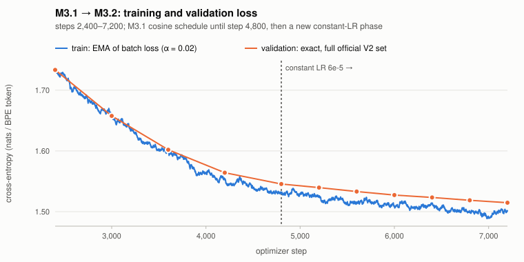
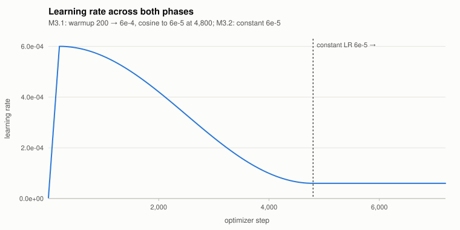
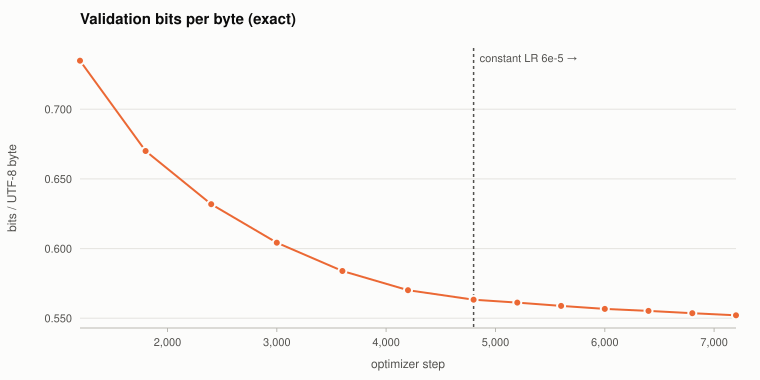
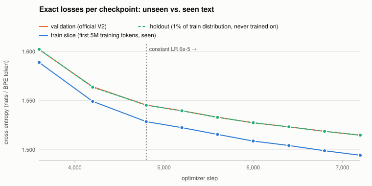

# M3.2 report: extended TinyStories pretraining (constant-LR continuation)

**Status:** complete, awaiting review. The work is uncommitted on
`milestone-3-dataset-research`. Nothing has been pushed. The M3.1 run, dataset and
tokenizer are byte-identical to before; all 26 run files and 6 dataset files were
SHA-256-checked before and after.

## Summary

- **Setup:** the 12,417,024-parameter M3.1 model continued from its best checkpoint
  (step 4800) for **2,400 more steps at a constant LR of 6e-5**. This was recorded as
  an explicit second training phase, with optimizer moments, RNG and data-sampler
  state restored exactly. It took 29.2 min.
- **Validation kept improving** at every evaluation: **1.5455 → 1.5147 nats/token
  (−2.0%)**, 0.5633 → **0.5521 bits/byte**, perplexity 4.69 → 4.55. Best = final
  (step 7200).
- **No overfitting** by the held-out measures:
  - validation and the never-seen 1% holdout are equal (1.5147 vs 1.5148);
  - the gap to a seen training slice grew only from +0.017 to +0.020 nats as the
    data passed 1.2 epochs;
  - memorization metrics did not rise.
- **Narrative quality did not measurably improve.** On the entity-consistency
  prompts, which were scored blind for both models, M3.2 scored 45% and M3.1 49%:
  5 vs 7 paired wins, sign-test p = 0.77, so no detectable difference. Character and
  entity errors persist in both: owners swapped, names replaced, characters merged.
- **Recommendation:** stop extending the 12.4M model. The next 2% of loss cost 52%
  more compute and bought no visible coherence. Scale to the 27.6M model on the same
  data (§8).

## 1. Continuation design

| | |
|---|---|
| parent | `runs/ts_s_bpe4096-20261113-172905/checkpoints/best.pt` (step 4800, SHA-256 `039f527f…3d9e9`), identical in weights, optimizer and sampler state to `step_00004800.pt` |
| new run | `runs/ts_s_bpe4096_m3_2-20261113-190046/`, a separate directory. Checkpoints continue the step numbering (`step_00005200.pt` … `step_00007200.pt`), so the parent's files cannot be overwritten. The CLI refuses a continuation into the parent directory or one that does not advance `max_steps`. |
| config | [`configs/tinystories_s_bpe4096_m3_2.toml`](../../configs/tinystories_s_bpe4096_m3_2.toml): the same model, data, batch (32 × 512), AdamW (0.9, 0.95, wd 0.1), clip 1.0 and seed. **Changed:** `lr_schedule = "constant"`, `learning_rate = 6e-5`, `warmup_steps = 0`, `max_steps = 7200`, evaluation and checkpoints every 400. |
| LR | **constant 6e-5** for steps 4800–7199, equal to the M3.1 cosine's final value (its last update used 6.00000630e-5), so the transition is continuous. The M3.1 cosine was neither stretched nor restarted (new `lr_schedule = "constant"` option; default behaviour unchanged). |
| phase record | every checkpoint stores `phases`: `[{0→4800, cosine, 6e-4→6e-5, warmup 200, horizon 4800}, {4800→7200, constant 6e-5, parent = best.pt}]` ([`m3_2/continuation.json`](m3_2/continuation.json), which also holds the parent SHA-256, tokenizer fingerprint and dataset hashes) |
| restored | weights, AdamW `exp_avg`/`exp_avg_sq`/`step` (4800), step counter, token count (78.6M), best-val bookkeeping (1.5455 @ 4800), loss and eval histories, CPU and MPS RNG, the data-sampler generator |
| implementation | `Trainer.load_state(path, continuation=True)` requires identical model *and* data configs and a larger `max_steps`, and appends a phase. `scripts/train.py --continue-from CKPT --config NEW.toml` adds the tokenizer-fingerprint check, the new-directory guard and `continuation.json`. 5 new tests cover these (§9). |

**Budget:**

- 2,400 steps × 16,384 tokens = **39.3M more presentations**.
- Totals after M3.2: 117,964,800 presentations over 98,200,365 unique tokens =
  **1.20 epochs**. This phase is the first to revisit data: about 20% of all
  presentations so far are repeats.

## 2. Preflight (all passed; [`m3_2/preflight.json`](m3_2/preflight.json))

| check | result |
|---|---|
| 1. checkpoint outputs match M3.1 | `best.pt` vs `step_00004800.pt`: weights identical, logits maximum difference **0.0**, optimizer and sampler state identical |
| 2. validation loss | recomputed **1.5454597872770313**, identical to the logged M3.1 value (difference 0.0) |
| 3. fingerprints | tokenizer `906bf77c…` identical across dataset, parent run and loaded tokenizer. `train.bin` `8f0473ad…` and `val.bin` `0a286be5…` verified on load. Model and data configs equal. |
| 4. optimizer restoration | `exp_avg`, `exp_avg_sq` and `step` identical for every parameter. Adam step = 4800. β = (0.9, 0.95), wd 0.1 / 0.0. |
| 5. constant LR | all 2,400 continuation LRs = 6e-5 exactly |
| 6. batch sampling | replaying 4,800 seeded draws reproduces the restored sampler state and the next batch exactly |
| 7. MPS stability (100 steps, nothing written) | all finite. Mean loss 1.529 vs 1.533 over M3.1's last 100 steps. Gradient norm median 0.71, max 0.76. 628 ms/step. |

One mistake before launch: my first launch failed immediately because the new
`--continue-from` flag was not registered with argparse (`unrecognized arguments`,
before any file was written). I fixed it, verified the CLI end to end on a tiny CPU
config (phases, `continuation.json`, step numbering, refusal to continue without
advancing) and relaunched.

## 3. Training results




| step | phase | tokens seen | **val (exact)** | val bits/byte | ppl | Δ per 400 steps |
|---|---|---|---|---|---|---|
| 3600 | M3.1 cosine | 59.0M | 1.6019 | 0.5839 | 4.96 | |
| 4200 | M3.1 cosine | 68.8M | 1.5641 | 0.5701 | 4.78 | (−0.0252 per 400) |
| **4800** | M3.1 end | 78.6M | **1.5455** | **0.5633** | 4.69 | (−0.0124 per 400) |
| 5200 | M3.2 constant | 85.2M | 1.5396 | 0.5612 | 4.66 | −0.0059 |
| 5600 | M3.2 | 91.8M | 1.5331 | 0.5588 | 4.63 | −0.0065 |
| 6000 | M3.2 | 98.3M (≈ 1 epoch) | 1.5273 | 0.5567 | 4.61 | −0.0058 |
| 6400 | M3.2 | 104.9M | 1.5233 | 0.5552 | 4.59 | −0.0040 |
| 6800 | M3.2 | 111.4M | 1.5187 | 0.5536 | 4.57 | −0.0046 |
| **7200** | M3.2 end | 118.0M | **1.5147** | **0.5521** | **4.55** | −0.0040 |



**Compute:**

| | M3.1 (steps 0–4800) | M3.2 (4800–7200) |
|---|---|---|
| wall-clock | 56.5 min | **29.2 min** (24.7 min of steps, 6 × ~46 s full-validation evals) |
| median step | 0.625 s (26.2k tok/s) | 0.614 s (**26.7k tok/s**) |
| MPS allocated after forward / Metal pool / RSS | 4.37 / 6.66 / 0.79 GB | 4.36 / 6.75 / 0.92 GB |
| gradient norm | median 0.70 after warmup, one spike at 4450 | median about 0.70, no spikes |
| non-finite values | none | none |

## 4. Generalization and memorization



Exact losses, recomputed for every checkpoint (`scripts/evaluate_m3_2.py`):

| step | val (official) | holdout (unseen, train distribution) | train slice (first 5M tokens, seen) | holdout − train slice |
|---|---|---|---|---|
| 3600 | 1.6019 | 1.6022 | 1.5888 | +0.0133 |
| 4800 | 1.5455 | 1.5453 | 1.5286 | +0.0167 |
| 5600 | 1.5331 | 1.5329 | 1.5156 | +0.0173 |
| 6400 | 1.5233 | 1.5232 | 1.5042 | +0.0190 |
| **7200** | **1.5147** | **1.5148** | 1.4943 | **+0.0205** |

| memorization measure | M3.1 @ 4800 | M3.2 @ 7200 |
|---|---|---|
| 16-gram overlap of 22 samples with training (all prompts) | 1.3% | 1.5% |
| 32-gram overlap | 0.0% | 0.0% |
| longest verbatim match (ladder) | ≥ 16 tokens | ≥ 16 tokens |
| extraction probe (64 training stories: 32-token prompt, greedy 64): mean / max matched tokens | 2.16 / 18 | **2.00** / 18 |
| same probe on 64 validation stories | 1.59 / 9 | 1.53 / 7 |
| full 64-token continuations reproduced | 0 | 0 |

*For reference, real validation stories have 2.7% 16-gram overlap with training
(M3.1 report).*

**Answer to "Is there evidence of overfitting?": no, not by these measures.**

- The official validation and the never-seen holdout stay identical and keep
  falling.
- The seen-vs-unseen gap widens slowly (+0.0133 → +0.0205 over 3,600 steps), which
  is expected once training revisits data.
- Extraction and k-gram overlap do not rise.

## 5. Generated stories and narrative evaluation

**Protocol:**

- **Models:** M3.1 @ 4800 and M3.2 @ 7200.
- **Prompts:** 5 story prompts (from M3.1) plus **6 entity-consistency prompts**.
  Each entity prompt binds objects or traits to 2–3 named characters, for example
  "Tom and Lily went into the forest. Tom carried a basket. Lily carried a
  lantern.", or "Anna, Leo and Zoe built a sandcastle. Anna found a shell. Leo found
  a stick. Zoe found a flag."
- **Seeds:** 1 and 2, giving 22 stories per model (44 total).
- **Decoding:** temperature 0.7, top-k 40, up to 300 tokens, stopped at
  `<|endoftext|>`.
- **Files:** all stories are in [`m3_2/stories.md`](m3_2/stories.md). The shuffled,
  label-free packet is [`m3_2/blind_packet.md`](m3_2/blind_packet.md), and the key is
  [`m3_2/blind_key.json`](m3_2/blind_key.json).

**Rubric** (0/1/2 each, total out of 14):

| criterion | 2 | 1 | 0 |
|---|---|---|---|
| Grammar | no errors | minor slips | broken sentences |
| Character consistency | names, species and roles stable | some drift | characters merge or rename |
| Entity tracking | prompt facts preserved | facts dropped or fuzzy | contradicted (owner swapped) |
| Cause and effect | actions have plausible consequences | weak links | non-sequiturs |
| Story progression | goes somewhere | minimal | stalls or loops |
| Ending quality | resolves the setup | generic ending | missing or contradictory |
| Repetition | none | some | loops |

### Blind scoring and its limits

I scored all 44 stories from the shuffled packet before opening the key, then
unblinded with `evaluate_m3_2.py --unblind` ([`m3_2/blind_results.json`](m3_2/blind_results.json)).
The blinding was **incomplete for the story prompts**: M3.1's story-prompt samples
use the same model, prompts and seeds as in the M3.1 report, so I had read those
10 stories before and recognized some of them (for example the owl thanked as
"Mr. Frog"). **The entity prompts were new for both models, so that comparison is
blind.** There is one rater, who is not a human annotator.

| (mean of 0–2 scores) | grammar | character | entity | cause–effect | progression | ending | repetition | **total** |
|---|---|---|---|---|---|---|---|---|
| **Entity prompts, blind:** M3.1 @ 4800 (n = 12) | 1.67 | 0.67 | 0.67 | 0.75 | 0.83 | 1.08 | 1.25 | **49.4%** |
| **Entity prompts, blind:** M3.2 @ 7200 (n = 12) | 1.58 | 1.00 | 0.42 | 0.42 | 0.75 | 0.92 | 1.25 | **45.2%** |
| Story prompts, *partly unblinded:* M3.1 (n = 10) | 1.90 | 1.30 | 1.20 | 0.80 | 0.90 | 1.40 | 1.30 | 62.9% |
| Story prompts, *partly unblinded:* M3.2 (n = 10) | 1.80 | 1.00 | 0.90 | 0.50 | 0.90 | 1.20 | 1.30 | 54.3% |

**Paired comparison** (same prompt and seed):

- Entity prompts: M3.2 better in 5, M3.1 better in 7, ties 0. Mean difference
  −0.58 of 14 points. Two-sided sign test **p = 0.77**.
- Story prompts: M3.2 better in 1, M3.1 better in 6, ties 3. Mean difference −1.2,
  p = 0.13, with possible familiarity bias towards M3.1.

**Conclusion:** no detectable improvement, and no significant degradation, in
narrative quality from M3.2. Sampling noise between two stories from the same seed
on slightly different models is large relative to any effect a 2% loss change could
produce.

### Measured story metrics

| | M3.1 @ 4800 | M3.2 @ 7200 |
|---|---|---|
| stories that end with `<|endoftext|>` (all 22) | 91% | 95% |
| new tokens (mean) | 129 | 127 |
| word-trigram repetition | 6.3% | **4.5%** |
| distinct-2 | 0.843 | **0.866** |
| entity prompts: prompt names still used | 73.6% | 73.6% |
| entity prompts with an introduced name (manual audit: a person-name not in the prompt) | 3 of 12 (Amy, Lucy, Mr. Lee) | 3 of 12 (Tim, Lily, Mia) |
| entity prompts with a **verified fact contradiction** (manual audit of the heuristic's flags) | **2 of 12** | **6 of 12** |

The automatic fact check (`analysis/story_eval.entity_check`) flags any sentence
that pairs an object with a single *other* prompt name. Its raw counts were 3
conflicts for M3.1 against 11 for M3.2, but it has false positives: for example
"Tim was not just about finding *her* doll", where "her" is Ella. Its "new name"
list also catches sentence-initial words ("While", "Wait"). The table therefore
reports the manually verified counts. Six contradictions against two out of twelve
is suggestive but not significant (Fisher's exact test, two-sided, p ≈ 0.19).

### Examples (verbatim; failures included)

**Entity success: M3.1, seed 1** (facts kept implicitly, coherent arc):

```text
Tom and Lily went into the forest. Tom carried a basket. Lily carried a lantern. Tom said, "Look, Lily! The forest is full of animals!"
While they were doing the same, the forest became dark and scary. Tom and Lily were scared. They did not want the dark to go back.
But then, they heard a loud noise. They looked up and saw a big, friendly bear! The bear said, "Don't be scared, I am the forest too. I am the dark and I am here to protect you from me."
Tom and Lily were happy. They said, "Thank you, bear." They all became friends. ...
```

**Entity failure, owner swapped: M3.2, seed 1** (Ben's kite becomes Mia's; Ben
vanishes and "Tim" appears; repetition):

```text
Mia had a red ball and Ben had a blue kite. They went to the park. Mia picked up a big blue kite. She wanted to play with it.
While playing, Mia met a boy named Tim. Tim said, "I want to play with the blue kite too!" ...
Then, something unexpected happened. The blue kite flew high in the sky with Mia's blue kite. The blue kite flew high in the sky. ...
```

**Entity failure, characters merged: M3.2, seed 2** (the cat and the dog both become
"Sam"):

```text
Sam was a cat and Max was a dog. Sam liked to sleep in the sun. Max liked to dig in the garden. One day, Sam found a big, round bone. He was very happy. Sam wanted to show the bone to his friend, Sam the dog.
Sam and Max went to Sam's house. They started to dig. ... Sam said, "Sam, I have an empty bone for you!" Sam's face lit up. Sam said, "Thank you, Sam! ..."
```

**Entity failure, attribute transferred: M3.1, seed 2** (the green hat is Lucy's
and the scarf is Jack's):

```text
Grandma gave Lucy a green hat and gave Jack a yellow scarf.
Lucy was so happy to have her new red scarf in her pocket. She thanked her grandma and gave her a big hug. The end.
```

**Entity failure, role inversion: M3.2, seed 2** (Grandma thanks herself):

```text
Grandma gave Lucy a green hat and gave Jack a yellow scarf. Then she gave him a big, blue scarf.
Grandma smiled. She said, "Thank you, little girl. It's very pretty."
Grandma said, "You're welcome. I'm glad you like it."
Lucy smiled. She was happy to have a new friend.
```

**Name replaced: M3.1, seed 1** (Ella becomes "Amy"; otherwise a complete,
coherent story):

```text
Ella lost her doll. Her brother Tim wanted to help her find it. He said, "Amy, let me see your doll on the shelf." Amy smiled and said, "Thank you, Tim."
Amy and Tim looked for the doll together. They found it under a big chair. Amy was happy to have her doll back. ...
```

**Story success: M3.2, seed 2:**

```text
Once upon a time, there was a little girl named Lily. She had a pretty veil that she loved very much. One day, she went outside to play in the park.
While playing, Lily saw a big, shiny rock. ... Suddenly, the rock moved! It was not a rock at all, but a big, friendly turtle! The turtle said, "Thank you for fixing me!" Lily was surprised and happy, but she was not scared anymore. She thanked the turtle and they became good friends. ...
```

**Repetition loop: M3.1, seed 1** (entity prompt, excerpt):

```text
"I am sorry, little ones. I was bad. I was mean to you. I was bad. You are not nice. You are mean. You are not my friend. You are mean. You are not nice." Mia said.
```

## 6. Answers to the study questions

1. **Does validation loss continue improving?** Yes, monotonically: −0.0308
   nats/token over 2,400 steps. The rate decays from −0.006 to −0.004 per 400 steps,
   so it is flattening but has not plateaued.
2. **Is there evidence of overfitting?** No. The unseen holdout equals validation at
   every checkpoint. The seen-vs-unseen gap grows by only +0.004 nats as the data
   passes 1.2 epochs. Memorization probes are flat.
3. **Does character consistency improve?** Not detectably:
   - blind entity-prompt character scores were 0.67 → 1.00, but entity tracking fell
     0.67 → 0.42;
   - verified fact contradictions were 2 vs 6 of 12;
   - introduced names were 3 vs 3.

   All of these are within noise at n = 12.
4. **Does extra training improve story coherence?** Not measurably. The blind
   entity-prompt totals are 49% vs 45% (p = 0.77). Repetition metrics improved
   slightly (trigram repetition 6.3% → 4.5%, distinct-2 0.84 → 0.87), consistent with
   a slightly better language model, but cause and effect and entity tracking did
   not.
5. **Are improvements worth the compute?** For loss, modestly: +52% compute for −2.0%
   nats/token (−0.011 bits/byte). For qualities a reader notices, no improvement was
   detected. Per M2.1, a fresh run with a 7,200-step cosine schedule from step 0
   might beat this continuation at equal compute, but that is untested.
6. **Continue 12.4M, scale to 27.6M, or change datasets?** **Scale to the 27.6M M
   configuration on the same TinyStories data first.**
   - The 12.4M model's remaining gains are small and its failures (who owns what,
     who is who) look like capacity or architecture limits rather than data
     shortage. That is a *hypothesis*.
   - Changing the dataset would confound the comparison.
   - The 98M-token corpus supports about 1–2 epochs for M at our compute: 44M
     tokens/hour.

## 7. Limitations

- **One run per phase, one seed.** The blind evaluation has one rater, 12 blind pairs
  (entity prompts) and 10 partly unblinded pairs (story prompts). No claim here is
  statistically significant.
- **The continuation design is not the compute-optimal comparison.** A single
  7,200-step cosine run would answer "what does 1.5× compute buy" more cleanly.
- **The entity heuristic is noisy.** It is substring-based, ignores pronouns and has
  false positives, so verified counts come from a manual audit by the same rater.
- **Two samples per prompt and model** at temperature 0.7. Story-level variance
  dominates.
- **The training-slice "seen" measure** uses the first 5M training tokens, which
  were presented about 1.2 times on average by step 7200 (random windows), not
  exactly once.

## 8. Recommended next step (not started; needs approval)

**M3.3: scale to the M configuration (8 layers / 8 heads / 512, 27.6M parameters) on
the same TinyStories-V2 corpus and tokenizer.**

- About 1.5–2 h, for example 9,600 steps × 16,384 tokens ≈ 157M presentations ≈ 1.6
  epochs at about 13.7k tok/s (M3 benchmark). Use a cosine schedule with horizon
  equal to max_steps.
- Compare against M3.2 at equal tokens seen, using the same blind entity test set
  (enlarged to 20+ prompts × 3 seeds), plus a second rater if possible.

The primary metric is the entity-consistency rate. It is a direct test of whether
capacity fixes "who owns what".

## 9. Verification

| check | result |
|---|---|
| pytest | **219 passed**. New: 5 continuation tests, covering the constant schedule, full state restoration and phase records, deterministic continued batches, rejection of model/data/`max_steps` mismatches, and synthesized phases for older checkpoints. Also 1 entity-check test. |
| ruff check / ruff format --check / mypy | clean |
| CLI continuation | verified end to end on a tiny CPU config before the real run (phases `[0→4 cosine, 4→8 constant]`, `continuation.json`, step numbering, refusal to continue without advancing) |
| checkpoint integrity | all 6 M3.2 step checkpoints and `best.pt` load with a full trainer restore. Each holds `phases = [0→4800 cosine, 4800→7200 constant]`, `step` equal to its metadata step, and a full loss history. Kinds: periodic × 5 + final. Recomputed val at step 7200 equals the logged 1.5147096. |
| tokenizer compatibility | the M3.2 run's tokenizer fingerprint equals M3.1's and the dataset's (`906bf77c…`). Unicode and special-token round trip is exact. |
| artifact preservation | SHA-256 of all 26 M3.1 run files and 6 dataset files are unchanged after M3.2, as are the M2 run's 50 files |
| older experiments | the M2 (1.4736) and M2.1-B (1.4638) Shakespeare best checkpoints load with the character tokenizer and reproduce their validation losses on CPU |
