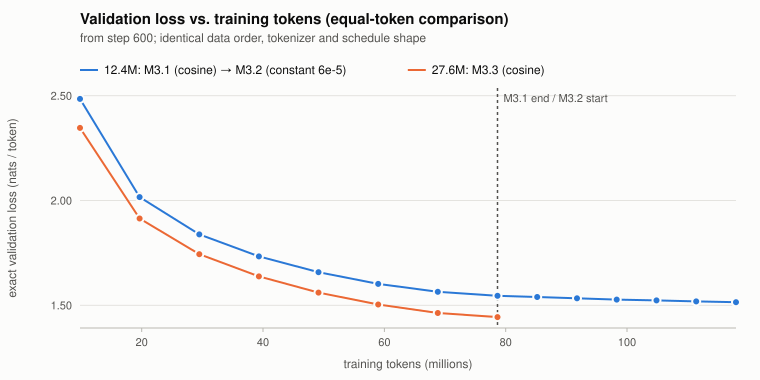
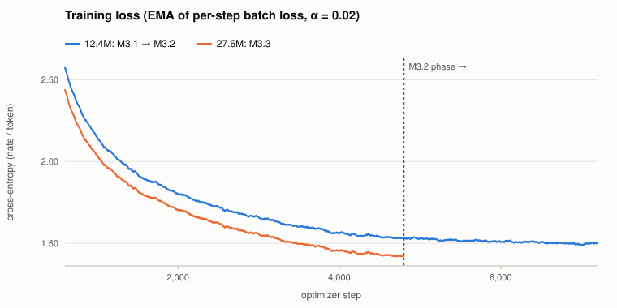
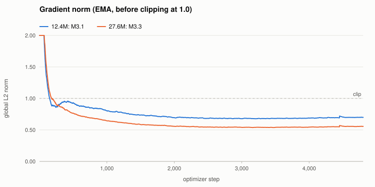
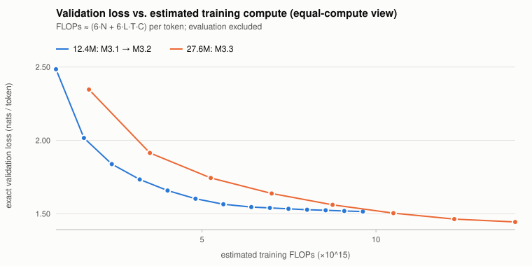

# M3.3 report: model-capacity scaling (12.4M → 27.6M) on TinyStories

**Status:** complete, awaiting review. The work is uncommitted on
`milestone-3-dataset-research`. Nothing has been pushed. All earlier run
directories (M2, M2.1 A/B, M3.1, M3.2) and the dataset are byte-identical to before;
their SHA-256s were checked before and after.

## Summary

| | A: M3.1 | B: M3.2 | **C: M3.3** |
|---|---|---|---|
| model | 6L / 6H / 384 | same as A | **8L / 8H / 512** |
| parameters | 12,417,024 | 12,417,024 | **27,579,392** |
| optimizer steps / tokens presented | 4,800 / 78.6M | 7,200 / 118.0M | 4,800 / 78.6M |
| estimated training FLOPs | 6.42 × 10¹⁵ | 9.62 × 10¹⁵ | 1.40 × 10¹⁶ (2.18 × A) |
| wall-clock (MPS) | 56.5 min | 56.5 + 29.2 min | 109.5 min |
| **validation loss (exact, nats/token)** | 1.5455 | 1.5147 | **1.4436** |
| bits per byte / perplexity | 0.5633 / 4.69 | 0.5521 / 4.55 | **0.5262 / 4.24** |
| blind narrative total (0–10, 63 stories each) | 5.76 [5.19, 6.30] | 5.49 [4.94, 6.06] | **6.06** [5.54, 6.57] |
| entity consistency (0–2) | 1.19 | 1.05 | 1.19 |
| contradiction rate | 33% | 37% | 30% |

1. **Equal tokens (primary, A vs C):** the 27.6M model is clearly better at language
   modelling. Validation loss is **−0.102 nats/token (−6.6%)**, −0.037 bits/byte. It
   led at every evaluation step.
2. **Narrative quality:** the blind rubric favours C, but **not significantly**:
   C − A = +0.30 points [−0.32, +0.90], wins/losses/ties 28/20/15, sign test p = 0.31.
   **Entity consistency did not improve** (1.19 vs 1.19). Contradictions: 30% vs
   33%.
3. **Capacity vs longer training (secondary, B vs C):** C beats B on loss (−0.071)
   and leans better on the rubric (+0.57 [−0.06, +1.19], p = 0.32), but C used 46%
   more FLOPs than B.
4. **Equal compute:**
   - At C's checkpoints that bracket A's FLOPs (0.82× and 1.09×), C was *worse* than
     A, but those checkpoints are mid-schedule and not annealed.
   - C passes B between 0.91× and 1.09× of B's FLOPs.

   Without an LR schedule sized to equal compute for C, **this experiment cannot
   say whether the larger model is more compute-efficient** (§6).
5. **Are the failures capacity-related?** Mostly not, at this scale:
   - entity swaps, renames and character merges persist at 27.6M at similar rates;
   - grammar and repetition improve modestly.

   One exploratory, post-hoc signal: on "Zoe was Kate's older sister", all 6 12.4M
   samples merged the sisters ("Zoe and Zoe"), while all 3 27.6M samples kept them
   distinct (§5).

## 0. Safety and controls

- **Git:** `milestone-3-dataset-research` @ `8d8d7c0`; M3, M3.1, M3.2 and M3.3 are
  uncommitted. `website/` untouched.
- **New run:** `runs/ts_m_bpe4096-20261114-042121/`.
- **Dataset and tokenizer fingerprints verified before training:**
  - tokenizer `906bf77c…` (identical across all three runs and the dataset);
  - `train.bin` `8f0473ad…`, `val.bin` `0a286be5…`;
  - all 6 dataset files unchanged.
- **Same data order as M3.1.** M3.3 uses micro-batches of 16 with 2-step
  accumulation (effective 32 × 512 = 16,384 tokens per step). I verified that two
  draws of 16 from the seeded sampler yield exactly the same 32 window offsets as
  one draw of 32 (and the same final generator state). **A and C therefore see
  identical training windows in identical order.**
- The accumulation was chosen *before* training, for memory: about 40% system
  memory free, and the M3 benchmark measured a 4.6 GB pool at micro-batch 16 against
  8.9 GB at 32. It was not tuned on results.
- **Unchanged from M3.1:**
  - seed 1337, GPT-2 initialization (std 0.02, residual projections 0.02/√(2L));
  - AdamW β = (0.9, 0.95), weight decay 0.1, clip 1.0;
  - warmup 200 → 6e-4, cosine to 6e-5 at step 4,800;
  - dropout 0, float32, MPS, full-validation evaluation every 600 steps.

  No hyperparameter was tuned. **This is an equal-token comparison, not an
  equal-FLOP one.**
- **Pre-registered before any generation** (UTC 2026-11-14 04:17:58):
  - [`m3_3/entity_prompts.json`](m3_3/entity_prompts.json), SHA-256 `11d9fcd1…6c611`:
    21 prompts × 3 seeds;
  - [`m3_3/rubric.md`](m3_3/rubric.md), SHA-256 `ea440b63…40670`.

  Neither was changed after generation.

## 1. Architecture comparison

| | 12.4M (A, B) | 27.6M (C) |
|---|---|---|
| layers / heads / width / head dim | 6 / 6 / 384 / 64 | 8 / 8 / 512 / 64 |
| MLP hidden | 1,536 | 2,048 |
| context / vocabulary | 512 / 4,096 BPE (tied embeddings) | same |
| total parameters (analytic = model) | 12,417,024 | **27,579,392** |
| non-embedding | 10,647,552 | 25,220,096 (2.37×) |
| token + position embedding | 1,572,864 + 196,608 | 2,097,152 + 262,144 |
| estimated training FLOPs per token, 6N + 6·L·T·C | 81.58M | 178.06M (2.18×) |

## 2. Preflight ([`m3_3/preflight.json`](m3_3/preflight.json))

| check | result |
|---|---|
| 1. historical checkpoints | M2, M2.1-A and M2.1-B `best.pt` reproduce their exact validation losses on CPU (differences ≤ 4e-8). The M3.1 and M3.2 `best.pt` load with finite loss. |
| 2. finite outputs | initial loss 8.397 (ln 4096 = 8.318). Logits finite. All 100 parameter tensors have finite, non-zero gradients. Initial gradient norm 12.3. |
| 3. causal attention | changing tokens 256–511 changes logits at positions 0–255 by **exactly 0.0**; later positions do change. SDPA vs explicit attention max difference 3.7e-6. |
| 4. optimizer initialization | decay group: 34 tensors, 27,525,120 parameters (wd 0.1). No-decay group: 66 tensors, 54,272 parameters (wd 0). Every parameter exactly once. β = (0.9, 0.95), ε = 1e-8, empty state at init. LR: 3e-6 at step 0, 6e-4 at step 199, 6.0e-5 at step 4799. |
| 5. stability (100 real steps) | all finite. Loss 8.39 → 4.21. Gradient norm 12.5 at step 1 and up to 4.9 during warmup (all clipped to 1.0), then decreasing. |
| 6. throughput and memory | 1.216 s/step = 13.5k tok/s, projecting 97 min of steps. MPS allocated 4.42 GB after forward, 5.64 GB pool. |
| 7. free memory | 16 GiB physical. About 20% free *while the preflight held its own allocations*. MPS recommended maximum 12.7 GB. |
| 8. checkpoint round trip | logits identical (0.0), optimizer moments and sampler identical. 331 MB per checkpoint. |

## 3. Training (C) and learning curves

The run took **109.5 min**: 97.0 min of optimizer steps plus 9 full-validation
evaluations of about 84 s each.

- Median 1.207 s/step = **13.6k tok/s**.
- MPS allocated 3.97 GB after forward, **5.62 GB Metal pool** (A: 6.66 GB at
  micro-batch 32), process RSS 0.82 GB.
- No NaN or Inf values; best = final (step 4800).

| step (tokens) | A: M3.1 val | **C: M3.3 val** | C − A | C bits/byte |
|---|---|---|---|---|
| 600 (9.8M) | 2.4847 | 2.3462 | −0.139 | 0.855 |
| 1200 (19.7M) | 2.0160 | 1.9142 | −0.102 | 0.698 |
| 1800 (29.5M) | 1.8382 | 1.7438 | −0.094 | 0.636 |
| 2400 (39.3M) | 1.7334 | 1.6379 | −0.096 | 0.597 |
| 3000 (49.2M) | 1.6577 | 1.5604 | −0.097 | 0.569 |
| 3600 (59.0M) | 1.6019 | 1.5036 | −0.098 | 0.548 |
| 4200 (68.8M) | 1.5641 | 1.4632 | −0.101 | 0.533 |
| **4800 (78.6M)** | **1.5455** | **1.4436** | **−0.102** | **0.526** |





**Exact losses on unseen and seen text**, recomputed from the final checkpoints:

| | val (official) | holdout (unseen, train distribution) | train slice (first 5M tokens, seen) | holdout − train slice |
|---|---|---|---|---|
| A | 1.5455 | 1.5453 | 1.5286 | +0.017 |
| B | 1.5147 | 1.5148 | 1.4943 | +0.021 |
| **C** | **1.4436** | **1.4439** | 1.4182 | **+0.026** |

The larger model fits seen text slightly more, with a gap of +0.026 against
+0.017. Validation and the never-seen holdout remain equal, so this is not harmful
overfitting.

## 4. Blind narrative evaluation

**Method:**

- **Prompts:** 21 held-out prompts, pre-registered by category: ownership 4,
  names 3, pronouns 3, relationships 3, cause and effect 3, event ordering 2,
  multi-character 3. Each lists the facts it establishes.
- **Generation:** 3 seeds (1, 2, 3), temperature 0.7, top-k 40, at most 300 tokens,
  stopped at `<|endoftext|>`. Same prompts, tokenizer, decoding and seeds for A, B
  and C, giving 189 stories.
- **Packet:** shuffled with a fixed seed under neutral ids S001–S189, with model
  identity hidden ([`m3_3/blind_packet.md`](m3_3/blind_packet.md)). The key
  ([`m3_3/blind_key.json`](m3_3/blind_key.json)) was opened only after all 189
  stories were scored.
- **Rubric** ([`m3_3/rubric.md`](m3_3/rubric.md)): grammar G, entity consistency
  E, coherence C, ending N, repetition R, each 0–2, giving a total of 0–10, plus a
  binary contradiction flag X.
- **Scoring conventions,** applied uniformly and recorded here:
  - 5 continuations were empty (the model emitted `<|endoftext|>` immediately);
    these got C = 0 and N = 0.
  - A renamed prompt character counts as X = 1, an explicit contradiction of a prompt
    fact.
- **Statistics:** 95% intervals are percentile bootstraps over stories (10,000
  resamples). Paired comparisons use the same prompt and seed (63 pairs), with a
  two-sided sign test. Contradiction differences use an exact binomial test on
  discordant pairs.

**Limitations (stated up front):**

- **One rater**, the same agent that built the models. No second human rater was
  available, and no automatic judge was used as ground truth.
- Unlike M3.2, none of these stories had been seen before scoring, so the blinding
  held. Style cues could still in principle reveal the model.

**Results:**

| per model (n = 63) | G | E | C | N | R | **total (0–10)** | contradiction rate X |
|---|---|---|---|---|---|---|---|
| A: M3.1 12.4M | 1.44 | 1.19 [0.97, 1.40] | 0.59 | 1.03 | 1.51 | 5.76 [5.19, 6.30] | 21/63 = 33% [23, 46] |
| B: M3.2 12.4M | 1.51 | 1.05 [0.83, 1.27] | 0.54 | 0.97 | 1.43 | 5.49 [4.94, 6.06] | 23/63 = 37% [26, 49] |
| **C: M3.3 27.6M** | **1.59** | 1.19 [0.98, 1.38] | 0.60 | 1.08 | **1.60** | **6.06** [5.54, 6.57] | 19/63 = **30%** [20, 42] |

| paired (63 items) | mean total difference [95% CI] | wins / losses / ties | sign-test p | contradiction discordant pairs (p) | criterion differences (G, E, C, N, R) |
|---|---|---|---|---|---|
| **C − A** (primary) | **+0.30** [−0.32, +0.90] | 28 / 20 / 15 | 0.31 | only C 11, only A 13 (p = 0.84) | +0.14, 0.00, +0.02, +0.05, +0.10 |
| C − B (secondary) | +0.57 [−0.06, +1.19] | 29 / 21 / 13 | 0.32 | only C 8, only B 12 (p = 0.50) | +0.08, +0.14, +0.06, +0.11, +0.17 |
| B − A | −0.27 [−0.94, +0.38] | 26 / 25 / 12 | 1.00 | only B 11, only A 9 (p = 0.82) | +0.06, −0.14, −0.05, −0.06, −0.08 |

**Per category** (total mean / entity mean / contradiction rate; 9 or 12 stories per
model per category, *exploratory*):

| category | A | B | C |
|---|---|---|---|
| ownership (12) | 5.33 / 1.17 / 25% | 5.33 / 0.50 / 67% | 6.33 / 1.17 / 50% |
| names (9) | 5.11 / 0.56 / 56% | 4.33 / 0.78 / 56% | 5.78 / 0.89 / 33% |
| pronouns (9) | 6.22 / 1.33 / 0% | 5.56 / 1.11 / 0% | 6.56 / 1.33 / 11% |
| relationships (9) | 4.22 / 0.67 / 44% | 4.11 / 0.56 / 44% | **5.56 / 1.11 / 0%** |
| cause and effect (9) | 6.11 / 1.78 / 22% | 6.44 / 1.78 / 11% | 5.78 / 1.67 / 22% |
| event ordering (6) | 8.17 / 2.00 / 17% | 8.00 / 2.00 / 17% | 7.50 / 1.67 / 0% |
| multi-character (9) | 6.11 / 1.11 / 67% | 5.56 / 1.11 / 44% | 5.33 / 0.67 / 78% |

**Measured story statistics** (by script, all 63 stories per model):

| | A | B | C |
|---|---|---|---|
| ended with `<|endoftext|>` | 96.8% | 98.4% | 96.8% |
| new tokens (mean) | 89.9 | 96.3 | 96.0 |
| word-trigram repetition | 3.0% | 4.1% | 3.2% |
| distinct-2 | 0.881 | 0.869 | **0.889** |
| valid words | 96.7% | 96.7% | **98.3%** |

## 5. Representative successes and failures (verbatim)

**Relationship: the post-hoc signal.** Prompt: "Zoe was Kate's older sister. Kate
always wanted to be like Zoe."

A (M3.1), seed 2, total 2/10. The sisters merge:

```text
One day, Zoe and Zoe decided to go on a journey. Zoe said goodbye to Zoe and waved goodbye. Zoe happily waved back.
Zoe and Zoe walked through the desert forest. They saw a big, green mountain. ...
```

C (M3.3), seed 1, total 8/10. Kate stays the protagonist:

```text
One day, Kate decided to take a walk on an adventure. She came across a big, beautiful forest, with lots of trees and animals. ...
At the end of the day, Kate was very happy. She had made a new friend and had lots of fun with her friends. ...
```

Counts for this prompt: "Zoe and Zoe" merges occurred in 3/3 A, 3/3 B and 0/3 C
samples. This was noticed only after unblinding, on one prompt with n = 3, so it is
a hypothesis to test, not a finding.

**C success: event ordering and coherence**, seed 2, 10/10:

```text
First, Max woke up. Then he brushed his teeth. After that, he went to school.
At school, Max saw all the other animals. They were playing and having fun. Max wanted to join them. ...
Max was so happy to join the game. He played with the other animals and became friends. Soon, Max was not lonely anymore. ...
```

**C failure: multi-character, ducks become fish and names drift**, seed 1, 3/10:

```text
Three ducks named Quack, Splash and Wing lived on a pond. Splash was the smallest. He was also very kind to all the little fish in the sea.
One day, a big shark came to the pond. He saw Quack and said, "Can I have some food too?" ...
Splash went to the big shark and said, "Please, can I have some food for you?" The big shark looked at the food and said, "I am sorry, Quack." But it was too late. The big shark was gone. He had to leave Quack and Wise. ...
```

**C failure: a renamed prompt character** (Ana becomes "Lily"), seed 1, 1/10,
excerpt:

```text
Ana and Ben both wanted the same swing. Their teacher, Ms. Lee, had an idea. She said, "Let's play a game. We can pretend we are in a castle and share the swing."
Lily and Ben liked the game. ...
```

**B failure: a repetition loop**, seed 3, 2/10:

```text
Three ducks named Quack, Splash and Wing lived on a pond. Splash was the smallest. Quick and Splash lived happily in the pond. ...
But then, something unexpected happened. Splash! Splash! Splash! Splash! Splash! Splash! Splash! ...
```

**A failure: ownership reassigned**, seed 1 (Ben's lost blue boat becomes Lily's):

```text
Lily had a red ball. Ben had a blue boat. One day, Ben lost his boat. ...
Lily's friend Tom saw Lily and asked, "What's wrong, Lily?" Lily said, "I have a blue boat for my boat." ...
Lily and Tom played with the blue boat and had a fun day.
```

All 189 stories, labelled, are in [`m3_3/stories.md`](m3_3/stories.md).

## 6. Compute efficiency

**FLOP assumption:** per training token, 6·N_total + 6·n_layer·n_ctx·d_model (Kaplan
et al. 2020 style). N_total includes the tied embedding, which carries the LM-head
matmul. Evaluation and data-loading FLOPs are excluded. These are estimates, not
hardware counters.

| | A | B | C |
|---|---|---|---|
| parameters | 12.4M | 12.4M | 27.6M |
| training tokens | 78.6M | 118.0M | 78.6M |
| estimated training FLOPs | 6.42e15 (1.00×) | 9.62e15 (1.50×) | 1.40e16 (2.18×) |
| measured throughput | 26.2k tok/s | 26.7k tok/s | 13.6k tok/s (0.52×) |
| optimizer-step time | 50.2 min | +24.7 min | 97.0 min |
| wall-clock incl. eval | 56.5 min | +29.2 min (85.7 cumulative) | 109.5 min |
| peak MPS pool | 6.66 GB | 6.75 GB | 5.62 GB (micro-batch 16) |
| val loss | 1.5455 | 1.5147 | 1.4436 |
| blind total (0–10) | 5.76 | 5.49 | 6.06 |



**1. Equal-token performance.** C beats A by 0.102 nats/token at every equal-token
checkpoint. This is the cleanest result: same data, same order, same schedule.

**2. Equal-compute performance (limited by available checkpoints).** No M3.3
checkpoint was trained to an LR schedule sized to A's or B's compute, so equivalent
models do not exist. These are the measured brackets, with no interpolation:

| target | C checkpoints bracketing the FLOPs | C val (exact) | reference |
|---|---|---|---|
| A's FLOPs (C step 2,199) | step 1,800 (0.82×) / step 2,400 (1.09×) | 1.7438 / 1.6379 | A = 1.5455 |
| B's FLOPs (C step 3,299) | step 3,000 (0.91×) / step 3,600 (1.09×) | 1.5604 / 1.5036 | B = 1.5147 |
| A's wall-clock (56.5 min) | step 2,400 (54.8 min) / 3,000 (68.5 min) | 1.6379 / 1.5604 | A = 1.5455 |
| A+B wall-clock (85.7 min) | step 3,600 (82.1 min) / 4,200 (95.8 min) | 1.5036 / 1.4632 | B = 1.5147 |

At these checkpoints C is still at high LR: 4.5e-4 at step 1800, 3.5e-4 at 2400,
2.4e-4 at 3000 and 1.5e-4 at 3600, against 6e-5 at the end. M2.1 showed that
annealing alone was worth about 0.02 nats (at step 2000, horizon 2000 vs 5000), so the
brackets understate what a C run *scheduled* for that compute would reach. Even so,
the gap at A's compute (+0.09 at 1.09× FLOPs) is larger than annealing explains.
**Hypothesis, untested:** at about 6e15 FLOPs, the 12.4M model is the better
compute-optimal choice for this data, and the 27.6M model only pays off above about
1e16 FLOPs. C first beats B somewhere between 0.91× and 1.09× of B's compute.

**3. Final model quality.**

- C is the best model on every loss metric, by a margin larger than any
  run-to-run noise we have measured (M2.1: about 0.002).
- On the blind narrative rubric it is the highest-scoring model, but the
  differences are within uncertainty, and entity consistency did not change.
- As a cost per quality point: B bought −0.031 nats for +50% compute; C bought
  −0.102 nats for +118% compute against A.

## 7. Answers to the research questions

1. **Does a 27.6M model outperform the 12.4M model at equal tokens?** On
   cross-entropy, yes, by 0.102 nats/token (6.6%), consistently throughout training.
   On blind narrative quality, directionally (+0.30/10) but not significantly.
2. **Does capacity improve character consistency and entity tracking?** Not
   measurably:
   - entity score 1.19 vs 1.19;
   - contradictions 30% vs 33% (p = 0.84 on discordant pairs).

   The relationship and names categories favour C, ownership and multi-character
   categories don't, and all categories have n ≤ 12.
3. **More improvement per unit of compute than continuing the small model?**
   Inconclusive.
   - Per FLOP *at the end of each run*: C's −0.102 for +1.18× compute is about 0.087
     nats per added A-compute, against B's 0.062 nats per added A-compute.
   - But at matched intermediate compute, C's un-annealed checkpoints trail A, and
     pass B only around B's compute.

   A proper answer needs C trained with schedules sized to those budgets.
4. **Are the remaining failures related to capacity?** Largely not, at 12–28M
   parameters with about 79M tokens. All three models make the same kinds of errors
   at similar rates: renamed or merged characters, ownership swaps, non-sequiturs.
   Grammar, word validity and repetition improve slightly with capacity. Entity
   tracking does not. The one large difference (sister merging, 6/6 vs 0/3) is
   post hoc and must be retested.

## 8. Limitations

- **One training run per model and seed.** Initialization or seed variance of the
  27.6M model is unknown.
- **One blind rater, who is not independent of the experiment.** No inter-rater
  reliability. 63 stories per model detect only effects of about 0.6+ points (out of
  10) with reasonable power.
- **Equal-compute comparisons** rest on un-annealed intermediate checkpoints (§6).
  The FLOP counts are analytic estimates.
- **C's micro-batch (16, × 2 accumulation)** differs from A's (32). The data and
  effective batch are identical, but the random-batch eval *estimates* use different
  batches (exact validation is unaffected). The memory figures are not
  like-for-like.
- **The prompts are short and in-domain.** TinyStories itself rarely requires
  long-range entity tracking, so the data may not reward it whatever the capacity.
- **Five empty continuations** ("Emma and her little brother Noah lived with their
  grandma.", "It rained all night…") occur in all models and depress coherence and
  ending scores equally.

## 9. Recommendations for the next milestone (not started; needs approval)

1. **The model-choice question is a compute-budget question.** Run the 27.6M model
   with a cosine schedule sized to A's FLOPs (about 2,200 steps) and to B's (about
   3,300 steps), roughly 50 and 75 min. That settles equal-compute efficiency without
   relying on un-annealed checkpoints. Repeat the 12.4M A run with a second seed to
   size the noise.
2. **Target entity tracking with data, not just capacity.** The rubric shows the
   failures are not fixed by 2.2× parameters. Options:
   - a TinyStories subset or augmentation rich in multi-character stories;
   - longer stories;
   - a held-out entity probe scored automatically against prompt facts, validated
     against the blind human scores first.
3. **Recruit a second, independent rater** for the existing 189-story packet
   (`blind_packet.md`, `rubric.md`; key withheld) before drawing narrative
   conclusions. The packet is ready to hand off as is.
4. Treat the "Zoe and Zoe" sibling-merging signal as a pre-registered hypothesis for
   the next evaluation: 10+ relationship prompts × 3 seeds.

## 10. Verification

| check | result |
|---|---|
| pytest | **224 passed**, including 4 new tests for the evaluation statistics (sign test, Wilson interval, bootstrap, FLOP formula, unblinding). |
| ruff check / ruff format --check / mypy | clean |
| historical checkpoints | M2, M2.1-A and M2.1-B reproduce their exact validation losses. The M3.1 and M3.2 `best.pt` load and give finite loss. All earlier run directories and the dataset are byte-identical (SHA-256) after M3.3. |
| M3.3 checkpoints | all 8 periodic checkpoints and `best.pt` load with a full trainer restore. The final exact val, recomputed (1.4436), equals the logged value. |
| tokenizer compatibility | identical fingerprint `906bf77c…` across M3.1, M3.2, M3.3 and the dataset |
