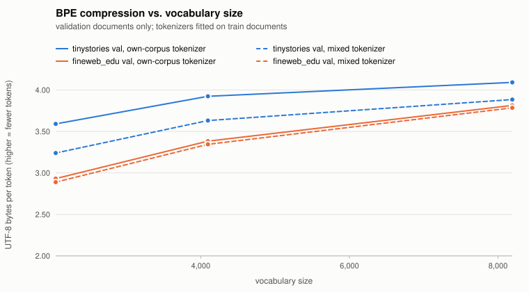
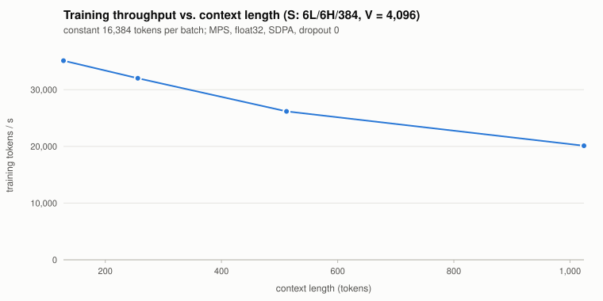
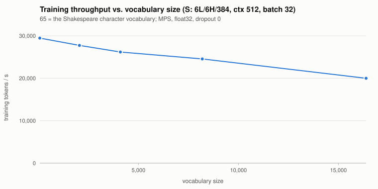
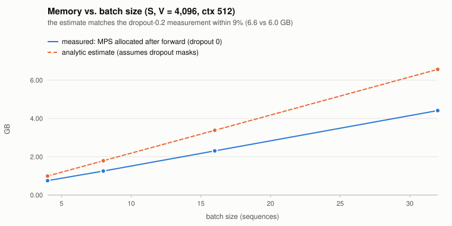

# M3 report: dataset research and BPE tokenization

**Status:** research complete, awaiting review. The work is uncommitted on
`milestone-3-dataset-research` (branched from `8d8d7c0`). Nothing has been pushed,
no full dataset has been downloaded, and no model has been trained.

## Summary

- **Recommended dataset for M3.1: TinyStories (GPT-4-only V2 file),** 100M tokens
  taken from bounded byte ranges. It is the only candidate on which a model of about
  12M parameters can plausibly learn coherent text within an hour, and the file
  supports exact byte-range downloads (verified), so no new dependency is needed.
  FineWeb-Edu is the right *next* step towards general text, but one hour covers
  about 0.8% of even its smallest sample.
- **Byte-level BPE is implemented in-repo** (`tokenizer/bpe.py`, standard library
  only, 38 tests). Training is deterministic, round-trips are exact, the vocabulary
  size is configurable, and special tokens are explicit. It trains a vocabulary of
  8,192 on 22 MB in 2.6 s and encodes 12–20 MB/s.
- **Recommended vocabulary: 4,096 for TinyStories.** It gives 3.92 bytes/token, 9%
  better than 2,048. Going to 8,192 adds only 4% compression, costs 6% of training
  throughput, and leaves many rarely used tokens. For FineWeb-Edu, 8,192 is better
  (+13% compression).
- **Recommended model: 6L/6H/384 (our existing architecture), vocabulary 4,096,
  context 512, 12.42M parameters.** Measured on MPS: 26.2k tokens/s (dropout 0),
  about 4.4 GB, roughly 80M tokens per hour.
- **Bottlenecks:** model compute dominates everything else. Loading a batch takes
  0.36 ms against a training step of about 626 ms; tokenizing 100M tokens takes
  under a minute (estimated from measured throughput).

## 0. Git and repository safety

| | |
|---|---|
| starting point | `milestone-2-pretraining` at `a47962c` (M2.1), clean apart from the untracked `website/` |
| **issue found** | `.gitignore`'s unanchored `data/` rule also matched `src/mini_chatgpt/data/`, so `dataset.py`, `prepare.py`, `sources.py` and `__init__.py` were **never committed** (missing from all three commits on GitHub; a fresh clone could not import the trainer) |
| fix (with your approval) | commit `8d8d7c0` on `milestone-2-pretraining`: anchored the rules (`/data/`, `/runs/`) and added the four files (ruff-formatted, no logic change). The staged diff was inspected before committing. A fresh local clone now imports and passes the full test suite. Not pushed. |
| M3 branch | `milestone-3-dataset-research`, created from `8d8d7c0` |
| untouched | `website/` (never staged, modified or moved), `main` (does not exist; not created), all `data/` and `runs/` artifacts |

## 1. Dataset comparison

| | **TinyStories** (`roneneldan/TinyStories`) | **FineWeb-Edu** (`HuggingFaceFW/fineweb-edu`) |
|---|---|---|
| What it is | synthetic short stories written by GPT-3.5 and GPT-4 for an audience of 3–4-year-olds | educational-quality English web pages filtered from FineWeb (Common Crawl, 2013–2025) |
| Provenance | Eldan & Li, Microsoft Research, *TinyStories: How Small Can Language Models Be and Still Speak Coherent English?* (arXiv:2305.07759, 2023). Each prompt picks three random words (noun, verb, adjective) from about 1,500 basic words, plus random story features (dialogue, plot twist, bad ending, moral). | Penedo et al., *The FineWeb Datasets* (arXiv:2406.17557, 2024). Llama-3-70B-Instruct scored 500k pages on a 0–5 educational scale, and a BERT-like regressor (Snowflake-arctic-embed) trained on those scores (F1 0.82 at threshold 3) filtered all of FineWeb, keeping score ≥ 3 and dropping 92%. |
| License | **CDLA-Sharing-1.0** (dataset card) | **ODC-By 1.0**, plus "subject to CommonCrawl's Terms of Use" (dataset card) |
| Total size | 2,141,709 rows (train 2,119,719, validation 21,990). About 1.0 GB parquet, 2.0 GB in memory. Files: `TinyStories-train.txt` 1.92 GB; **`TinyStoriesV2-GPT4-train.txt` 2.23 GB** and `-valid.txt` 22.5 MB (GPT-4 only); `TinyStories_all_data.tar.gz` 1.61 GB (with prompts and metadata) | **1.3T tokens** (5.4T for the `score-2` variant). 1.53B rows. `sample-10BT`: 9,672,101 rows, 28.5 GB parquet in 14 shards of 0.54–2.15 GB. Also `sample-100BT`, `sample-350BT` and per-dump configs. |
| Formats | parquet (the auto-converted `default` config, 4 shards of about 248 MB plus validation 10 MB) and raw `.txt` with `<|endoftext|>` separators | parquet with columns `text, id, dump, url, date, file_path, language, language_score, token_count, score, int_score` |
| Language and content | English, very small vocabulary, simple grammar, children's narratives. Our sample: 881 chars per story on average (median 790, p95 1,649), 8,511 distinct words in 6,000 stories, 0.13% non-ASCII characters. The V2 file uses curly quotes (“ ”), which the original parquet sample does not. | English (fastText score ≥ 0.65). Encyclopedic, educational, how-to and lesson pages. Our sample: 4,718 chars per document on average (median 2,870, p95 13,224, max 226k), 83,351 distinct words in 4,000 documents, 1,038 distinct characters, 3,620 domains (top: en.wikipedia.org 24, reference.com 16, britannica.com 12). Classifier `int_score`: 3: 87%, 4: 13%, 5: <0.1%. |
| Duplication | The card says nothing about duplication. Generation from a small word list makes formulaic openings ("Once upon a time…") pervasive. Within our 6,000-story sample: 0 exact and 0 near-duplicates (MinHash, Jaccard ≥ 0.8). | FineWeb applies MinHash deduplication (5-grams, 14 × 8 hashes) **within each dump only**, not across dumps, so cross-dump duplicates remain by design. The card reports that further deduplication had no impact in their ablations. Our 4,000-document sample: 0 exact and 0 near-duplicates. |
| Contamination | Validation stories come from the same generator and prompt process, so they are in-distribution but templated. Overlap with standard benchmarks is unlikely (synthetic children's text). | Web text can contain benchmark questions and answers (educational sites, worksheets). The card does not describe benchmark decontamination; we did not verify it. |
| PII and safety | synthetic, so little real PII | emails are replaced and public IP addresses anonymized. The card notes that a "significant number" of NSFW/toxic documents remain, and phone numbers are not redacted. |
| Suitable for ~10–30M models? | **Yes.** It was designed for this; the paper reports coherent multi-paragraph stories from models under 10M parameters. | **Partly.** It gives the best general-knowledge signal per token, but a 10–30M model in about 80M tokens will learn fluent-looking fragments, not knowledge. Its documents are also long (median 711–949 tokens), well beyond a 512-token context. |
| Strengths | coherent output is reachable at our scale, so it validates the BPE pipeline and the training recipe; short documents fit a 512 context; small files | broad vocabulary and real-world knowledge; strong published results on MMLU and ARC; permissive license |
| Weaknesses | narrow domain and vocabulary, no factual knowledge, generated by OpenAI models (see licensing) | needs far more compute than we have per hour; 1,038 characters and many rare words; web biases; parquet needs a new dependency (`pyarrow`) |
| Bounded local options | (a) **HTTP byte-range requests on `TinyStoriesV2-GPT4-train.txt`** (verified: HTTP 206), with no new dependency, e.g. 8 ranges of 50 MB at seeded offsets, each cut at `<|endoftext|>`; (b) one 248 MB parquet shard (about 530k stories, needs `pyarrow`); (c) the full 22.5 MB V2 validation file | (a) the dataset-viewer `/rows` API (100 rows per request, rate-limited: our 40 requests took about 5 min with 429 back-offs), so research samples only; (b) the smallest `sample-10BT` shard (0.54 GB parquet, needs `pyarrow`); (c) the `datasets` library in streaming mode (new dependency). All require approval. |

**Bounded samples fetched for this study** (`scripts/fetch_samples.py`; git-ignored
under `data/raw/samples/`; each has a `manifest.json` recording every request offset,
counts and hashes):

| sample | source | requests × rows | documents | text | SHA-256 (`sample.jsonl`) |
|---|---|---|---|---|---|
| `tinystories` | `default` / `train` (the original GPT-3.5 + GPT-4 mixture) | 60 × 100 at seeded offsets (seed 2026) | 6,000 | 5.30 MB | `49bccd67…59303` |
| `fineweb_edu_10bt` | `sample-10BT` / `train` | 40 × 100 at seeded offsets | 4,000 | 18.97 MB | `e6cacd68…3961f` |

Each request returns 100 *contiguous* rows. For FineWeb-Edu these cluster by crawl
dump (35 dumps, 2013–2023), so the sample covers fewer sources than 4,000
independent draws would.

## 2. Licensing and provenance findings

These are summaries of the license texts and dataset cards, not legal advice.

- **TinyStories: CDLA-Sharing-1.0.**
  - Redistributing the data, or modified "Enhanced Data", requires the same license,
    change notices and preserved attribution, with no added restrictions.
  - **Results**, such as trained models and analyses, carry "no obligations or
    restrictions" (§3.5), provided they don't contain more than a *de minimis*
    portion of the data.
  - The stories are **outputs of OpenAI models**. Whether OpenAI's terms on using
    outputs to develop competing models apply to downstream users of a third-party
    dataset is a policy question for you. For a non-commercial research model this
    is commonly considered acceptable, but we have not verified it.
- **FineWeb-Edu: ODC-By 1.0**, which requires attribution, plus **Common Crawl's
  Terms of Use**:
  - no illegal use;
  - no harvesting of personal information;
  - respect for third-party copyright;
  - an indemnity that explicitly covers AI/ML use.

  The underlying pages keep their original authors' rights. Training a private
  research model is the use case these datasets were released for. Redistributing
  raw text, or a model that regurgitates it, carries more risk.
- **Our practice (proposed for M3.1):**
  - Never commit raw data (only manifests, hashes and code).
  - Record source URL, byte ranges, licenses and fetch dates in a manifest.
  - Keep attribution in the report.
  - Run the memorization probe from M2 on every model.

## 3. BPE implementation

`src/mini_chatgpt/tokenizer/bpe.py` (`ByteBPETokenizer`, standard library only, no
pretrained assets).

- **Base alphabet: the 256 byte values**, so any `str` encodes with no unknown token,
  and `decode(encode(s)) == s` holds for every string. This is tested on edge cases
  and 300 random Unicode strings: CJK, emoji with ZWJ sequences, combining marks,
  RTL, zero-width characters, control characters.
- **Pre-tokenization regex**, standard library `re`:
  - contractions;
  - optionally space-prefixed Unicode letter runs;
  - digit groups of 1–3;
  - punctuation and underscore runs;
  - whitespace;
  - a final `[\s\S]` catch-all, so chunks always tile the input (tested).

  Merges never cross chunk boundaries (tested).
- **Training:**
  - Chunk counts are computed first, then the most frequent adjacent pair is merged
    repeatedly.
  - Pair counts are updated incrementally, touching only words that contain the
    merged pair, and the maximum is found with a lazily invalidated heap.
  - Ties go to the smallest `(left, right)` id pair, so training is deterministic;
    two trainings give identical merges and fingerprints (tested).
  - It raises if the corpus cannot support the requested number of merges.
- **Vocabulary size** is configurable and exact: 256 bytes + merges + special tokens.
- **Special tokens** (default `<|endoftext|>`) get ids after the merges.
  `encode(text)` treats their text as ordinary bytes, so user text cannot inject
  control tokens. `encode(text, allowed_special="all" | {...})` recognizes them, and
  unknown names raise.
- **Decoding** validates ids. Partial UTF-8, which arbitrary model output can
  produce, becomes U+FFFD; it never raises.
- **Persistence:** a JSON file with format version, pattern, merges, special-token
  ids, metadata (training document count, bytes, corpus SHA-256, unique
  pre-tokens) and a SHA-256 **fingerprint** of pattern, merges and specials. Loading
  verifies the vocabulary size, special-token ids and fingerprint, and tampered
  files are rejected (tested).
- **Encoding speed** comes from a per-chunk cache (bounded at 500k entries). The
  reported throughput uses a fresh tokenizer, i.e. it includes cold-cache cost.
- **Tests:** `tests/test_bpe.py`, 38 tests covering Unicode, whitespace, punctuation,
  empty strings, serialization, determinism, tie-breaking, specials, invalid input
  and the `Tokenizer` protocol.

## 4. Tokenizer comparison

**Protocol** (`scripts/benchmark_tokenizers.py`):

- Exact-duplicate documents are dropped, then documents are split **before any
  fitting** by `int(sha256[:8], 16) % 100 < 10` into validation:
  - TinyStories: 5,404 train / 596 val documents;
  - FineWeb-Edu: 3,599 train / 401 val documents.
- Tokenizers are trained on train documents only:
  - on each corpus alone;
  - on an identical **mixed** set (both corpora's train documents, 21.8 MB).
- All metrics are on validation documents. Encoding throughput is measured on a
  freshly loaded tokenizer.

Compression is shown as UTF-8 bytes per token; higher means fewer tokens for the
same text. The character-level baseline is 1.0 by definition.

| tokenizer trained on | V | train time | **TinyStories val** B/tok | tokens/story (mean / p95) | **FineWeb-Edu val** B/tok | tokens/doc (mean / median / p95) |
|---|---|---|---|---|---|---|
| TinyStories | 2,048 | 0.2 s | 3.591 | 244 / 473 | 2.404 | 1,977 / 1,131 / 5,273 |
| TinyStories | **4,096** | 0.2 s | **3.924** | 223 / 441 | 2.666 | 1,783 / 1,009 / 4,855 |
| TinyStories | 8,192 | 0.2 s | 4.092 | 214 / 425 | 2.945 | 1,614 / 914 / 4,430 |
| FineWeb-Edu | 2,048 | 2.0 s | 2.802 | 312 / 608 | 2.931 | 1,621 / 938 / 4,665 |
| FineWeb-Edu | 4,096 | 2.2 s | 3.123 | 280 / 554 | 3.384 | 1,405 / 800 / 4,129 |
| FineWeb-Edu | **8,192** | 2.5 s | 3.459 | 253 / 504 | **3.814** | 1,246 / 711 / 3,615 |
| mixed | 2,048 | 2.2 s | 3.240 | 270 / 534 | 2.889 | 1,645 / 949 / 4,615 |
| mixed | 4,096 | 2.4 s | 3.632 | 241 / 480 | 3.344 | 1,421 / 817 / 4,082 |
| mixed | 8,192 | 2.6 s | 3.885 | 225 / 451 | 3.785 | 1,256 / 710 / 3,609 |

**Throughput, round-trip and rare-token behaviour** (validation of the tokenizer's
own corpus):

| tokenizer | V | encode MB/s (cold) | encode tokens/s | exact round-trip | single-byte tokens | non-ASCII byte fallback | vocabulary used on val | merged tokens never used on train | merged tokens used < 10× on train |
|---|---|---|---|---|---|---|---|---|---|
| TinyStories | 2,048 | 17.9 | 5.0M | yes | 17.5% | 0.01% | 86.8% | 20 | 62 |
| TinyStories | 4,096 | 20.2 | 5.1M | yes | 16.4% | 0.00% | 78.4% | 169 | 490 |
| TinyStories | 8,192 | 19.5 | 4.8M | yes | 15.9% | 0.00% | 53.4% | 800 | **3,924** |
| FineWeb-Edu | 2,048 | 13.4 | 4.6M | yes | 21.4% | 0.45% | 95.8% | 2 | 2 |
| FineWeb-Edu | 4,096 | 12.8 | 3.8M | yes | 19.0% | 0.44% | 97.5% | 4 | 11 |
| FineWeb-Edu | 8,192 | 12.3 | 3.2M | yes | 17.5% | 0.39% | 96.9% | 24 | 79 |

**Observations:**

1. **Diminishing returns.**
   - TinyStories gains +9.3% compression from 2k to 4k but only +4.3% from 4k to 8k.
   - FineWeb-Edu gains +15.5% and +12.7%: richer text keeps benefiting from a larger
     vocabulary.
2. **Domain match matters as much as size.** A TinyStories tokenizer needs a
   vocabulary of 8,192 to compress FineWeb-Edu as well (2.95) as a FineWeb-Edu
   tokenizer does at 2,048 (2.93), and it leaves 2.3% of FineWeb-Edu tokens as raw
   non-ASCII bytes. The mixed tokenizer costs TinyStories 5–10% compression relative
   to its own tokenizer (−9.8% at 2k, −7.4% at 4k, −5.1% at 8k).
3. **Rare tokens.** An 8,192 vocabulary fitted to the 4.8 MB TinyStories sample has
   3,924 merged tokens (48%) used fewer than 10 times. Their embeddings would get
   almost no gradient. A larger fitting corpus reduces this, but TinyStories' small
   vocabulary (8.5k distinct words per 6k stories) caps how many tokens it can use.
4. **"Single-byte tokens"** (16–21%) are mostly legitimate: punctuation, newlines,
   and words like "a" and "I". True byte fallback, meaning non-ASCII bytes emitted
   singly, is ≤ 0.5% in-domain.
5. **Throughput:**
   - Training a tokenizer takes seconds; counting pre-tokens dominates.
   - Encoding at 12–20 MB/s means 400 MB of text tokenizes in about 20–35 s on a
     single core. This is an estimate from the measured rate; the cache behaves
     differently at full scale.

## 5. Model parameters and memory estimates

The architecture is unchanged (pre-LN GPT-2, tied embeddings, learned positions,
bias). Parameter counts are exact (`ModelConfig.estimate_parameters`, which tests
check against `GPT.num_parameters`) and **include** token and position embeddings.

| candidate | L / H / C | V | ctx | **total params** | non-embedding | embeddings | weights + grads + AdamW (16 B/param) |
|---|---|---|---|---|---|---|---|
| S (≈10M) | 6 / 6 / 384 | 2,048 | 512 | 11,630,592 | 10,647,552 | 983,040 | 0.19 GB |
| **S (≈10M)** | 6 / 6 / 384 | **4,096** | 512 | **12,417,024** | 10,647,552 | 1,769,472 | **0.20 GB** |
| S (≈10M) | 6 / 6 / 384 | 8,192 | 512 | 13,989,888 | 10,647,552 | 3,342,336 | 0.22 GB |
| M (≈30M) | 8 / 8 / 512 | 4,096 | 512 | 27,579,392 | 25,220,096 | 2,359,296 | 0.44 GB |
| M (≈30M) | 8 / 8 / 512 | 8,192 | 512 | 29,676,544 | 25,220,096 | 4,456,448 | 0.47 GB |
| L (≈100M, stretch) | 12 / 12 / 768 | 4,096 | 1024 | 88,988,160 | 85,056,000 | 3,932,160 | 1.42 GB |
| L (≈100M, stretch) | 12 / 12 / 768 | 8,192 | 1024 | 92,133,888 | 85,056,000 | 7,077,888 | 1.47 GB |
| L14 (≈100M) | 14 / 12 / 768 | 8,192 | 1024 | 106,309,632 | 99,231,744 | 7,077,888 | 1.70 GB |

**Activation-memory model** (float32 training, per layer, B = batch, T = context):

- about **74·B·T·C bytes** for the 18 saved width-C tensors plus dropout masks;
- plus **9·B·H·T² bytes** if attention probabilities are materialized;
- plus **12·B·T·V bytes** for logits, log-softmax and their gradient.

Calibration:

- M2 (gpt_10m, B 64 × T 256): 4.3 GB predicted against 4.05 GB measured.
- Here: the model **overestimates dropout-free runs by about 1.45×** (no dropout
  masks or outputs are saved), and is **within 9% with dropout 0.2** (6.57 GB
  predicted vs 6.01 GB measured).
- At T = 512, attention accounts for about 43% of activations; at T = 1024, about
  60%. The quadratic T² term is what limits context length.

| candidate setting | est. activations (with dropout) | est. total | **measured** MPS allocated after forward (dropout 0) | Metal pool |
|---|---|---|---|---|
| S V4096 T512 B32 | 6.37 GB | 6.57 GB | 4.41 GB (6.01 GB with dropout 0.2) | 6.66 GB |
| M V4096 T512 B16 | 5.34 GB | 5.78 GB | 3.97 GB | 4.55 GB |
| M V4096 T512 B32 | 10.67 GB | 11.11 GB | 7.49 GB | 8.93 GB |
| M V4096 T1024 B8 | 7.75 GB | 8.20 GB | 5.05 GB | 6.70 GB |
| L V4096 T512 B8 | 5.74 GB | 7.16 GB | 5.21 GB | 5.80 GB |
| L V8192 T1024 B4 | 8.66 GB | 10.13 GB | 6.62 GB | 7.83 GB |

**Maximum practical context and batch** (budget: 0.85 × the 12.7 GB recommended MPS
maximum = 10.8 GB):

| model | practical context | micro-batch at that context | tokens/step target | how |
|---|---|---|---|---|
| S | 512 (1024 measured OK: 5.6 GB at B16) | 32 at 512, 16 at 1024 | 16k | single micro-batch |
| M | 512–1024 | 16 at 512, 8 at 1024 | 16–32k | 2 × accumulation at 512 |
| L | 1024 | 4 at 1024 (6.6 GB) | 16–32k | 4–8 × accumulation |

A context of 2048 at a useful batch size would approach the cap for M and L, because
the T² attention term grows with it.

## 6. Actual MPS microbenchmarks

Measured with `scripts/benchmark_models.py`:

- Apple M6, PyTorch 2.15.0, MPS, float32, SDPA, AdamW plus gradient clipping.
- Synthetic ids and random weights.
- Each case in its own subprocess, one at a time, 3 warm-up and 10 timed iterations
  (medians), under a 0.85 memory cap. No case ran out of memory.
- Raw data: `m3/model_benchmark.json`.

| case | params | forward ms | train step ms (min–max) | **train tok/s** | ≈ TFLOP/s |
|---|---|---|---|---|---|
| **S V4096 T512 B32** | 12.42M | 122.7 | **626** (609–844) | **26,174** | 2.32 |
| S same, dropout 0.2 | 12.42M | 123.7 | 670 | 24,441 | 2.17 |
| M V4096 T512 B16 | 27.58M | 134.5 | 598 | 13,711 | 2.61 |
| M V4096 T512 B32 | 27.58M | 257.7 | 1,242 | 13,197 | 2.52 |
| M V4096 T1024 B8 | 27.84M | 136.1 | 761 | 10,760 | 2.34 |
| L V4096 T512 B8 | 88.59M | 190.7 | 844 | 4,852 | 2.85 |
| L V8192 T1024 B4 | 92.13M | 206.1 | 1,039 | 3,944 | 2.63 |

**Vocabulary size** (S, T512, B32):

| V | 65 (char) | 2,048 | 4,096 | 8,192 | 16,384 |
|---|---|---|---|---|---|
| train tok/s | 29,462 | 27,739 | 26,174 | 24,545 | 19,991 |
| memory after forward | 3.86 GB | 4.13 GB | 4.41 GB | 4.98 GB | 6.10 GB |
| **TinyStories text throughput** (tok/s × own-tokenizer B/tok) | 29.5 kB/s* | 99.6 kB/s | **102.7 kB/s** | 100.4 kB/s | not tested |
| **FineWeb-Edu text throughput** | | 81.3 kB/s | 88.6 kB/s | **93.6 kB/s** | not tested |

\* Characters are about 1 byte each in TinyStories.

**Context length** at a constant 16,384 tokens per batch (S, V4096):

| T × B | 128 × 128 | 256 × 64 | 512 × 32 | 1024 × 16 |
|---|---|---|---|---|
| train tok/s | 35,113 | 32,013 | 26,174 | 20,113 |
| memory after forward | 3.50 GB | 3.81 GB | 4.41 GB | 5.63 GB |

**Batch size** (S, V4096, T512):

| B | 4 | 8 | 16 | 32 |
|---|---|---|---|---|
| train ms | 81.5 | 156.4 | 307.5 | 626.0 |
| train tok/s | 25,138 | 26,183 | 26,641 | 26,174 |
| memory after forward | 0.75 GB | 1.25 GB | 2.31 GB | 4.41 GB |

**Observations (measured):**

- Throughput is saturated from batch 8, so batch size is a memory and
  optimization choice, not a speed choice.
- A larger vocabulary costs 6% per doubling at 4k→8k, mostly in the LM head and
  softmax.
- Doubling the context from 512 to 1024 costs 23% of tokens/s.
- Character-level training does **not** transfer: per byte of text, BPE-4096 is
  **3.5× faster** than characters on TinyStories (102.7 vs 29.5 kB/s).
- Dropout 0.2 costs 7% of speed and 36% more activation memory.
- Larger models use the GPU slightly better: 2.3 TFLOP/s for S, 2.6–2.9 for M and L.

## 7. Compute and data budget

**Tokens presented in one hour.** This is measured tokens/s × 3600 × 0.9, where 0.9
allows for evaluation and checkpoint overhead with an eval every 250 steps.

| model (setting) | tok/s | **tokens / hour** | tokens/param in 1 h | 20 tokens/param (Chinchilla) would need |
|---|---|---|---|---|
| S V4096 T512 B32 (dropout 0) | 26.2k | **84.8M** | 6.8 | 248M tokens, ≈ 2.9 h |
| S (dropout 0.2) | 24.4k | 79.2M | 6.4 | 3.1 h |
| M V4096 T512 B16 | 13.7k | 44.4M | 1.6 | 552M, ≈ 12 h |
| L V4096 T512 B8 | 4.85k | 15.7M | 0.18 | 1.8B, ≈ 114 h |

**Unique tokens vs presentations.** A *unique* token is a distinct position in the
prepared corpus. A *presentation* is one appearance in a training batch. Random
windows over a corpus of N unique tokens, trained for P presentations, see each
token about P/N times (epochs). The M2 runs repeated 1M characters about 80 times
and overfitted after about 29 repetitions.

| unique corpus | S epochs in 1 h (84.8M) | M epochs in 1 h (44.4M) | TinyStories text needed (3.92 B/tok) | FineWeb-Edu text needed (3.81 B/tok, V8192) | token file (uint16) |
|---|---|---|---|---|---|
| 10M | 8.5 | 4.4 | 39 MB (≈ 45k stories) | 38 MB (≈ 8k docs) | 20 MB |
| 25M | 3.4 | 1.8 | 98 MB (≈ 111k) | 95 MB (≈ 20k) | 50 MB |
| 50M | 1.7 | 0.9 | 196 MB (≈ 223k) | 190 MB (≈ 40k) | 100 MB |
| **100M** | **0.85** | 0.44 | **392 MB (≈ 445k)** | 381 MB (≈ 81k) | 200 MB |

For scale: TinyStories V2 holds about 2.2 GB, roughly 560M tokens, and
FineWeb-Edu `sample-10BT` holds about 10B GPT-2 tokens. So 100M tokens is about 18%
of TinyStories V2 and **about 1% of the smallest FineWeb-Edu sample**.

**What limits throughput** (measured or estimated):

| | cost |
|---|---|
| batch loading, measured (`scripts/benchmark_dataloading.py`, 32 × 512 random windows from a 100M-token uint16 memmap, int64 conversion, copy to MPS) | **0.36 ms** median, 0.44 ms p95, against a 626 ms train step (0.06%) |
| tokenization, estimated from measured encode rates | 392 MB at about 18 MB/s ≈ 22 s on one core (minutes at worst) |
| download | 392 MB via byte ranges: network-bound, minutes |

**Model computation is the limiting factor by roughly three orders of magnitude.**

**Data preparation strategy for M3.1** (to implement, with approval):

1. **Fetch:** `TinyStoriesV2-GPT4-train.txt` in 8 byte ranges of 50 MB at seeded
   offsets, plus the full 22.5 MB `TinyStoriesV2-GPT4-valid.txt`. Record every URL,
   range, HTTP ETag/size, SHA-256 per range and the fetch date in `manifest.json`.
2. **Parse:** split on `<|endoftext|>`, drop the partial story at each range edge,
   apply NFC normalization only if needed (record either way), and strip
   surrounding whitespace.
3. **Deduplicate:** exact (SHA-256 of normalized text), then near-duplicates (the
   MinHash/LSH in `scripts/sample_stats.py`, Jaccard ≥ 0.8). Record counts.
   Also remove any training story that exactly or nearly duplicates a validation
   story.
4. **Split:** validation is the official V2 validation file, which is generated
   separately. Also hold out 1% of training stories by hash, as an in-distribution
   check. Splits are a pure function of content hashes, so they are reproducible.
5. **Tokenizer:** train BPE-4096 on training stories only, and save the tokenizer
   JSON with its fingerprint.
6. **Encode:** encode each story and append `<|endoftext|>`, then concatenate into
   `train.bin` / `val.bin` (uint16), with `meta.json` holding token counts, the
   tokenizer fingerprint and per-file SHA-256.

## 8. Recommended dataset

**TinyStories V2 (GPT-4-only) for M3.1. FineWeb-Edu for the general-text milestone
after it.**

- At ≈ 80M tokens per hour, a 12M model can reach the regime where the TinyStories
  paper reports coherent stories. On FineWeb-Edu the same budget is a small fraction
  of one shard.
- TinyStories validates the new pieces end to end (BPE, document packing,
  end-of-text handling, memmap loading) at a point where success is recognizable.
- Its stories (mean about 223 tokens, p95 441 with BPE-4096) fit a 512 context
  whole.
- It can be downloaded in bounded ranges with no new dependency (verified).

The choice of V2 over the original mixture follows the card, which describes the
GPT-3.5 portion as "of lesser quality".

## 9. Recommended tokenizer vocabulary size

**4,096 for TinyStories**, trained on the M3.1 training split. (The vocabulary will
be refit on V2 text, which uses curly quotes the research sample lacks.)

- It has the highest text throughput of the three sizes (102.7 kB/s).
- Its compression is within 4% of 8,192.
- Under-trained embeddings are fewer: 490 tokens are used fewer than 10 times on a
  4.8 MB sample, against 3,924 at 8,192.

For FineWeb-Edu or mixed data, use **8,192**: +13% compression outweighs the 6%
speed cost, giving the highest text throughput (93.6 kB/s). Re-evaluate 16k when
models reach M size or larger.

## 10. Recommended model configuration

**S: 6 layers, 6 heads, 384 width, context 512, vocabulary 4,096, tied embeddings.**

- 12,417,024 parameters, about 1.8M of them in embeddings.
- Batch 32 × 512 = 16,384 tokens per step, with no accumulation.
- Measured: 626 ms per step (26.2k tok/s) and 4.4 GB with dropout 0; 670 ms and
  6.0 GB with dropout 0.2.
- It keeps the M2 architecture intact, so the only changes are tokenizer and data.

M (27.6M) runs at half the tokens per hour and is the natural follow-up once the
pipeline is validated. L (≈ 90M) is feasible in memory (6.6 GB at T1024 × B4) but
sees only 0.18 tokens per parameter per hour, so it is a multi-hour or overnight
target.

## 11. Risks and limitations

- **Small samples.**
  - Tokenizer statistics come from 6,000 + 4,000 documents (24 MB). Full-corpus
    vocabularies will differ, especially rare-token counts.
  - The TinyStories research sample is from the original mixture, not V2.
  - The FineWeb-Edu sample clusters by dump (100-row windows).
- **Duplication checks** are within-sample only. With 6,000 of 2.1M documents, a
  zero near-duplicate count does **not** bound corpus-level duplication. M3.1 must
  deduplicate the prepared corpus itself.
- **Estimates vs measurements:**
  - the memory model is calibrated only to within 9–45%, depending on dropout;
  - the tokens-per-hour figures assume 10% overhead;
  - tokenization time is extrapolated from validation-sized inputs.
- **Microbenchmarks** use synthetic data and dropout 0, with 10 timed iterations
  per case (one case had an 844 ms outlier step). Real runs add evaluation, dropout
  and thermal effects.
- **Licensing:** the OpenAI-output provenance of TinyStories and the third-party
  rights in FineWeb-Edu web pages are unresolved policy questions, not technical
  ones.
- **Domain:** a TinyStories model will not be a general-purpose model. It is a
  pipeline-validation and coherence milestone.
- **Pure-Python BPE** is fast enough here thanks to caching, but it is
  single-threaded. Corpora of several GB would want multiprocessing.

## 12. Proposed M3.1 training experiment (not started; needs approval)

**Goal:** the first BPE model. Train S on 100M unique TinyStories-V2 tokens for
about 1 hour, roughly 0.8 epochs, so the corpus is not repeated.

| | |
|---|---|
| data | `TinyStoriesV2-GPT4-train.txt`, 8 × 50 MB seeded byte ranges (≈ 400 MB, ≈ 100M tokens after BPE), plus the full V2 validation file (22.5 MB). Manifest, exact and near-duplicate removal, validation decontamination, hash-based 1% train holdout. |
| tokenizer | BPE 4,096 (+`<|endoftext|>`) trained on the training split only. Stories are separated by `<|endoftext|>`. |
| model | 6L / 6H / 384, ctx 512, V 4,096: 12,417,024 parameters |
| optimization | AdamW (0.9, 0.99), weight decay 0.1, clip 1.0, lr 1e-3 with warmup 200, cosine horizon equal to max_steps (per M2.1), dropout 0.0 (single epoch), batch 32 × 512 |
| length | max_steps 4,800 ≈ 78.6M tokens ≈ 52 min of steps, plus evaluation ≈ 1 h |
| evaluation | exact loss on a fixed 2M-token slice of V2 validation every 250 steps, plus the full validation set at the end. Report bits per byte (comparable across tokenizers) as well as per-token loss. Run the M2 memorization probe and fixed-seed samples. |
| code needed | add `tokenizer = "bpe"` support in `DataConfig`; a TinyStories range fetcher and preparer with manifest; memmap-backed `train.bin`/`val.bin` loading; bits-per-byte reporting; tests for each |
| expected | val loss well below the unigram baseline, grammatical multi-sentence stories (to be checked, not assumed), no memorization beyond n-gram baselines |

## Sources

- TinyStories dataset card: https://huggingface.co/datasets/roneneldan/TinyStories
  (files and sizes via `/api/datasets/roneneldan/TinyStories/tree/main`)
- Eldan & Li 2023, *TinyStories*: https://arxiv.org/abs/2305.07759
- FineWeb-Edu dataset card: https://huggingface.co/datasets/HuggingFaceFW/fineweb-edu
- FineWeb dataset card (deduplication, PII, language filter):
  https://huggingface.co/datasets/HuggingFaceFW/fineweb
- Penedo et al. 2024, *The FineWeb Datasets*: https://arxiv.org/abs/2406.17557
- CDLA-Sharing-1.0: https://cdla.dev/sharing-1-0/
- Common Crawl Terms of Use: https://commoncrawl.org/terms-of-use
- Hugging Face dataset-viewer API (`/size`, `/rows`): https://datasets-server.huggingface.co
- Sajith & Kathala 2024, data duplication in TinyStories subsets (context only):
  https://arxiv.org/abs/2411.15821
