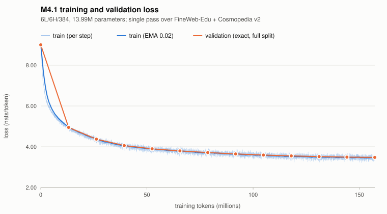
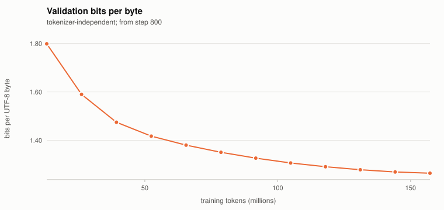
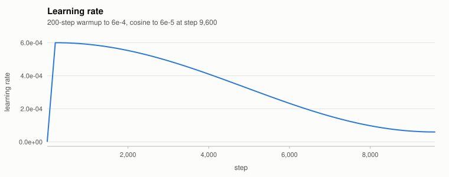
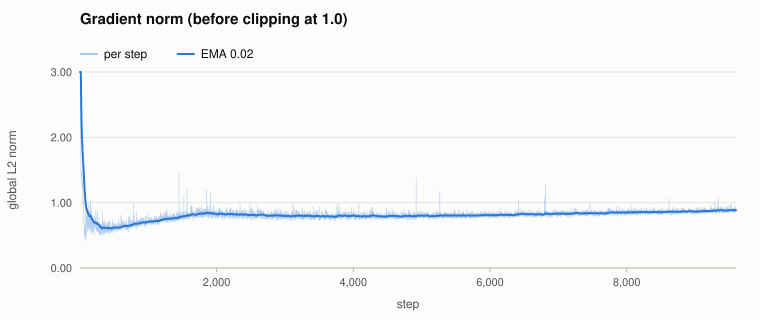
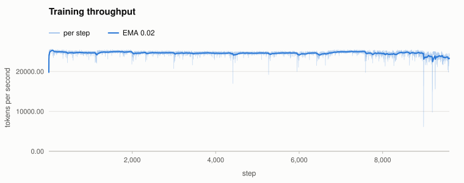
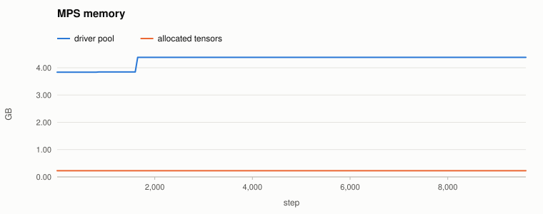

# M4.1 — General-purpose pretraining (FineWeb-Edu + Cosmopedia v2, 14M parameters)

**Status:** complete, stopped for review. No conversational training, no UI work, nothing committed.
**Run:** `runs/m4_1_general_s_bpe8192-20261114-190514` (Git-ignored), config
`configs/m4_1_general_s_bpe8192.toml`, code at `8d8d7c0` + uncommitted M3–M4.1 working tree.

## 1. Summary

| | value |
|---|---|
| Model | 6 layers, 6 heads, width 384, context 512, 13,989,888 parameters (tied embeddings) |
| Data | 157.29M training tokens prepared; 157,286,400 presented, **each exactly once** (0 repeated presentations) |
| Mix (train tokens) | FineWeb-Edu 110.10M (70.0%), Cosmopedia v2 47.19M (30.0%) |
| Tokenizer | byte-level BPE, 8,192 ids incl. 5 special tokens, fitted on the training split only; fingerprint `e6be77cc…32ce91c8` |
| Schedule | 9,600 steps × 32 sequences × 512 tokens; warmup 200, cosine 6e-4 → 6e-5 |
| Wall-clock | 109.9 min (6,594 s); mean 24,552 tokens/s; MPS pool 4.38 GB |
| Validation (exact, full split) | **3.4769 nats/token, perplexity 32.4, 1.2641 bits/byte** (best = final = step 9,600) |
| Held-out bits/byte vs M3.3 (TinyStories, 27.6M) | FineWeb-Edu 1.335 vs 3.086; Cosmopedia 0.993 vs 2.975; Wikipedia (OOD) 1.660 vs 3.745 |
| Frozen suite (`general_v1`, acc_norm) | facts 22/40 (55%) · QA 12/30 (40%) · grammar 30/30 · code MC 7/20 · greedy code 2/10 |
| Main failure | sampled text degenerates into loops: 63% of continuations and 89% of explanation answers have >30% repeated 4-grams; no sample ends on its own |

The run is a clean, reproducible base model: it trained without a single instability, the loss was
still falling at the end, and it beats every TinyStories model by a wide margin on general text. It
is **not** a usable assistant, and was never meant to be: it has never seen a chat token, cannot
stop, and its knowledge is shallow. Section 11 assesses readiness for M5.

## 2. Data provenance

Both files are pinned to a Hugging Face dataset commit and verified (size + SHA-256) before every use
(`src/mini_chatgpt/data/general.py::SOURCES`, `scripts/preflight_m4_1_data.py`). Raw and tokenized
files live under `data/` and are Git-ignored; nothing is redistributed.

| source | repo @ revision | file | bytes | SHA-256 | licence |
|---|---|---|---|---|---|
| FineWeb-Edu | `HuggingFaceFW/fineweb-edu` @ `87f09149` | `sample/10BT/013_00000.parquet` | 540,632,672 | `b393f51f…7ec832de` | ODC-By 1.0 (+ Common Crawl ToU) |
| Cosmopedia v2 | `HuggingFaceTB/smollm-corpus` @ `3ba9d605` | `cosmopedia-v2/train-00000-of-00104.parquet` | 1,174,424,341 | `5a257211…cdb1491d` | ODC-By 1.0; generated by Mixtral-8x7B-Instruct (Apache 2.0) |

**FineWeb-Edu shard 013 is not a uniform sample.** Its 182,101 rows come from only six Common Crawl
dumps (2017: 60,352; 2019: 30,605; 2020: 30,941; 2023: 60,203). Educational score 3: 157,941, 4:
24,016, 5: 144; minimum language score 0.65. **Cosmopedia** uses a 25% document-hash pool
(`int(sha[:8],16) % 4 == 0`, 94,323 of 376,289 rows) to bound memory and time; the pool still held
~80M tokens for a 47M quota.

### Pipeline (`scripts/prepare_general.py`, 211.7 s, peak RSS 3.9 GB)

1. **Clean** (`clean_text`): NFC, Unix newlines, C0 controls removed (tab/newline kept), trailing
   spaces stripped, ≥3 newlines collapsed to 2.
2. **Quality filter** (`quality_reject`, deliberately conservative — both sources are filtered
   upstream): U+FFFD present; fewer than 50 words; >30% of substantive (≥30-char) lines duplicated;
   letters <50% of characters.
   *A first preparation attempt was stopped before writing output*: the duplicate-line rule then
   counted all lines and wrongly rejected 803 good Cosmopedia documents (repeated code fences,
   `* * *`, table rules). The rule now counts only lines of ≥30 characters (unit-tested); the stopped
   attempt's log is kept as `runs/m4_1_prepare_attempt1_stopped.log`.
3. **Deduplicate across both sources before splitting** (exact SHA-256, then MinHash/LSH near-
   duplicates with union-find; the smallest hash survives), so a duplicate cluster can never straddle
   train and validation.
4. **Split by document hash**: `int(sha[:8],16) % 1000` — 0–4 validation, 5–9 holdout, rest train.
5. **Decontaminate** train against the frozen suite (word 8-grams of every item with ≥8 words).
6. **Fit the tokenizer** on train only, then encode train documents per source in hash order up to
   the token quota; the run stops with an error if a source runs short.
7. Shuffle sources together by sorting the selected documents by hash; write uint16 streams with
   `<|endoftext|>` between documents, plus `meta.json` and `manifest.json` (all hashes and counts).

| | FineWeb-Edu | Cosmopedia v2 |
|---|---|---|
| rows read | 182,101 | 94,323 (25% pool) |
| rejected by quality rules | 133 (U+FFFD 70, <50 words 56, dup lines 6, letters 1) | 186 (<50 words 82, dup lines 80, U+FFFD 22, letters 2) |
| exact / near duplicates removed | 96 / 51 | 143 / 2 |
| documents after dedup | 181,821 | 93,992 |
| train / val / holdout documents | 179,933 / 906 / 976 | 93,036 / 511 / 444 |
| train docs dropped by decontamination | 6 | 1 |
| **selected for training** | **88,688 docs, 110,104,294 tokens** (3.886 bytes/token) | **54,591 docs, 47,186,681 tokens** (4.331 bytes/token) |
| unused train tokens (estimate) | ~112M | ~33M |

Near-duplicate pairs found: 53, none across sources. Decontamination indexed 151 suite items; train
hits were fact04 (×4), fact10, fact12, fact29 — all short encyclopedic statements, so other wordings
of the same facts certainly remain (limitation, §10). Held-out documents had 0 hits.

### Streams

| stream | tokens | documents | SHA-256 | bytes/token |
|---|---|---|---|---|
| train | 157,290,975 | 143,279 | `78082023…5dbad` | 4.019 |
| val | 1,675,956 | 1,417 | `ab385ad6…4221` | 3.968 |
| holdout | 1,627,118 | 1,420 | `1f6b7601…bc25` | 3.955 |

No document hash is shared between any two splits. Validation is 73% FineWeb-Edu / 27% Cosmopedia by
tokens (hash split by document, not by token quota). The holdout stream was never used for any
decision in this milestone; it is reserved.

### Unique tokens vs presentations

| | tokens |
|---|---|
| unique training tokens in `train.bin` | 157,290,975 |
| non-overlapping 512-token windows available | 307,208 |
| windows presented (9,600 × 32) | 307,200 |
| **token presentations** | **157,286,400** |
| repeated presentations | **0** |
| unused windows | 8 (4,096 tokens + tail) |

To guarantee this, M4.1 added `data_order = "single_pass"`: a seeded permutation of non-overlapping
windows, indexed by `(step × accumulation + micro_step) × batch`. The trainer refuses to start if the
plan would need more windows than exist, and raises instead of wrapping around if data ever ran out.
Resuming needs no extra state because the position is derived from the step (tested).

## 3. Tokenizer

Our own byte-level BPE (`src/mini_chatgpt/tokenizer/bpe.py`, M3), retrained from scratch — no
pretrained tokenizer. Fitted on the first 70.0 MB of FineWeb-Edu train (14,832 docs) and 30.0 MB of
Cosmopedia train (8,032 docs) in hash order, 8.4 s.

- 8,192 ids = 256 bytes + 7,931 merges + 5 specials: `<|endoftext|>` 8187, `<|user|>` 8188,
  `<|assistant|>` 8189, `<|system|>` 8190, `<|end|>` 8191.
- Fingerprint `e6be77ccff4929187ed84ee1b71d15b7654824abd9e23f3ad889c57232ce91c8`, identical in
  `meta.json`, the manifest, the run directory copy and every checkpoint evaluation.
- Checks: exact round trip on all 2,837 val/holdout documents; reload reproduces merges and
  fingerprint; special-token *text* inside documents is encoded as ordinary bytes unless explicitly
  allowed, so web text cannot inject a `<|user|>` id.
- Usage on train: 265 / 4,054 / 7,217 token types cover 50 / 90 / 99% of tokens; every merge is used
  at least once (36 fewer than 100 times); 50 byte ids never occur. **The four chat tokens occur 0
  times in training** — their embeddings are untrained random vectors (relevant for M5).

## 4. Model

GPT-2-style pre-LN decoder (`src/mini_chatgpt/model/`), unchanged from the M4 recommendation.

| | |
|---|---|
| layers / heads / width / head dim | 6 / 6 / 384 / 64 |
| context | 512 (learned absolute positions) |
| MLP | 4× (1,536), GELU |
| norm / bias / dropout | LayerNorm, bias on, dropout 0 |
| embeddings | tied input/output, 8,192 × 384 = 3,145,728 |
| attention | `scaled_dot_product_attention`, causal |
| parameters | **13,989,888** (analytic count matches) |

## 5. Training configuration

| | |
|---|---|
| optimizer | AdamW, β 0.9/0.95, weight decay 0.1 on 2-D weights incl. embeddings (13,959,168 params), none on biases/LayerNorm (30,720) |
| learning rate | linear warmup 200 steps to 6e-4, cosine to 6e-5 at step 9,600 |
| batch | 16 sequences × 2 accumulation × 512 = 16,384 tokens/step |
| gradient clipping | 1.0 (global L2) |
| precision / device | float32, MPS (Mac mini, 16 GB) |
| seed | 1337 |
| evaluation | every 800 steps: 10-batch train/val estimate + **exact loss over the full validation stream** |
| checkpoints | every 800 steps (last 3 kept) + `best.pt` by exact validation loss |
| launch | `caffeinate -dims python scripts/train.py --config configs/m4_1_general_s_bpe8192.toml` |

### Preflight (all passed before launch)

Data (`docs/reports/m4_1/preflight_data.json`): raw hashes; stream hashes, counts and id range;
tokenizer fingerprint and round trip; zero split overlap; single-pass windows sufficient; `y[t] =
x[t+1]` on real windows; budget equals 157,286,400. Model (`scripts/preflight_scaling.py`): historical
Shakespeare M2 checkpoint re-evaluates to the logged 1.4735867; M3.1/M3.3 load; initial loss 9.089 vs
ln 8192 = 9.011; all gradients finite and non-zero; causality (prefix difference 0.0; SDPA vs explicit
attention 2.7e-6); optimizer groups cover every parameter once; 100-step stability 9.09 → 6.87;
checkpoint save/load exact; projected 104.5 min.

## 6. Learning curves



| step | tokens seen | lr | train (est.) | **val exact** | val ppl (exact) | **val bits/byte** |
|---|---|---|---|---|---|---|
| 0 | 0 | 3.0e-6 | 9.090 | 9.088 | 8,852 | 3.304 |
| 800 | 13.1M | 5.9e-4 | 4.918 | 4.948 | 140.9 | 1.799 |
| 1,600 | 26.2M | 5.7e-4 | 4.349 | 4.373 | 79.3 | 1.590 |
| 2,400 | 39.3M | 5.3e-4 | 4.021 | 4.056 | 57.8 | 1.475 |
| 3,200 | 52.4M | 4.8e-4 | 3.857 | 3.898 | 49.3 | 1.417 |
| 4,000 | 65.5M | 4.1e-4 | 3.755 | 3.796 | 44.5 | 1.380 |
| 4,800 | 78.6M | 3.4e-4 | 3.672 | 3.714 | 41.0 | 1.351 |
| 5,600 | 91.8M | 2.7e-4 | 3.608 | 3.648 | 38.4 | 1.326 |
| 6,400 | 104.9M | 2.0e-4 | 3.548 | 3.593 | 36.3 | 1.306 |
| 7,200 | 118.0M | 1.4e-4 | 3.506 | 3.551 | 34.8 | 1.291 |
| 8,000 | 131.1M | 9.8e-5 | 3.465 | 3.516 | 33.7 | 1.278 |
| 8,800 | 144.2M | 7.0e-5 | 3.439 | 3.491 | 32.8 | 1.269 |
| **9,600** | **157.3M** | 6.0e-5 | 3.425 | **3.4769** | **32.4** | **1.2641** |

(lr: value at the eval step; ppl = exp(val exact); train is a 10-batch estimate. Full data in
`docs/reports/m4_1/curve_points.json`.)



Observations:

- **Every evaluation was a new best**; the last 800 steps still gained 0.014 nats. The model is
  under-trained for its size, not over-fitted — expected at ~11 tokens per parameter in a single pass.
- **Train–validation gap ≈ 0.05 nats** throughout. Since nothing is repeated, this is not
  memorization: validation holds a slightly larger share of FineWeb-Edu (73% vs 70%), which is the
  harder source (1.33 vs 0.99 bits/byte, §8).
- Stability: after warmup the gradient norm stayed below 1.45 (clipping engaged on 0.17% of steps);
  no loss spikes, no NaN/Inf, no warnings in `runs/m4_1_train.log`.

 

## 7. Checkpoints

| file | step | val exact | notes |
|---|---|---|---|
| `checkpoints/best.pt` | 9,600 | 3.4769 | selected by exact validation loss |
| `checkpoints/step_00009600.pt` | 9,600 | 3.4769 | final; **weights tensor-for-tensor identical to best.pt** |
| `step_00007200/8000/8800.pt` | — | 3.551 / 3.516 / 3.491 | last three periodic checkpoints (rotation, as configured) |

Both best and final load with `load_model` (13,989,888 parameters) and evaluate identically, so the
rest of the report uses "final". Each checkpoint embeds its config, tokens seen, git commit and torch
version; 168 MB each.

## 8. Validation and held-out language modelling

Bits per byte (bpb) divides total negative log-likelihood by the UTF-8 byte count, so models with
different tokenizers are directly comparable. Each set uses up to 400 documents (same documents for
every model); `wikipedia_en_ood` is the 257-document M4 Wikipedia sample, a source the model never
trained on. TinyStories models are the M3.1 (12.4M) and M3.3 (27.6M) checkpoints at step 4,800.

| held-out set (bits/byte, lower is better) | **M4.1 (14.0M)** | M3.1 TinyStories (12.4M) | M3.3 TinyStories (27.6M) |
|---|---|---|---|
| FineWeb-Edu val (400 docs, 1.84 MB) | **1.335** | 3.152 | 3.086 |
| FineWeb-Edu holdout (400 docs) | **1.344** | 3.098 | 3.033 |
| Cosmopedia v2 val (400 docs, 1.55 MB) | **0.993** | 3.037 | 2.975 |
| Cosmopedia v2 holdout (400 docs) | **0.994** | 3.015 | 2.952 |
| Wikipedia EN (out of domain, 257 docs) | **1.660** | 3.818 | 3.745 |
| TinyStories V2 val (400 docs) | 1.169 | **0.546** | **0.508** |

- Val and holdout agree within 0.01 bpb, so model selection on validation did not bias the estimate.
- General text: 2.3–3.0× fewer bits than the TinyStories models. On TinyStories itself M4.1 is
  2.1× worse than models trained on it — each model is good on its own distribution.
- Cosmopedia (synthetic, written by one LLM in a homogeneous textbook style) is far more predictable
  than web text. Wikipedia is hardest: dense named entities, numbers and an unseen style.

## 9. Frozen evaluation suite (`evals/general_v1.json`)

Suite SHA-256 `f2265af3…63faffd8365` (unchanged; frozen-hash test passes). 95% Wilson intervals.
Primary multiple-choice metric is acc_norm (log-probability per byte). Every M4.1 deterministic
result was reproduced exactly by a second full evaluation run (`reproducible_deterministic_sections:
true`).

| section | chance | **M4.1** | M3.1 | M3.3 |
|---|---|---|---|---|
| facts_mc (40) | 25% | **22/40 = 55%** [40, 69] | 7/40 = 18% [9, 32] | 10/40 = 25% [14, 40] |
| qa_mc (30) | 25% | 12/30 = 40% [25, 58] | 12/30 = 40% [25, 58] | 13/30 = 43% [27, 61] |
| grammar_pairs (30) | 50% | **30/30 = 100%** [89, 100] | 26/30 = 87% [70, 95] | 26/30 = 87% [70, 95] |
| code_mc (20) | 25% | 7/20 = 35% [18, 57] | 5/20 = 25% [11, 47] | 7/20 = 35% [18, 57] |
| code_generation (10, greedy) | — | 2/10 [6, 51] | 0/10 | 1/10 |
| chat format (12) | — | 0/12 | n/a | n/a |

Interpretation, honestly bounded by the small suite:

- **Facts: the only clear gain.** 55% vs 25% chance; the interval [40, 69] excludes chance and M3.1's
  interval, and only touches M3.3's upper end (40%). Caveat: decontamination can only remove exact
  8-gram overlaps; common facts ("The capital of France is …") are in the web data in many wordings,
  which is the point of pretraining but means this measures recall of frequent facts, not reasoning.
- **QA and code MC are indistinguishable from chance and from the TinyStories models.** Intervals
  overlap 25% in every case.
- **Grammar** is saturated (30/30); the TinyStories models already reached 26/30. The 4-item difference
  is not statistically resolved by 30 pairs.
- **Code generation 2/10** — and both successes are trivial completions (`import numpy as` → ` np`,
  `return width *` → ` height`). Most failures loop or echo the prompt (`print(i, print(i, …`, `y * y * y * …`), see
  `samples.md`.
- **Chat 0/12 on format** as expected for a base model (the suite states this). Three replies pass
  the keyword check, but by accident: they repeat a word from the conversation (`Lena!` ×32,
  `red and green` in a loop, `fruit is a fruit that is used to produce fruit`). Those are not
  successes.

### Free generation (automatic surface metrics, 3 seeds, T = 0.7, top-k 40, 200 tokens)

| section | metric | **M4.1** | M3.1 | M3.3 |
|---|---|---|---|---|
| continuation (20 × 3) | mean repeated 4-gram fraction | **0.37** | 0.09 | 0.05 |
| | samples with >30% repeated 4-grams | **63%** | 2% | 0% |
| | distinct-2 | 0.54 | 0.77 | 0.83 |
| | ended with end-of-text | **0%** | 65% | 85% |
| explanations (12 × 3) | repeated 4-gram fraction / >30% | **0.61 / 89%** | 0.10 / 3% | 0.08 / 3% |
| repetition_stress (8 × 3) | repeated 4-gram fraction / >30% | 0.47 / 63% | 0.11 / 8% | 0.11 / 8% |
| all | replacement characters | 0 | 0 | 4 |

**This is the most important finding of M4.1 and a regression relative to M3.** The TinyStories
models write short, complete, varied stories and stop; M4.1 never stops within 200 tokens and loops
on a phrase in most samples. Likely causes (not tested in this milestone — no further runs were
launched):

1. **Document length.** The median validation document is 762 tokens (holdout 795), longer than the
   512 context, so most training windows contain no `<|endoftext|>`; TinyStories stories have a median
   of 180 tokens, so the M3 models saw an ending in nearly every window.
2. **Under-training on a far harder distribution.** At 3.48 nats/token the model's next-token
   distribution is broad; under top-k 40 sampling, a phrase it has just produced is often the most
   probable continuation, and the loop is self-reinforcing.
3. **No decoding safeguards.** The suite deliberately samples without repetition penalty, so this
   is the raw model's behaviour.

None of these is a bug in the training code: the losses are healthy and the same pipeline produces
non-repetitive text on TinyStories. For M5, supervised chat data ends every assistant turn with
`<|end|>`, which directly teaches stopping; a repetition penalty or no-repeat-n-gram setting at
inference is a standard, cheap mitigation and should be evaluated separately from the model.

### Memorization

Every M4.1 generation (120 samples) was re-encoded and searched for verbatim k-gram matches in the
157M-token training stream it was trained on:

| section | samples | mean fraction of 16-grams found in train | samples with a 32-gram match | with a 48-gram match |
|---|---|---|---|---|
| continuation | 60 | 0.00036 | 0 | 0 |
| explanations | 36 | 0 | 0 | 0 |
| repetition_stress | 24 | 0 | 0 | 0 |

No verbatim regurgitation of training text, consistent with a single pass at this scale.

### Samples (unedited)

Selected **by rule**, not by hand: for each section, the seed-11 sample with the lowest, median and
highest repeated-4-gram fraction. Text is inserted programmatically by `scripts/m4_1_samples.py`
from `general_eval_m4_1_final.json`. All 76 seed-11 generations, all 12 chat replies and all 10
greedy code completions are in [`m4_1/samples.md`](m4_1/samples.md).

#### continuation

*least repetitive*: **cont13** (seed 11, repeated 4-gram fraction 0.06, ended with end-of-text: False)

Prompt:

````text
Honeybees communicate with each other by
````

Model continuation:

````text
 sharing information, but they can do what they can do to help them. They can then use a smartphone to see if someone can use your hand to help their friend. They can also be using a smartphone to create a new device.
Luckily, you would like to help your friend and friend to help her friend to help her friend.
Honeybeeeeeeeeeeeeeeeeeeeeeeeeeeeeeeeeeeeeeeeeeeeeeeeeeeeeeeeeeeeeeeeeeeeeeeeeeeeeeeeeeeeeeeeeeeeeeeeeeeeeeeeeeeeeeeeeeeeeeeeeeeeee
````

*median*: **cont04** (seed 11, repeated 4-gram fraction 0.38, ended with end-of-text: False)

Prompt:

````text
One of the most important ideas in mathematics is
````

Model continuation:

````text
 the ability to explain the structure of the puzzle and solve problems in relation to the problem of a problem. By doing so, you will have a good understanding of how to solve problems in order to solve problems. The problem is also important in understanding the structure of the puzzle and how to solve problems.
What are the problems?
The problem is to know how to solve problems. It is also important in building a good understanding of how to solve problems.
Give the solution to solve problems, you know what you need to solve.
When you start learning how to solve problems, you learn how to solve problems.
The solution you can use to solve problems in order to solve problems.
One of the most important problems is learning how to solve problems, which is a way to solve problems.
The solution you have to solve problems.
What is the problem?
The problem is the problem you must have to solve problems.
It is a way to solve
````

*most repetitive*: **cont20** (seed 11, repeated 4-gram fraction 0.92, ended with end-of-text: False)

Prompt:

````text
Most deserts receive less than
````

Model continuation:

````text
 six hours a day, including the following:
- The first day of the day,
- the second day of the day of the day,
- the second day of the day
- the third day of the day
- the second day of the day
- the second day of the day of the day,
- the third day of the day
- the second day of the day of the day
- the second day of the day of the day
- the second day of the day,
- the third day of the day of the day of the day of the day
- the second day of the day of the day of the day of the day
- the third day of the day
- the third day of the day of the day,
- the third day of the day of the day of the day
- the third day of the day of the day of the day of the day
The third day of the day of the day
````


#### explanations

*least repetitive*: **expl10** (seed 11, repeated 4-gram fraction 0.29, ended with end-of-text: False)

Prompt:

````text
Question: What does a function do in a computer program?
Answer:
````

Model continuation:

````text
 What is the function?
Answer: The function is a function that is used in the computer to perform training in the machine.
Answer: The function is to perform a testing in the computer.
Answers: What inputs are: What inputs are the outputs are the inputs?
Answer: The function is to perform specific training in the computer.
Answer: An algorithm that we can perform to perform a test, which is the outputs.
Answer: The function performs a test in the machine, which is the inputs (length of the inputs).
Answer: This function is called the function to perform an test in the machine, which is the inputs.
Answer: The function is the inputs that the inputs are the inputs.
Answer: This is the outputs.
Ans
````

*median*: **expl04** (seed 11, repeated 4-gram fraction 0.70, ended with end-of-text: False)

Prompt:

````text
Question: Why does a metal spoon feel colder than a wooden spoon at the same temperature?
Answer:
````

Model continuation:

````text
 When a metal spoon was used, a metal spoon was used to form a plastic spoon around the spoon.
The metal spoon was used to form a wireless spoon in a way that was used in the form of a metal spoon.
But the metal spoon was also used to form a material that was used to form a metal spoon.
The metal spoon was used to form a metal spoon in a hedge.
The metal spoon was used to form a metal spoon in a way that was used to form a metal spoon.
Answer: When a metal spoon was used in a metal spoon, it was used to form a metal spoon.
The metal spoon was used to form a metal spoon.
Answer: When the metal spoon was used to form a metal spoon, it was used to form a metal spoon.
Answer
````

*most repetitive*: **expl07** (seed 11, repeated 4-gram fraction 0.95, ended with end-of-text: False)

Prompt:

````text
Question: What is a noun?
Answer:
````

Model continuation:

````text
 A noun is a noun, a noun, a noun, a noun, a noun, a noun, a noun, a pronoun, a noun, a noun, a noun, a noun, a noun, a noun, a noun, a noun, a noun, a noun, a noun, a noun, a noun, a noun, a noun, a noun, a noun, a noun, a noun, a noun, a noun, a noun, a noun, a noun, a noun, a noun, a noun, a noun, a noun, a noun, a noun, a noun, a noun, a noun, a noun, a noun, a noun, a noun, a noun, a noun, a noun,
````


#### repetition_stress

*least repetitive*: **rep04** (seed 11, repeated 4-gram fraction 0.06, ended with end-of-text: False)

Prompt:

````text
Chapter 1


````

Model continuation:

````text
Have you ever wondered how your doctor makes a doctor? It's all about how you can keep a healthy person around you. That's where your doctor comes in! A doctor is like a specialist who specializes in taking care of your blood vessels and joins another patient. Just like how your doctor works, doctors often help to manage your symptoms and work hard to make sure they don't work properly. This is called a "skelp" or "skelp" or "skelp" or "skelp," which means they are working hard to maintain a healthy balance in their body.

Let's explore how it works. Imagine you are building a big building with your body. Your body needs to work properly and maintain a healthy weight. You might think that feeling the same level of your body changes, but instead of saying, "skelp" is a way to keep your body functioning properly. But if you're a doctor
````

*median*: **rep03** (seed 11, repeated 4-gram fraction 0.66, ended with end-of-text: False)

Prompt:

````text
The the the
````

Model continuation:

````text
sis is designed to make the reader more aware of the subject being written in the form of the word. When a reader is asked to write a sentence in a sentence, it is the same to say that there is a sentence in the form of the sentence.
Here the reader should read about the subject being written in the form of the sentence.
Here is a way to write the sentence in the form of the sentence:
You may find the sentence in the form of the sentence to be written in the form of the sentence in the form of the sentence.
How to write a sentence in the form of the sentence in the form of the sentence in the form of the word in the form of the sentence in the form of the word in the form of the word in the form of the word in the form of the word in the form of the word in the form of the word in the form of the word in the form of the word in the form of the word in the
````

*most repetitive*: **rep06** (seed 11, repeated 4-gram fraction 0.91, ended with end-of-text: False)

Prompt:

````text
def f(x):
    return f(
````

Model continuation:

````text
x):
    return m:= 1.1
    return m:
        return m:
        return m:
    return m:
            e:
        return m:
        return m:
        return m:
        return m:
        return m:
    return m:
        return m:
        return m:
        return m:
        return m:
        return m:
        return m:
        return m:
        return m:
        return m:
        return m:
        return m:
        return m:
        return m:
        return m:
        return m:
        return m:
        return m:
        return m:
        return m:
        return m:
        return m:
        return m:
        return m:
        return m:
        return m:
        return m:
        return m:
        return m:
        return m:
        return m:
        return m:
        return m:
        return m:
        return m:
        return m:
        return m:
       
````

Patterns visible across the full sample file:

- **Successes:** fluent, grammatical English at the sentence level; correct register for the prompt
  (encyclopedic for history prompts, textbook "Let's explore …" voice from Cosmopedia, Markdown
  lists and Python code blocks in the right places); topical vocabulary (printing press, brain,
  honeybees).
- **Failures:** loops at phrase, line and list-item level; facts and dates invented and contradicted
  ("began in 1958 … began until 1950"); circular definitions ("A noun is a noun"); one token-level
  collapse (`Honeybeeeeee…`); question prompts answered with more questions or with
  `Answer:` lines that never resolve.

## 10. Compute and memory

| | |
|---|---|
| wall-clock, step 0 → 9,600 | 6,594 s = **109.9 min** (6,406 s in training steps, rest evaluation + checkpoints) |
| step time | mean 0.667 s, median 0.664 s, max 2.68 s |
| throughput | 24,552 tokens/s (mean step); 24,666 (median) |
| estimated training compute | 6N + 6·L·T·C = 91.0 MFLOP/token × 157.3M = **1.43 × 10¹⁶ FLOPs** (≈ 2.2 TFLOP/s sustained) |
| MPS driver pool (peak) | 4.38 GB |
| MPS allocated tensors (peak, after forward) | 2.60 GB |
| process RSS (peak) | 0.90 GB |
| full evaluation of one checkpoint | ~90 s |
| data preparation | 211.7 s, 3.9 GB RSS |

The 104.5-min preflight projection was within 5% of the actual time. Compute is essentially equal to
M3.3's (1.40 × 10¹⁶) with half the parameters and twice the tokens.

 

## 11. What we implemented vs what PyTorch provides

**Implemented in this repository (M0–M4.1):** the GPT model (embeddings, attention block wiring,
pre-LN residual stream, weight tying, initialization, generation with temperature/top-k); the
byte-level BPE tokenizer (training, merges, special-token handling, fingerprinting); the whole data
pipeline (Parquet streaming, cleaning, quality rules, exact + MinHash/LSH deduplication, hash
splits, n-gram decontamination, uint16 memmap streams with integrity hashes); single-pass data
ordering; the training loop (gradient accumulation, warmup + cosine schedule, clipping, parameter
groups for weight decay, exact validation, checkpoint rotation/best/resume, metrics and memory
logging); the evaluation suite and all its scorers, bits per byte, Wilson intervals, the k-gram
memorization index; preflights and SVG plotting.

**Provided by PyTorch:** tensors and autograd, the MPS backend, `nn.Linear`/`nn.Embedding`/
`nn.LayerNorm`/GELU, `scaled_dot_product_attention` (verified against our explicit attention),
`torch.optim.AdamW`, `clip_grad_norm_`, `torch.save/load`. **pyarrow** (new optional `data`
dependency) only reads Parquet columns. No pretrained weights, tokenizers or LLM APIs were used.

## 12. Limitations

- **Small model, single run, single seed.** No error bars on the training curve itself.
- **Suite size.** 30–40 items per multiple-choice section give ±15-point intervals; only the facts gain
  is resolved. Generation quality is measured by surface metrics only; no human rubric was run in
  M4.1.
- **Data coverage.** One FineWeb-Edu shard from six crawl dumps; a 25% Cosmopedia pool from one of 104
  files. Topic and time coverage are narrower than "the web".
- **Decontamination** is exact word 8-grams; paraphrased facts remain, so facts_mc partly measures
  recall of common knowledge seen in training.
- **Synthetic data.** 30% of training text was written by an LLM (Mixtral) — legally licensed and
  allowed by the brief (we did not *call* an LLM), but it imports that model's style.
- **Degenerate sampling** (§9) is unresolved; causes are hypotheses.
- **Chat token embeddings are untrained**; the base model has no notion of turns or stopping.

## 13. Readiness for conversational training (M5)

Ready, with explicit caveats:

- ✅ A reproducible base checkpoint (`step_00009600.pt`, val 3.477 / 1.264 bpb) with config, tokenizer
  fingerprint and git commit embedded.
- ✅ Tokenizer already reserves `<|user|>`, `<|assistant|>`, `<|system|>`, `<|end|>` (ids 8188–8191);
  no vocabulary resize is needed. They are guaranteed single ids and cannot be injected from text.
- ✅ Chat section of the frozen suite is wired up (`has_chat_tokens`, `chat_ids`, `score_chat`) and
  currently scores 0/12 on format — a clear baseline to improve on.
- ⚠️ Expect M5 to need to teach **stopping** (`<|end|>`), which should also address much of the
  looping; evaluate decoding settings (repetition penalty) separately and report both.
- ⚠️ Knowledge is shallow (facts 55%, QA at chance). Post-training will make answers *formatted*, not
  *correct*; the v1.0 demo should set expectations accordingly.

No M5 work has been started.

## 14. Reproduction

```bash
uv pip install --python .venv/bin/python -e ".[data]"
python scripts/prepare_general.py --download            # fetch + verify pinned files
python scripts/prepare_general.py                       # writes data/processed/general_m4_1_bpe
python scripts/preflight_m4_1_data.py configs/m4_1_general_s_bpe8192.toml
python scripts/preflight_scaling.py configs/m4_1_general_s_bpe8192.toml --historical runs/<M2 run> runs/<M3.1 run> runs/<M3.3 run>
caffeinate -dims python scripts/train.py --config configs/m4_1_general_s_bpe8192.toml
python scripts/plot_m4_1.py runs/<run> docs/reports/m4_1
python scripts/evaluate_m4_1.py runs/<run> --out docs/reports/m4_1
python scripts/m4_1_samples.py docs/reports/m4_1
```

Artifacts in `docs/reports/m4_1/`: `preflight_data.json`, `curve_points.json`, six SVG charts,
`general_eval_{m4_1_final,m4_1_best,m4_1_final_repeat,m3_1_s12m_tinystories,m3_3_m28m_tinystories}.json`,
`evaluation_summary.json`, `samples.md`, `samples_excerpt.md`.
