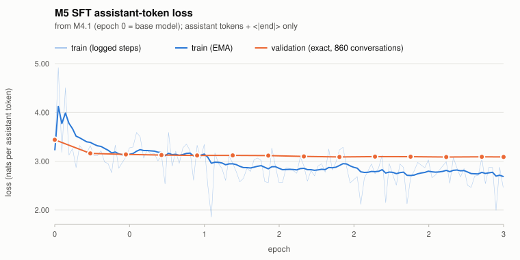
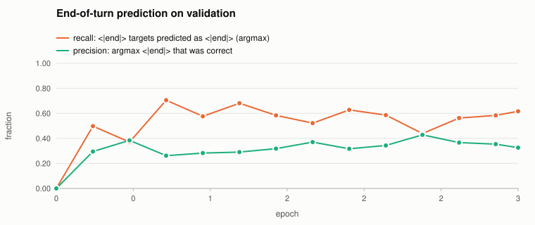
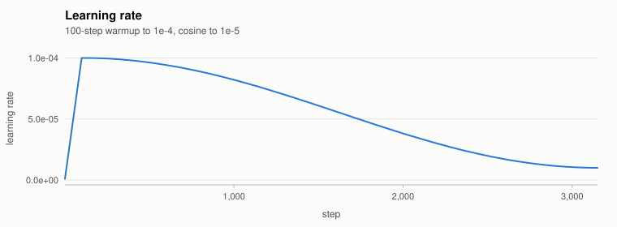
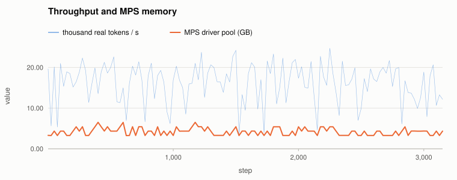

# M5 — Conversational post-training (supervised fine-tuning)

**Status:** complete, stopped for review. No chat UI (M6) work, nothing committed.
**Run:** `runs/m5_sft_chat-20261114-175334` (Git-ignored), config `configs/sft/m5_sft_chat.toml`,
initialized from the M4.1 base checkpoint `runs/m4_1_general_s_bpe8192-20261114-190514/checkpoints/step_00009600.pt`
(SHA-256 `fb21b80a…6148082`, unchanged after training).

## 1. Summary

| | M4.1 base | **M5 SFT (best, step 2,750)** |
|---|---|---|
| Ends its own reply with `<|end|>` (chat_v1, sampled T 0.7, 120 replies) | 0% | **77%** (97.5% with repetition penalty 1.2) |
| Ends its own reply (greedy, 40 replies) | 0% | 55% (82.5% with penalty) |
| Replies with >30% repeated 4-grams (sampled / sampled + penalty) | 30% / 0.8% | 28% / **2.5%** |
| Validation loss on assistant tokens (860 held-out conversations) | 3.438 | **3.085** (ppl 31.1 → 21.9) |
| Factual QA, strict single-rater grade (15 questions) | 0/15 greedy | **1/15** greedy + penalty; 2/45 sampled |
| Frozen M4 chat section, format correct (12 items, greedy) | 0/12 | 6/12 |
| Held-out general text, bits/byte (FineWeb-Edu val) | 1.335 | 1.477 (+10.6%, forgetting) |
| Training | — | 3 epochs, 3,153 steps, **8.0 min** on MPS |

**What worked:** the model learned the chat structure. It answers in the assistant role, writes
short replies (median 27–44 words depending on decoding, instead of running to the 200-token limit) and, above all, **stops by
itself** — the base model never did. A CTRL-style repetition penalty at inference removes most of the
remaining loops without hurting termination.

**What did not:** the model is almost never *right*. It produces well-formed, confident, wrong or
circular answers ("The largest planet in our solar system is the largest planet in our solar
system."). That is the expected ceiling for a 14M-parameter model pretrained on 157M tokens: SFT
teaches format and stopping, not knowledge. General-text modelling degraded moderately.

## 2. What conversational post-training is

Pretraining (M4.1) teaches a model to continue *any* document: it predicts every next token of web
and textbook text. It has no notion of a speaker, a question or an answer, and no reason to stop —
which is exactly what M4.1 showed (0/12 chat format, no autonomous termination, 63% looping).

Supervised fine-tuning (SFT) continues training the **same weights** on a small set of *conversations*
written by people, serialized with special role tokens. Two things differ from pretraining:

| | pretraining (M4.1) | SFT (M5) |
|---|---|---|
| data | 157M tokens of documents, each seen once | 3.2M tokens of 16,813 conversations, each seen 3× |
| unit | fixed 512-token windows across document boundaries | one whole conversation per row, padded |
| loss | every token | **only assistant tokens and the assistant's `<|end|>`** |
| learning rate | 6e-4 peak | 1e-4 peak (6× lower, to adapt rather than overwrite) |
| optimizer | AdamW from scratch | AdamW **fresh** (pretraining moments not restored) |
| goal | model the language | behave as an assistant: answer in turn, then stop |

## 3. Data

### Sources (reviewed at pinned revisions before processing)

| | OASST2 | Dolly-15k |
|---|---|---|
| repo @ revision | `OpenAssistant/oasst2` @ `179dd21f` | `databricks/databricks-dolly-15k` @ `bdd27f4d` |
| file | `2023-11-05_oasst2_ready.trees.jsonl.gz` (54,370,156 B) | `databricks-dolly-15k.jsonl` (13,085,339 B) |
| SHA-256 (= Hub LFS oid, verified) | `7a886a16…995f42f0` | `2df90833…fcbf794ec` |
| licence | Apache 2.0 | CC BY-SA 3.0 (© 2023 Databricks; includes Wikipedia excerpts) |
| authorship | crowd-written conversation trees, human-ranked replies | written by Databricks employees, who were told not to use generative AI |
| structure | message trees, strictly alternating prompter/assistant, multilingual | single-turn: instruction, optional context, response, category |

**Synthetic content check.** OASST2 messages carry `synthetic` and `model_name` fields. In the
`ready_for_export` file all 85,318 assistant and 49,856 prompter messages have `synthetic = false`;
the pipeline still filters on the flag. No LLM-generated replies were used, and no API was called.

**Licensing note.** Both licences permit this use. Dolly's CC BY-SA 3.0 is share-alike: the raw and
processed data stay in Git-ignored `data/` and are not redistributed; if the M5 checkpoint is ever
published, the attribution and share-alike question for derived weights should be reviewed then.

### Pipeline (`scripts/prepare_chat.py`, 6.9 s, deterministic)

1. **Verify** size and SHA-256 of both files.
2. **Build conversations.**
   - OASST2: one conversation per tree whose root is English. At every node follow the
     **best human-ranked valid reply** (lowest `rank`; unranked after ranked; ties by message id),
     skipping deleted, negatively reviewed, synthetic and non-English messages. A trailing
     unanswered user turn is removed.
   - Dolly: one turn. User message = instruction, then the reference context after a blank
     line; Wikipedia citation markers `[n]` removed as the dataset card recommends.
3. **Normalize** (NFC, Unix newlines, control characters, trailing spaces, ≥3 newlines → 2) and
   **reject malformed**: non-alternating roles, empty messages, U+FFFD, not ending with the
   assistant, or <90% Latin letters (catches mislabelled languages).
4. **Decontaminate** against both frozen suites (`general_v1`, 167 items, and the new `chat_v1`, 40):
   drop a conversation sharing a word 8-gram with any eval item, or whose first user message equals
   an eval question. 9 removed, e.g. Dolly's "Is a tomato a fruit or a vegetable?" (×2) and
   "What is the capital of France?" (OASST2 and Dolly).
5. **Deduplicate** exactly on the first user message (lowercased, whitespace-collapsed); survivor =
   smallest hash of its group id.
6. **Split** by group hash (OASST2 tree id / Dolly record): 5% validation.
7. **Context policy**: a conversation must fit 513 tokens (512 inputs + 1 shifted target). If not,
   drop trailing exchanges back to the longest prefix ending with an assistant reply; if even the
   first exchange does not fit, drop it. **No message is ever cut**, because a cut reply would teach
   the model to answer without ending.

| | OASST2 | Dolly-15k |
|---|---|---|
| input | 13,854 trees (8,453 non-English roots skipped) | 15,011 records |
| conversations built | 5,401 | 15,011 |
| malformed | 7 (6 non-Latin script, 1 no complete exchange) | 6 (4 U+FFFD, 2 non-Latin) |
| decontaminated | 5 | 4 |
| exact duplicates | 55 | 208 |
| context policy | 3,170 full · **1,009 truncated to earlier turns** · 1,155 dropped | 13,494 full · 1,299 dropped (long contexts) |
| **train / validation conversations** | **3,970 / 209** | **12,843 / 651** |
| assistant-target tokens (train) | 996,722 | 1,010,644 |

| split | conversations | multi-turn (4 or 6 messages) | tokens | assistant-target tokens | tokens/conversation (mean / median / p95 / max) |
|---|---|---|---|---|---|
| train | 16,813 | 2,034 | 3,191,908 | 2,007,366 (62.9%) | 190 / 151 / 453 / 513 |
| validation | 860 | 100 | 166,038 | 106,309 | 193 / 152 / 460 / 511 |

Dolly categories in train: open QA 3,459, classification 2,018, general QA 1,932, brainstorming
1,650, closed QA 1,395, information extraction 1,030, summarization 787, creative writing 572.
Leakage check: 0 groups and 0 first-user messages shared between train and validation. Hashes of
every stream are in `data/processed/chat_m5/manifest.json`.

## 4. Chat format

The tokenizer's reserved special tokens are used with their existing ids; the vocabulary and every
id are unchanged (fingerprint `e6be77cc…32ce91c8`).

| token | id | meaning |
|---|---|---|
| `<|endoftext|>` | 8187 | start of a conversation (the document separator the base model knows) |
| `<|user|>` | 8188 | a user message begins |
| `<|assistant|>` | 8189 | an assistant message begins |
| `<|system|>` | 8190 | a system message begins (supported, but no training data uses it) |
| `<|end|>` | 8191 | end of any message; **the assistant's end-of-turn signal** |

Serialization (`src/mini_chatgpt/chat/format.py`), identical byte for byte to the template the
frozen M4 suite already used (`general_eval.chat_ids`; a test asserts equality):

```
<|endoftext|><|user|>\nWhat is Python?<|end|>\n<|assistant|>\nPython is a programming language.<|end|>\n
<|user|>\n…<|end|>\n<|assistant|>\n…<|end|>\n
```

Message text is encoded with special tokens *disabled*: a user typing the characters `<|end|>`
produces ordinary byte tokens and cannot end a turn or impersonate a role (tested).

### Assistant-only loss mask

For token ids `s[0..n-1]` the model reads `x = s[:-1]` and is trained to predict `y = s[1:]`. A label
is kept only where the *predicted* token is assistant content or the assistant's closing `<|end|>`;
every other label is −100 and ignored by `F.cross_entropy`:

```
token     <|eot|> <|user|> \n What is Python? <|end|> \n <|assistant|> \n Python is … . <|end|> \n
target?      ·       ·     ·   ·    ·    ·       ·    ·       ·        ·   ✓    ✓  ✓ ✓    ✓     ·
```

The header `<|assistant|>\n` is not a target because the inference code writes it; the reply and its
`<|end|>` are, so the model learns both *what* to say and *when to stop*. Loss = sum of target
cross-entropy / number of targets in the batch. Batches hold 16 conversations, right-padded with
ignored labels (the model is causal, so padding cannot affect earlier positions — tested: loss is
identical with and without extra padding).

Verified by tests (`tests/test_chat.py`, 26 tests) and by the preflight on real data: exact token
layout, mask covers exactly assistant text + `<|end|>` in every turn, `y[t] = s[t+1]` alignment,
0 user/system tokens marked as targets in a real batch, masked loss equal to a manual computation,
and 300 random stored conversations re-serialize identically from their text.

## 5. Training

| | |
|---|---|
| initialization | M4.1 final (= best) weights, 13,989,888 parameters, architecture unchanged (6L/6H/384, context 512, tied embeddings), float32, MPS |
| optimizer | fresh AdamW, β 0.9/0.95, weight decay 0.1 (2-D weights), gradient clip 1.0 |
| learning rate | warmup 100 steps to **1e-4**, cosine to 1e-5 at step 3,153 |
| batch | 16 conversations (length-bucketed: pools of 50 batches sorted by length), padded to a multiple of 64 positions |
| budget | **3 epochs** = 3,153 steps; 6,022,098 assistant-target presentations of 2,007,366 unique target tokens (each conversation seen 3×) |
| selection | exact validation loss over all 860 validation conversations every 250 steps; `best.pt` kept |
| wall-clock | **8.0 min** (478.6 s), median 0.167 s/step, 16.9k real tokens/s (20.6k incl. padding) |
| memory | MPS driver pool ≤ 6.5 GB, live tensors ≤ 0.24 GB |

### Preflight (`scripts/preflight_sft.py`, all passed; `docs/reports/m5/preflight.json`)

1. Base checkpoint SHA-256, 13,989,888 parameters, context 512, tokenizer fingerprint.
2. Data hashes, id range, every conversation starts with `<|endoftext|>`, max length 513, 0/300
   re-serialization mismatches, 0 leakage.
3. Masked loss equals manual computation; 0 user tokens are targets.
4. **Chat-token gradients**: after one backward pass the embedding-row gradient norms were
   `<|end|>` 0.39, `<|user|>` 0.31, `<|assistant|>` 0.18 vs a median row of 0.00065 — the untrained
   tokens are learning. `<|system|>` ≈ 7e-7 (never appears in the data; it gets only the tiny softmax
   gradient), as expected.
5. **Overfit**: 4 real conversations, 80 steps at lr 1e-3 → loss 3.55 → 1.5e-5, every `<|end|>`
   predicted.
6. 30 real steps: finite losses and gradients; projected 6 min.
6b. 400-step **memory soak**: pool must plateau below 10 GB (added after the failure below).
7. Checkpoint save → fresh trainer → next step: identical loss, parameter difference 9e-10;
   `load_model` (inference path) loads the SFT checkpoint.

### A failure and its fix (documented, not hidden)

The first launch **stalled at step ~260**: the process grew to a 15 GB footprint and the machine
swapped. Metrics showed live tensors flat at 0.23 GB while the MPS driver pool climbed 2.2 → 13.6 GB.
Cause: every distinct padded batch length allocates and caches a separate set of MPS buffers. Padding
to multiples of 64 (8 shapes) slowed the growth but the pool still stepped up (7.8 → 9.9 GB in a soak
test); adding `torch.mps.empty_cache()` every 25 steps holds it at ~4–6.5 GB with no measurable speed
cost (0.149 vs 0.153 s/step). A guard now aborts the run if the pool exceeds 10 GB rather than
swapping. The stalled attempt is kept as `runs/m5_sft_chat-20261114-174453_attempt1_stalled/` (with a
NOTE) and `runs/m5_sft_train_attempt1_stalled.log`; the failed preflight as
`docs/reports/m5/preflight_attempt2_failed_memory.json`. The rerun reproduced attempt 1's step-250
validation loss exactly (3.1590), so the fix did not change the training math.

### Learning curves



| step | epoch | val loss (assistant tokens) | val ppl | `<|end|>` recall | `<|end|>` precision |
|---|---|---|---|---|---|
| 0 (base) | 0 | 3.4382 | 31.1 | 0.000 | 0.000 |
| 250 | 0.24 | 3.1590 | 23.5 | 0.498 | 0.295 |
| 500 | 0.48 | 3.1389 | 23.1 | 0.370 | 0.384 |
| 1,000 | 0.95 | 3.1168 | 22.6 | 0.576 | 0.283 |
| 1,500 | 1.43 | 3.1139 | 22.5 | 0.584 | 0.318 |
| 2,000 | 1.90 | 3.0861 | 21.9 | 0.627 | 0.317 |
| 2,500 | 2.38 | 3.0915 | 22.0 | 0.439 | 0.428 |
| **2,750** | 2.62 | **3.0854** | **21.9** | 0.562 | 0.366 |
| 3,153 (final) | 3.00 | 3.0864 | 21.9 | 0.617 | 0.326 |

(Recall: of the 918 validation positions whose target is `<|end|>`, the share where argmax is
`<|end|>`. Precision: of target positions where argmax is `<|end|>`, the share that were correct.
Argmax is a strict test — in sampling, `<|end|>` only needs enough probability; see §7.)



- **Most of the gain arrives in the first 250 steps** (3.438 → 3.159): learning the format. The
  remaining 2,900 steps add 0.07.
- Validation is essentially flat in epoch 3 (3.086 → 3.085) while training loss keeps falling (~2.66
  averaged over the last logged steps): the model is starting to memorize the SFT conversations.
  Best-validation selection picked step 2,750; final differs by 0.001.
- **Gradient clipping was active on every step after warmup** (norms ~2–3, max 16.9). Assistant-only
  loss averages over ~1,900 targets per batch, so gradients are noisier than in pretraining (where
  clipping engaged on 0.17% of steps). The effective update was therefore a normalized gradient step;
  this was not tuned (bounded budget) and is noted as a limitation.

 

## 6. Inference: conversational generation and stopping

`src/mini_chatgpt/chat/generate.py::chat_reply` and the CLI `scripts/chat.py`:

- builds the prompt from the message history plus an open `<|assistant|>\n` header (identical to
  the training serialization);
- **multi-turn history**: when the prompt would leave less than `min(max_new_tokens, 256)` tokens
  of room in the 512 window, the oldest user/assistant exchanges are dropped (a system message is
  kept);
- samples with temperature and top-k (or greedy);
- **stops** and records exactly one reason:
  - `end_of_turn`: `<|end|>` generated — the only success;
  - `max_tokens`: the limit was reached, reported as **truncated**;
  - `structural_token`: the model emitted another role/EOT token, a format error;
  - `context_full`;
- optional **repetition penalty** (Keskar et al. 2019): logits of tokens already in this reply are
  divided by the penalty if positive, multiplied if negative; structural tokens are exempt, so the
  penalty can never discourage `<|end|>`;
- displays text with every structural token removed.

## 7. Evaluation

Everything was run by `scripts/evaluate_m5.py` (~10 min) on the base model, the SFT best and the SFT
final checkpoint. Raw results are in `docs/reports/m5/`.

### 7.1 New fixed conversational suite `evals/chat_v1.json`

There are 40 items, written before training and frozen by SHA-256 (`c5b264d3…`; a test asserts the
hash). The training data was decontaminated against them.
- 15 factual questions (qa);
- 10 checkable instructions (ins), e.g. "answer yes or no", "list three", "one word";
- 8 multi-turn items (mt) that need an earlier turn, such as a name, a country or a number;
- 7 open questions (op), scored for stopping and repetition only.

Every reply is scored on three things:
- **format**: it ended with `<|end|>` and is non-empty;
- **content**: simple case-insensitive string and count rules;
- **repetition**: the share of repeated 4-grams.

Four decoding settings were used, with a 200-token limit:
- greedy and greedy + penalty 1.2;
- sampled (temperature 0.7, top-k 40, seeds 11/22/33) and sampled + penalty 1.2.

Selected rows are shown below. Full per-category and per-checkpoint tables are in
`evaluation_summary.json`.

| model | decoding | **natural `<|end|>`** | truncated at 200 | repetitive (>30% 4-grams) | mean words | content (automatic) | format + content |
|---|---|---|---|---|---|---|---|
| base | greedy | 0/40 | 40 | 40/40 | 166 | 2/33 | 0/33 |
| base | sampled | 0/120 | 120 | 36/120 | 171 | 20/99 | 0/99 |
| base | sampled + pen. | 0/120 | 104 (+16 structural) | 1/120 | 173 | 29/99 | 0/99 |
| **SFT** | greedy | **22/40 (55%)** | 18 | 27/40 | 84 | 9/33 | 5/33 |
| **SFT** | greedy + pen. | **33/40 (82.5%)** | 7 | 10/40 | 52 | 11/33 | 9/33 |
| **SFT** | sampled | **92/120 (77%)** [68, 83] | 28 | 34/120 (28%) | 63 | 21/99 | 15/99 |
| **SFT** | sampled + pen. | **117/120 (97.5%)** [93, 99] | 3 | **3/120 (2.5%)** | 46 | 25/99 | 25/99 |
| SFT final | sampled + pen. | 115/120 (96%) | 5 | 1/120 | 42 | 28/99 | 27/99 |

The table supports four conclusions:

1. **Termination is the clearest result.** The base model never ends a reply, and the SFT model does
   77–98% of the time depending on decoding. Truncations are counted separately and never as
   successes.
2. **Repetition penalty OFF vs ON** (same prompts, same seeds). For the SFT model, sampled replies:
   - repetitive replies: 28% → 2.5%;
   - mean repeated-4-gram fraction: 0.205 → 0.025;
   - natural ending: 77% → 97.5%;
   - mean length: 63 → 46 words.

   Greedy decoding loops most (27/40 repetitive), and the penalty cuts that to 10/40. For the base
   model, the penalty removes the loops (36 → 1 repetitive replies) but cannot make it stop: 0/120.
   It also pushes it into emitting structural tokens (16×). Stopping comes from SFT; the penalty is
   a decoding aid.
3. **Automatic content checks overcount.** Substring rules accept "57 percent" as containing "7",
   and a list "Brown, Brown, Brown, Brown" as four list items. Treat those columns as upper bounds;
   §7.2 gives a strict grade for the factual questions.
4. **Best vs final** checkpoints are within noise of each other on every row.

### 7.2 Basic question answering and factual accuracy

I strictly re-graded all 15 factual questions as a single rater
(`docs/reports/m5/strict_qa_grades.json`). A reply counts only if it states the right answer as
the answer:

| | greedy | greedy + pen. | sampled (45) | sampled + pen. (45) |
|---|---|---|---|---|
| base | 0/15 | 0/15 | 0/45 | 1/45 |
| SFT | 0/15 | **1/15** (Pacific) | 2/45 | 2/45 |

**SFT did not make the model knowledgeable.** It answers in the right *form*, and frequently
restates the question as the answer:
- "The capital city of Japan is the capital city of Japan";
- "Romeo and Juliet was written by Romeo and Juliet".

Other replies confidently give a wrong fact, such as "Mercury" for the largest planet or
"4 days in a week". This is consistent with M4.1's general-knowledge results (facts MC 22/40, QA
at chance). The lower SFT loss reflects learning the conversational *distribution*, not facts.

### 7.3 Multi-turn behaviour

The automatic multi-turn content checks pass for 4/8 items with greedy decoding and 11/24 with
sampling. Reading the replies shows that most passes **copy a word from the earlier turn** rather
than reason about it:
- mt03 "What is my dog's name?" → "Max is a dog." (correct);
- mt01 → "My favorite color is blue. I'm sorry, but I don't know what I can do." (half right).

Failures:
- mt04 "And what is the capital of Germany?" → "The capital of Italy is Rome." The model repeats
  the previous answer instead of answering the new question.
- mt06 "How many cats do I have?" (asked after "I have two cats") is never answered with "two" in
  any of the 8 SFT replies. Greedy produces a list ("- Fish - Fish - Fish …"); the one automatic
  pass is a substring false positive.

The model uses the history, but mostly by echoing it.

### 7.4 Instruction following

Format constraints are followed only sometimes:
- **List requests** produce numbered lists, often degenerate ("1. Bananas 2. Bananas …" when greedy).
- **"Yes or no"** gets a sentence instead ("The sun is hot").
- **Summarize in one sentence** gets a copy of the input sentence (ins08), which passes the
  automatic check.

Strict reading puts real instruction following well below the automatic pass rates (5/10 greedy,
6–7/30 sampled).

### 7.5 Frozen M4 general suite: forgetting and the old chat section

Held-out bits per byte, computed on the same documents as M4.1:

| bits per byte | base | SFT best | change |
|---|---|---|---|
| FineWeb-Edu val (400 docs) | 1.335 | 1.477 | +10.6% |
| Cosmopedia v2 val | 0.993 | 1.149 | +15.7% |
| Wikipedia EN (OOD) | 1.660 | 1.779 | +7.2% |
| TinyStories V2 val | 1.169 | 1.238 | +5.9% |

Frozen suite sections:

| section | base | SFT best |
|---|---|---|
| facts MC (acc_norm, 40) | 22 | 20 |
| QA MC (30) | 12 | 15 |
| code MC (20) | 7 | 6 |
| grammar pairs (30) | 30 | 29 |
| greedy code completion (10) | 2 | 5 |
| chat section: format / content / both (12, greedy, 128 tokens) | 0 / 3 / 0 | **6 / 4 / 2** |
| plain-text continuation, repeated-4-gram fraction | 0.37 | 0.69 |

The forgetting is **moderate and expected**: three epochs on a narrow conversational distribution,
with no pretraining data mixed in, cost 0.07–0.16 bits per byte on documents. The multiple-choice
changes are all inside their Wilson intervals (±15 points), so none is significant. The model does
continue *plain documents* worse, looping more (0.37 → 0.69). It now expects to be in a
conversation. Mixing a fraction of pretraining data into SFT is the standard remedy, and it is
deferred.

### 7.6 Memorization

None of the 120 sampled SFT replies contains a 32- or 48-token span from the SFT training
conversations; the mean fraction of 16-grams found there is 0.0.

## 8. Representative transcripts (unedited)

These transcripts were inserted programmatically by `scripts/m5_transcripts.py` from
`chat_eval_*.json`. Selection rules were fixed before the SFT outputs existed:
- five fixed items (qa01, ins01, mt01, mt04, op01), base vs SFT, greedy;
- for each behaviour, the first matching SFT reply, searching settings in the fixed order greedy,
  greedy_rp, sampled, sampled_rp;
- the five fixed items with the penalty off vs on.

All 40 greedy replies of both models are in [`m5/transcripts_all.md`](m5/transcripts_all.md).

#### Fixed transcripts: base model vs SFT (greedy)

**qa01** (qa) — M4.1 base · stop: `max_tokens` · 200 tokens · content check: False

*user*:

````text
What is the largest planet in our solar system?
````

*assistant (model)*:

````text
This is the first planet in our solar system. It is a planet that is a planet that is a planet that is a planet that is a planet that is a planet that is a planet that is a planet that is a planet that is a planet that is a planet that is a planet that is a planet that is a planet that is a planet that is a planet that is a planet that is a planet that is a planet that is a planet that is a planet that is a planet that is a planet that is a planet that is a planet that is a planet that is a planet that is a planet that is a planet that is a planet that is a planet that is a planet that is a planet that is a planet that is a planet that is a planet that is a planet that is a planet that is a planet that is a planet that is a planet that is a planet that is a planet that is a planet that is a planet that is a planet that is a planet that is
````

**qa01** (qa) — M5 SFT · stop: `end_of_turn` · 16 tokens · content check: False

*user*:

````text
What is the largest planet in our solar system?
````

*assistant (model)*:

````text
The largest planet in our solar system is the largest planet in our solar system.
````

**ins01** (instruction) — M4.1 base · stop: `max_tokens` · 200 tokens · content check: False

*user*:

````text
List three fruits.
````

*assistant (model)*:

````text
Among the most famous examples of the "Listen" is the "Listen" of the "Listen" of the "Listen" of the "Listen" of the "Listen" of the "Listen" of the "Listen" of the "Listen" of the "Listen" of the "Listen" of the "Listen" of the "Listen" of the "Listen" of the "Listen" of the "Listen" of the "Listen" of the "Listen" of the "Listen" of the "Listen" of the "Listen" of the "Listen" of the "Listen" of the "Listen" of the "Listen" of the "Listen" of the "Listen" of the "L
````

**ins01** (instruction) — M5 SFT · stop: `max_tokens` · 200 tokens · content check: True

*user*:

````text
List three fruits.
````

*assistant (model)*:

````text
1. Bananas
2. Bananas
3. Bananas
4. Bananas
5. Bananas
6. Bananas
7. Bananas
8. Bananas
9. Bananas
10. Bananas
10. Bananas
10. Bananas
10. Bananas
10. Bananas
10. Bananas
10. Bananas
10. Bananas
10. Bananas
10. Bananas
10. Bananas
10. Bananas
10. Bananas
10. Bananas
10. Bananas
10. Bananas
10. Bananas
10. Bananas
10. Bananas
10. Ban
````

**mt01** (multiturn) — M4.1 base · stop: `max_tokens` · 200 tokens · content check: True

*user*:

````text
My favorite color is blue.
````

*assistant*:

````text
Blue is a lovely color!
````

*user*:

````text
What is my favorite color?
````

*assistant (model)*:

````text
Among the most famous color, Irish color is blue. It is a color that is white. It is white. It is white. It is white. It is white. It is white. It is white. It is white. It is white. It is white. It is white. It is white. It is white. It is white. It is white. It is white. It is white. It is white. It is white. It is white. It is white. It is white. It is white. It is white. It is white. It is white. It is white. It is white. It is white. It is white. It is white. It is white. It is white. It is white. It is white. It is white. It is white. It is white. It is white. It is white. It is white. It is white. It is white. It is white. It is white. It is
````

**mt01** (multiturn) — M5 SFT · stop: `end_of_turn` · 40 tokens · content check: True

*user*:

````text
My favorite color is blue.
````

*assistant*:

````text
Blue is a lovely color!
````

*user*:

````text
What is my favorite color?
````

*assistant (model)*:

````text
My favorite color is blue. I'm sorry, but I don't know what I can do. I'm sorry, but I don't know what I can do.
````

**mt04** (multiturn) — M4.1 base · stop: `max_tokens` · 200 tokens · content check: False

*user*:

````text
What is the capital of Italy?
````

*assistant*:

````text
The capital of Italy is Rome.
````

*user*:

````text
And what is the capital of Germany?
````

*assistant (model)*:

````text
This capital of Italy is the capital of Italy. It is the capital of Italy. It is the capital of Italy. It is the capital of Italy. It is the capital of Italy. It is the capital of Italy. It is the capital of Italy. It is the capital of Italy. It is the capital of Italy. It is the capital of Italy. It is the capital of Italy. It is the capital of Italy. It is the capital of Italy. It is the capital of Italy. It is the capital of Italy. It is the capital of Italy. It is the capital of Italy. It is the capital of Italy. It is the capital of Italy. It is the capital of Italy. It is the capital of Italy. It is the capital of Italy. It is the capital of Italy. It is the capital of Italy. It is the capital of Italy. It is the capital of Italy. It is the capital of Italy. It is the capital of Italy. It
````

**mt04** (multiturn) — M5 SFT · stop: `end_of_turn` · 8 tokens · content check: False

*user*:

````text
What is the capital of Italy?
````

*assistant*:

````text
The capital of Italy is Rome.
````

*user*:

````text
And what is the capital of Germany?
````

*assistant (model)*:

````text
The capital of Italy is Rome.
````

**op01** (open) — M4.1 base · stop: `max_tokens` · 200 tokens · content check: None

*user*:

````text
Why is exercise good for you?
````

*assistant (model)*:

````text
This is a good idea for you to think about the best way to do it. It's a good idea to think about what you're doing. It's a good idea to think about what you're doing.

Let's look at some examples:

* **Avoid**: A person's body is a person's body, which is a person's body. It's a person's body, which is a person's body. It's a person's body, which is a person's body. It's a person's body, which is a person's body.
* **Avoid**: A person's body is a person's body, which is a person's body. It's a person's body, which is a person's body. It's a person's body, which is a person's body.
* **Avoid**: A person's body is a person's body, which is a person's body. It's a person's
````

**op01** (open) — M5 SFT · stop: `end_of_turn` · 50 tokens · content check: None

*user*:

````text
Why is exercise good for you?
````

*assistant (model)*:

````text
Because exercise is good for you. It is important to be able to work with your body and mind. It is important to be able to work with your body and mind. It is important to be able to work with your body and mind.
````


#### Behaviour examples (SFT; first match in suite order)

Settings are searched in the fixed order greedy, greedy_rp, sampled, sampled_rp (seed order 11, 22, 33); the first reply matching each rule is shown.

**qa10** (qa) — Successful answer [greedy_rp] · stop: `end_of_turn` · 8 tokens · content check: True

*user*:

````text
Which ocean is the largest?
````

*assistant (model)*:

````text
The largest ocean is the Pacific Ocean.
````

**qa01** (qa) — Wrong answer (well-formed but incorrect) [greedy] · stop: `end_of_turn` · 16 tokens · content check: False

*user*:

````text
What is the largest planet in our solar system?
````

*assistant (model)*:

````text
The largest planet in our solar system is the largest planet in our solar system.
````

**qa01** (qa) — Repeated text [greedy] · stop: `end_of_turn` · 16 tokens · content check: False

*user*:

````text
What is the largest planet in our solar system?
````

*assistant (model)*:

````text
The largest planet in our solar system is the largest planet in our solar system.
````

**ins02** (instruction) — Failed instruction following [greedy] · stop: `end_of_turn` · 4 tokens · content check: False

*user*:

````text
Answer with only yes or no: Is the sun hot?
````

*assistant (model)*:

````text
The sun is hot
````

**op01** (open) — Successful stopping (open question) [greedy] · stop: `end_of_turn` · 50 tokens · content check: None

*user*:

````text
Why is exercise good for you?
````

*assistant (model)*:

````text
Because exercise is good for you. It is important to be able to work with your body and mind. It is important to be able to work with your body and mind. It is important to be able to work with your body and mind.
````

**qa07** (qa) — Failed stopping [greedy] · stop: `max_tokens` · 200 tokens · content check: False

*user*:

````text
What gas do plants absorb from the air to make their food?
````

*assistant (model)*:

````text
The gas that is used in the air is called a gas. The gas is then used to produce gas that is then used to produce gas. The gas is then used to produce gas that is then used to produce gas that is then used to produce gas that is then used to produce gas that is then used to produce gas that is then used to produce gas that is then used to produce gas that is then used to produce gas that is then used to produce gas that is then used to produce gas that is then used to produce gas that is then used to produce gas that is then used to produce gas that is then used to produce gas that is then used to produce gas that is then used to produce gas that is then used to produce gas that is then used to produce gas that is then used to produce gas that is then used to produce gas that is then used to produce gas that is then used to produce gas that is then used to produce gas that is then used to produce gas that is
````


#### Repetition penalty off vs on (SFT, sampled T=0.7, top-k 40, seed 11)

**qa01** (qa) — penalty 1.0 (off) · stop: `end_of_turn` · 11 tokens · content check: False

*user*:

````text
What is the largest planet in our solar system?
````

*assistant (model)*:

````text
The largest planet in our solar system is Mercury
````

**qa01** (qa) — penalty 1.2 · stop: `end_of_turn` · 11 tokens · content check: False

*user*:

````text
What is the largest planet in our solar system?
````

*assistant (model)*:

````text
The largest planet in our solar system is Mercury
````

**ins01** (instruction) — penalty 1.0 (off) · stop: `end_of_turn` · 84 tokens · content check: True

*user*:

````text
List three fruits.
````

*assistant (model)*:

````text
Here is one big fruit:
1. Blue Brown
2. Heat
3. Creek
4. Heat
5. Putting Knife
6. Fruit Low
10. Heat

Here is another one,
Three-star,

These fruits are all based on the type of fruits and the fruits of the world.
````

**ins01** (instruction) — penalty 1.2 · stop: `end_of_turn` · 30 tokens · content check: True

*user*:

````text
List three fruits.
````

*assistant (model)*:

````text
Here is one big fruit:
1. Blue Brownings
2. Yellow Brownings
3. Fish Brownings
````

**mt01** (multiturn) — penalty 1.0 (off) · stop: `end_of_turn` · 77 tokens · content check: True

*user*:

````text
My favorite color is blue.
````

*assistant*:

````text
Blue is a lovely color!
````

*user*:

````text
What is my favorite color?
````

*assistant (model)*:

````text
My favorite color is red. I don't think it would be a favorite color. I'm happy to think it is blue. I am a good color and I can try my color to see what I have seen. I can look at the colors of my favorite color, colors and colors. I also think the colors of your favorite color would be much more interesting and delicious.
````

**mt01** (multiturn) — penalty 1.2 · stop: `end_of_turn` · 50 tokens · content check: False

*user*:

````text
My favorite color is blue.
````

*assistant*:

````text
Blue is a lovely color!
````

*user*:

````text
What is my favorite color?
````

*assistant (model)*:

````text
My favorite color is red. I don't think it would be a green color you could use orange. However, if I can make your own color, I would recommend adding the same color in a way that I may choose to look at.
````

**mt04** (multiturn) — penalty 1.0 (off) · stop: `end_of_turn` · 8 tokens · content check: False

*user*:

````text
What is the capital of Italy?
````

*assistant*:

````text
The capital of Italy is Rome.
````

*user*:

````text
And what is the capital of Germany?
````

*assistant (model)*:

````text
The capital of Italy is Rome.
````

**mt04** (multiturn) — penalty 1.2 · stop: `end_of_turn` · 8 tokens · content check: False

*user*:

````text
What is the capital of Italy?
````

*assistant*:

````text
The capital of Italy is Rome.
````

*user*:

````text
And what is the capital of Germany?
````

*assistant (model)*:

````text
The capital of Italy is Rome.
````

**op01** (open) — penalty 1.0 (off) · stop: `end_of_turn` · 19 tokens · content check: None

*user*:

````text
Why is exercise good for you?
````

*assistant (model)*:

````text
People who are doing well, but some people might think they will do well on themselves.
````

**op01** (open) — penalty 1.2 · stop: `end_of_turn` · 60 tokens · content check: None

*user*:

````text
Why is exercise good for you?
````

*assistant (model)*:

````text
People who are doing well, but some people might think they will do better at themselves than others.  They can also do better at your owning and their work.  The same is a stress-related exercise program that helps you get more attention to the stress you are struggling with.
````

## 9. What we implemented vs what PyTorch provides

**Implemented in this repository for M5:**
- the chat serialization over the reserved tokens, assistant-only target masks, label alignment
  and the context-fitting policy (`chat/format.py`);
- the OASST2 tree walker with best-rank path selection, Dolly formatting, cleaning, malformed-data
  rules, decontamination, deduplication and group-hash split (`chat/data.py`, `prepare_chat.py`);
- the SFT trainer: conversation batching with length bucketing and shape-bounded padding, masked
  loss, end-of-turn metrics, fresh-optimizer initialization from the base checkpoint, checkpoints,
  and the MPS memory management and guard (`chat/sft.py`);
- generation with end-of-turn stopping, stop-reason accounting, CTRL repetition penalty, history
  trimming and display cleaning (`chat/generate.py`, `scripts/chat.py`);
- the frozen conversational suite and its scorer (`evals/chat_v1.json`, `chat/evaluate.py`);
- the preflight, evaluation and transcript scripts, and 26 tests.

**Provided by PyTorch:**
- tensors, autograd and the MPS backend;
- `F.cross_entropy` (including `ignore_index`), `torch.optim.AdamW` and `clip_grad_norm_`;
- `torch.multinomial`, `torch.save`/`torch.load`, and `torch.mps.empty_cache`.

The transformer, tokenizer and learning-rate schedule are our own (M1–M4.1), reused unchanged. No
pretrained weights, pretrained tokenizers, hosted APIs, retrieval or agent frameworks were used.

## 10. Limitations

- **Factual accuracy is near zero** (strict 0–2 correct of 15–45). The model is a format-following
  imitator at 14M parameters. Do not read the lower SFT loss as better knowledge.
- **Forgetting:** general-text bits per byte rose 6–16%, and plain-document continuation loops more.
- **Repetition remains** without the penalty (28% sampled, 68% greedy). The penalty is required for
  usable output and should be the M6 default.
- **Multi-turn** use of history is shallow (echoing); 6-message conversations are rare in training
  (59).
- **Gradient clipping was active on every step.** The learning rate and clip were not tuned (a
  single planned run).
- **Evaluation is small**: 40 items, simple string checks that overcount, and a strict grade from a
  single rater (Claude) on QA only. There is no human preference evaluation.
- **Data:** English only. OASST2 contributes only one path per tree, and 1,155 long trees were
  dropped by the 512-token context. Dolly replies are short and Wikipedia-styled. No
  safety-specific data or filtering was added beyond the source datasets' own moderation.
- The system role is supported in code but untrained.

## 11. Readiness for M6 (chat interface)

**Ready for a demo interface, with honest framing.**
- `chat_reply` already provides everything a UI needs:
  - message history in, display text out;
  - a stop reason per reply, so the UI can flag truncated answers;
  - deterministic seeds;
  - history trimming within the 512-token window.
- Recommended defaults are temperature 0.7, top-k 40, repetition penalty 1.2 and 200 max new
  tokens. With these, 97.5% of replies end naturally and 2.5% are repetitive.
- Checkpoint: `runs/m5_sft_chat-20261114-175334/checkpoints/best.pt` (168 MB), loadable with
  `load_model`. Measured MPS latency is about 2.5 ms per generated token: 0.1 s for a 40-token reply,
  0.55 s for 200 tokens. This recomputes the full context at every step, with no KV cache, which is
  fast enough at this size.
- The UI should make clear that answers are often wrong. This is an educational model built from
  scratch.

M6 has not been started.

## 12. Reproduction

```bash
python scripts/prepare_chat.py --download
python scripts/preflight_sft.py configs/sft/m5_sft_chat.toml --out docs/reports/m5/preflight.json
caffeinate -dims python scripts/train_sft.py --config configs/sft/m5_sft_chat.toml
python scripts/plot_m5.py runs/<run> docs/reports/m5
python scripts/evaluate_m5.py runs/<run> --out docs/reports/m5
python scripts/m5_transcripts.py docs/reports/m5
python scripts/chat.py runs/<run>/checkpoints/best.pt --repetition-penalty 1.2
```
