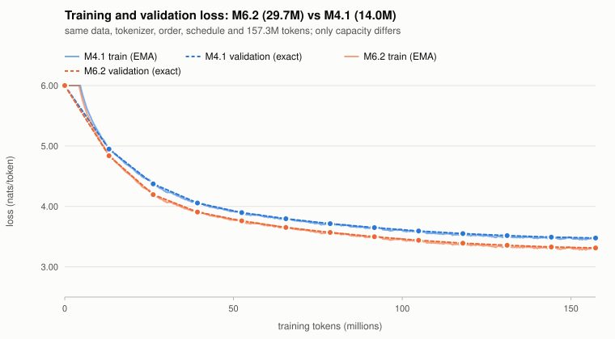
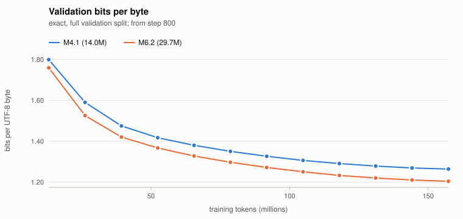
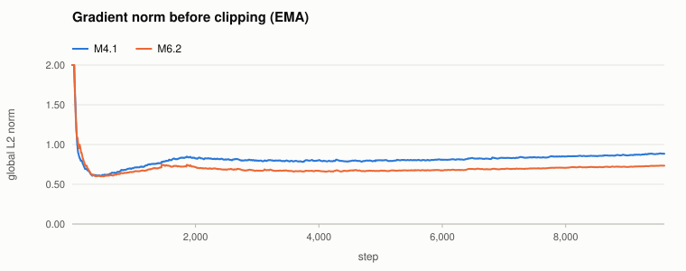
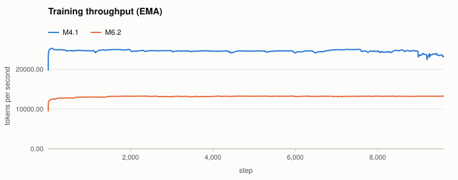
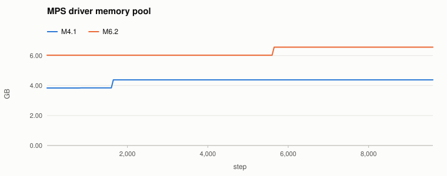

# M6.2 — Scaling general-purpose pretraining (14.0M → 29.7M)

**Status:** complete, stopped for review. Base model only; no SFT; the chatbot still uses M5.
Nothing committed.
**Run:** `runs/m6_2_general_m_bpe8192-20261115-001655` (Git-ignored), config
`configs/m6_2_general_m_bpe8192.toml`.

## Summary

| | M4.1 (baseline) | **M6.2** | change |
|---|---|---|---|
| parameters (non-embedding) | 13,989,888 (10,647,552) | **29,676,544 (25,220,096)** | ×2.12 (×2.37) |
| training tokens (single pass, identical order) | 157,286,400 | 157,286,400 | equal |
| validation loss, exact, best = final | 3.4769 nats/token | **3.3122** | −0.165 (−4.7%) |
| validation bits/byte / perplexity | 1.2641 / 32.4 | **1.2042 / 27.4** | −4.7% / −15% |
| FineWeb-Edu · Cosmopedia · Wikipedia (OOD) bits/byte | 1.335 · 0.993 · 1.660 | **1.278 · 0.928 · 1.592** | −4.3% · −6.6% · −4.1% |
| facts / QA / code multiple-choice (acc_norm) | 22/40 · 12/30 · 7/20 | 23/40 · 13/30 · 9/20 | all n.s. (paired) |
| grammar pairs / greedy code completion | 30/30 · 2/10 | 29/30 · 4/10 | n.s. |
| estimated training compute | 1.43e16 FLOPs | 3.00e16 FLOPs | ×2.09 |
| wall-clock / throughput | 109.9 min / 24.6k tok/s | 205.4 min / 13.2k tok/s | ×1.87 / ×0.54 |
| MPS memory pool (peak) | 4.38 GB | 6.56 GB | +2.2 GB |

**Conclusion:** at equal tokens, doubling capacity gives a consistent, clearly measurable
improvement in language modelling on every held-out set. Benchmark gains are directionally positive
but too small for these suites (20–40 items) to resolve. The 30M model is the better base for M6.3,
at about twice the training cost.

## 1. Architecture and parameter count

The GPT implementation is unchanged: pre-LN, learned absolute positions, GELU MLP (4×), LayerNorm,
bias, tied embeddings and causal SDPA attention. Only depth, width and head count changed.

| | M4.1 | M6.2 |
|---|---|---|
| layers / heads / width / head dim | 6 / 6 / 384 / 64 | **8 / 8 / 512 / 64** |
| context / vocabulary | 512 / 8,192 | 512 / 8,192 |
| token + position embeddings | 3,145,728 + 196,608 | 4,194,304 + 262,144 |
| per layer | 1,774,464 | 3,152,384 |
| **total** | 13,989,888 | **29,676,544** (= analytic count, computed before training) |

## 2. Data and tokenizer: verified identical

`scripts/preflight_m4_1_data.py` was run on the M6.2 config (`m6_2/preflight_data.json`, passed):

| check | result |
|---|---|
| raw files | the same pinned FineWeb-Edu and Cosmopedia v2 files, SHA-256 verified |
| prepared data | the same files (`general_m4_1_bpe`): train SHA `78082023…`, validation `ab385ad6…`, holdout hash verified |
| tokenizer | fingerprint `e6be77cc…`, the same file as M4.1 |
| splits | 0 overlap between train, validation and holdout |
| traversal | single pass; the same permutation (same seed, same stream, same 512-token windows) |
| token budget | 307,200 of 307,208 windows used; 157,286,400 presentations, 0 repeated |

Both models therefore saw *the same tokens in the same order*.

## 3. Training configuration

Identical to M4.1 in every respect except model size:
- AdamW with β 0.9/0.95 and weight decay 0.1 (2-D weights only);
- gradient clip 1.0;
- learning rate warmup 200 steps to 6e-4, cosine to 6e-5 at step 9,600;
- batch 16 × 2 accumulation × 512 = 16,384 tokens per step;
- dropout 0, float32, MPS, seed 1337;
- exact full-split validation every 800 steps, best by exact validation loss.

No hyperparameter was retuned; 6e-4 is the rate M3.3 used for the same 8L/8H/512 shape. Memory
fit without reducing the micro-batch (peak pool 6.56 GB, MPS recommended max 12.7 GB).

**Unavoidable differences:**
- **Initialization:** a different random initialization, because different shapes cannot share
  weights. Both used the same seed and the same GPT-2 scheme.
- **Compute:** 2.09× the FLOPs, because the comparison is equal-token, not equal-compute.

### Preflight (all passed: `m6_2/preflight_model.json`, `preflight_overfit.json`)

| check | result |
|---|---|
| historical checkpoints | load correctly (M2 Shakespeare recomputes 1.4735867 exactly; M3.1, M3.3 and M4.1 give finite batch losses) |
| initialization | loss 9.111 vs ln V = 9.011; all logits and gradients finite and non-zero |
| causality | prefix difference 0.0; SDPA vs explicit attention 3.5e-6 |
| optimizer | covers every parameter once (decay 29,622,272 / no-decay 54,272) |
| stability | 100 steps: 9.12 → 6.69, max gradient norm 1.78 after step 10 |
| single-batch overfit | 4 × 512 real tokens: 9.10 → 0.21 (step 50) → **0.012** (step 150) |
| checkpoint round trip | exact (356 MB) |
| projection | 1.29 s/step, 12.7k tok/s, 207 min + validation; free memory 20% |

## 4. Training curves



| step | tokens | M4.1 validation | **M6.2 validation** | Δ (nats) | M4.1 bits/byte | **M6.2 bits/byte** |
|---|---|---|---|---|---|---|
| 0 | 0 | 9.0883 | 9.1205 | +0.032 | 3.304 | 3.316 |
| 800 | 13.1M | 4.9481 | 4.8375 | −0.111 | 1.799 | 1.759 |
| 1,600 | 26.2M | 4.3730 | 4.1954 | −0.178 | 1.590 | 1.525 |
| 3,200 | 52.4M | 3.8979 | 3.7608 | −0.137 | 1.417 | 1.367 |
| 4,800 | 78.6M | 3.7144 | 3.5686 | −0.146 | 1.351 | 1.297 |
| 6,400 | 104.9M | 3.5930 | 3.4394 | −0.154 | 1.306 | 1.251 |
| 8,000 | 131.1M | 3.5163 | 3.3564 | −0.160 | 1.278 | 1.220 |
| **9,600** | 157.3M | 3.4769 | **3.3122** | **−0.165** | 1.264 | **1.204** |



- **Every evaluation was a new best for both models.** Neither had converged; the larger model
  benefits more from each token.
- **The gap widens late** (−0.137 at 52M tokens → −0.165 at 157M), so the larger model's advantage
  grows with data.
- **Train–validation gap:** +0.051 at the end vs about +0.05 for M4.1. With single-pass data this
  reflects the validation set's source mix, not overfitting.
- **Stability:** clipping fired on 0.04% of post-warmup steps (max norm 2.38), with no NaN/Inf. Best
  checkpoint = final checkpoint (step 9,600, identical weights).

  

## 5. Validation and held-out results

These are the same 400-document samples M4.1 was evaluated on, scored by the same code in the same
session. The deterministic sections reproduced exactly on a repeat run.

| bits per byte | M4.1 | **M6.2** | relative |
|---|---|---|---|
| FineWeb-Edu validation | 1.3349 | **1.2783** | −4.2% |
| FineWeb-Edu holdout (never used for selection) | 1.3444 | **1.2877** | −4.2% |
| Cosmopedia v2 validation | 0.9930 | **0.9276** | −6.6% |
| Cosmopedia v2 holdout | 0.9942 | **0.9299** | −6.5% |
| Wikipedia EN (out of domain) | 1.6598 | **1.5922** | −4.1% |
| TinyStories V2 (out of domain) | 1.1692 | **1.1047** | −5.5% |

Validation and holdout agree to within 0.01, and the gain transfers to both out-of-domain sources.

## 6. Factual, grammar, code and generation evaluation (frozen `general_v1`)

| section | M4.1 | M6.2 | paired McNemar (M4.1-only vs M6.2-only correct) |
|---|---|---|---|
| facts MC (40, chance 25%) | 22 (55%) | 23 (58%) [42, 71] | 1 vs 2, p = 1.0 |
| QA MC (30) | 12 | 13 | 0 vs 1, p = 1.0 |
| code MC (20) | 7 | 9 | 1 vs 3, p = 0.63 |
| grammar pairs (30) | 30 | 29 | 1 vs 0, p = 1.0 |
| greedy code completion (10) | 2 | 4 | 1 vs 3, p = 0.63 |

None of the multiple-choice or code differences is statistically meaningful. The suite was sized
for a 14M-vs-baseline contrast, not for detecting a 5% loss improvement. Facts remain at about 55%,
so the larger base model still knows little.

| free generation (3 seeds, T 0.7, top-k 40, 200 tokens) | M4.1 | M6.2 |
|---|---|---|
| continuation: share > 30% repeated 4-grams / mean fraction | 63% / 0.37 | **38% / 0.32** |
| explanations ("Question: … Answer:") | 89% / 0.61 | 94% / 0.66 |
| repetition stress | 63% / 0.47 | 67% / 0.56 |
| ended on its own (`<|endoftext|>`) | 0% | 3% of continuations |

Continuations loop less, but the question/answer format still collapses into loops ("Answer: …
Answer: …"). As established in M5, that is fixed by SFT and decoding, not by base-model scale.

**Memorization:** none. No sample of either model contains a 32- or 48-token span of `train.bin`
(16-gram overlap 0.02% for both).

### Generated samples (unedited)

Selected by rule by `scripts/m6_2_samples.py`: per section the least, median and most repetitive
seed-11 sample, plus the first five continuation prompts side by side. All samples are in
[`m6_2/samples.md`](m6_2/samples.md). Remember this is a **base model**: it continues documents and
has not been taught to answer or stop.

#### M6.2, continuation

*least repetitive*: **cont04** (seed 11, repeated 4-gram fraction 0.03, ended with end-of-text: False)

Prompt:

````text
One of the most important ideas in mathematics is
````

Continuation:

````text
 the ability to explain and write the answers. By reading these examples, we can develop a better understanding of the subject and make sure that a great introduction to a problem has a long and complex understanding of the way it is taught.

Let's start by reading another example. Imagine you're playing a game of game, but it's just a game of game you want to share. You try to figure out what is best for you, where the players go. You then choose the players and then decide what to do next. You can then choose the player's game based on the game's strengths and weaknesses.

Now, let's explore how to use the game's strengths to solve problems. Have you ever wondered why it's important to learn how to solve math problems? Maybe you've noticed that if you don't understand the concept of a problem, then you can start using it to solve a problem. That's kind of like a game of game where players take
````

*median*: **cont06** (seed 11, repeated 4-gram fraction 0.30, ended with end-of-text: False)

Prompt:

````text
Volcanoes form when
````

Continuation:

````text
 a person produces a red blood cell, a small amount of blood in the blood that is made up of the blood.
Habitans must be taken to protect themselves from the damage to the blood, and the cells that can cause blood clots that can cause the blood to block blood.
To prevent the blood clots, a person will need to take a small amount of blood in a large quantity of blood that does not cause the blood clots.
Heart cells, which are caused by the blood of the blood, can cause blood clots that are blocked by the blood that is made up of the blood.
A blood clot called blood clot is a blood clot that can cause blood clots to block blood clots that can cause blood clots.
The blood clot is used to prevent the blood clots from entering the blood that is made up of a small amount of blood that can cause blood clots.
The blood
````

*most repetitive*: **cont05** (seed 11, repeated 4-gram fraction 0.90, ended with end-of-text: False)

Prompt:

````text
The city council met on Tuesday to discuss
````

Continuation:

````text
 the following topics:
- The National Park Service and the National Park Service (NHP)
- The National Park Service and the National Station Museum (NHP)
- The National Park Service and the National Park Service (NHP)
- The National Park Service and the National Park Service (NHP)
- The National Park Service and the National Park Service (NHP)
- The National Park Service and the National Park Service (NHP)
- The National Park Service and the National Park Service (NHP)
- The National Park Service (NHP)
- The National Park Service
- The National Park Service (NHP)
- The National Park Service and the National Park Service (NHP)
- The National Park Service (NHP)
- The National Park Service (NHP)
- The National Park Service and its National Park Service (NHP)

````


#### M6.2, explanations

*least repetitive*: **expl03** (seed 11, repeated 4-gram fraction 0.09, ended with end-of-text: False)

Prompt:

````text
Question: How do plants get the energy they need?
Answer:
````

Continuation:

````text
 How can plants grow?
Similarly: How can they grow?
Answer: When plants grow well in the air, they are most likely to live long enough to feed in a cool, darker environment than they grow well in the air.
Endly: In a small garden, the plant will begin growing in a warm, warm way, and when the sun is sunny, it will produce an interesting and dense plant.
Growth: What can plants grow?
Identification: Growth is the process of growing and growth. It is the process of growing and growing.
Back to the soil, the soil will thrive in the winter, but it is important to keep the plant warm in the spring, and the soil is in the spring.
Answer: If the plants’ plants are going to grow well in winter, the plant will grow well in its roots, and the soil will grow well and
````

*median*: **expl08** (seed 11, repeated 4-gram fraction 0.59, ended with end-of-text: False)

Prompt:

````text
Question: How does a vaccine protect people from a disease?
Answer:
````

Continuation:

````text
 How can a vaccine protect people from a virus?
Answer: What if a vaccine is used to protect people from a virus?
Answer: How can a vaccine protect people from a virus?
Answer: Can a vaccine protect people against a virus?
Answer: What is a vaccine?
Answer: What is a specific virus that can infect a person of the country?
Answer: How do you know what is a vaccine?
Answer: What do you know when a vaccine is used to prevent a virus?
Answer: What does a vaccine work?
Answer: What are you going to get to know?
Answer: What is a vaccine?
Answer: What are the reasons for the vaccine?
Answer: What are you going to get to know?
Answer: How
````

*most repetitive*: **expl05** (seed 11, repeated 4-gram fraction 0.94, ended with end-of-text: False)

Prompt:

````text
Question: What causes ocean tides?
Answer:
````

Continuation:

````text
 What causes ocean tides?
Answer: Absorbate stormwater runoff.
Answer: Absorbate stormwater runoff.
Answer: Absorbate stormwater runoff.
Answer: Absorbate stormwater runoff.
Answer: Absorbate stormwater runoff.
Answer: Absorbate stormwater runoff.
Answer: Absorbate stormwater runoff.
Answer: Absorbate stormwater runoff.
Answer: Absorbate stormwater runoff.
Answer: Absorbate stormwater runoff.
Answer: Absorbate stormwater runoff.
Answer: Absorbate stormwater runoff.
Answer: Absorbate stormwater runoff
````


#### M6.2, repetition_stress

*least repetitive*: **rep08** (seed 11, repeated 4-gram fraction 0.06, ended with end-of-text: False)

Prompt:

````text
<|endoftext|>
````

Continuation:

````text
Chapter 11: Understanding Human Genetics through a Focus on Religion and Polycyclopedia

I. Introduction

As we explore the world of religion and spirituality in ancient Israel, it becomes increasingly important for us to understand the various ways that people thought about God. One such belief is the belief in God, which is an ancient belief that emphasizes the idea of God. This belief is called "self-eligibility." In this chapter, we will explore these ideas and how they can be translated into their own unique way of life.

II. Understanding Human Genesis

Before discussing the Bible, it is essential to understand the concept of human Genesis. As mentioned earlier, it is essential to understand the spiritual aspects of the divine. One way to understand this basic concept is through a lens called "nation," which refers to the belief in God's existence. By studying these teachings, we can understand the human brain and its connection
````

*median*: **rep01** (seed 11, repeated 4-gram fraction 0.67, ended with end-of-text: False)

Prompt:

````text
Here is a list of animals: cat, dog,
````

Continuation:

````text
 cock, ducks, jamma and lions.
In the wild, a bisonous bird is a great pair. In the wild, a cat is very happy to see a baby. The birds are also very happy to see a bird.
But, a new bird is a very happy bird. The bird is very happy to see a bird. The bird is full of surprised and is a natural bird.
What is a bird?
A bird is a very friendly bird. It is a bird. It is a bird.
A bird is a very friendly bird. It is a bird. It is a bird. It is a bird that is a bird. It is a bird.
A bird is a bird. It is a bird. It is a bird. It is a bird that is a bird. It is a bird that is a bird. It is a bird. It is a bird that is a bird.
What is a
````

*most repetitive*: **rep05** (seed 11, repeated 4-gram fraction 1.00, ended with end-of-text: False)

Prompt:

````text
Thank you. Thank you. Thank you.
````

Continuation:

````text
 Thank you. Thank you. Thank you. Thank you. Thank you. Thank you. Thank you. Thank you. Thank you. Thank you. Thank you. Thank you. Thank you. Thank you. Thank you. Thank you. Thank you. Thank you. Thank you. Thank you. Thank you. Thank you. Thank you. Thank you. Thank you. Thank you. Thank you. Thank you. Thank you. Thank you. Thank you. Thank you. Thank you. Thank you. Thank you. Thank you. Thank you. Thank you. Thank you. Thank you. Thank you. Thank you. Thank you. Thank you. Thank you. Thank you. Thank you. Thank you. Thank you. Thank you.
````


#### Side by side: first five continuation prompts (seed 11)

**cont01**: prompt `The history of the printing press begins`

*M4.1:*

````text
 on May 17, and the subsequent generation of the printing press began in 1958. In the late 1960s, the printing press began on at the stage of Bell Kent Gallery, and later on. In 1960, the printing press began on the front lines and was replaced by the printing press. Then, the printing press began to be added to the printing press. It was also edited by the printing press, where the printing press began to be used for the printing press. The printing press became the first editable press. The printing press began until 1950.
At the same time, printing press ended with the printing press. This was the first printing press in 1972, and it was now the first printing press. The printing press had been transformed into a very small part of the printing press. This opened its first printing press. The printing press was transferred to the printing press, and the printing press had been replaced by printing.
The printing
````

*M6.2:*

````text
 with an invocations that employs a single word “multiplication” to describe the shape of the word being used to describe it as a form of the word.
The word “multiplication” also has a “multiplication” which is used to describe a word being used to describe it as a form of the word.
The word “multiplication” is used to describe the word being used to describe a word.
The word “multiplication” is used to describe a word being used to describe a word as a form of the word being used to describe a word.
The word “multiplication” was used to describe a word being used by the word being used to describe a word, which is used to describe a word being used to describe a word being used to describe a word being used to describe a word, which is a form of the word being used to describe a word.
The word
````

**cont02**: prompt `Photosynthesis is the process`

*M4.1:*

````text
 of being made from the brain of the brain. It is used in the form of the brain that the brain is doing.
The brain is a part of the brain that is done in the brain and is also used in the form of the brain.
The brain is used to explain what the brain is being used to make it.
The brain is a part of the brain that is being used to describe the brain. It does not work for a certain form of consciousness.
The brain is a part of the brain.
The brain is a part of the brain called the brain. It is the part of the brain.
The brain is a part of the brain that changes the brain.
The brain is a part of the brain and it is a part of the brain.
The brain is a part of the brain that can produce something new, or even a part of the brain.
The brain is a part of the brain.
The brain is a part of
````

*M6.2:*

````text
 of being able to reduce the amount of energy it is coming from the body. The process of a process of a process is called a ‘magnetic energy’, which is the energy that is in the brain. The cells in the brain are called neurotransmitters, which are called neurons.
The brain has its own state of energy. The brain is called the brain. It is also called the brain. It does the brain. When the brain is called the brain, the brain does the brain, the brain gets its energy.
When the brain happens to the brain, the brain reaches the brain and changes its energy (called a brain). The brain is called the brain. The brain is called the brain, which is called the brain.
The brain is called the brain, which is the brain. The brain is called the brain, which is called the brain. The brain is called the brain. The brain is called the brain.
The brain is called
````

**cont03**: prompt `In the morning, the market was already busy`

*M4.1:*

````text
. There were no cars that had been built in the night. But after that, I realized that the car was still in the middle of the night sky. It was a long time in the morning of the night sky. In the winter of the night sky, the weather would be just as long as the night sky. Then it is a time for the day sky sky, the sun would be a light that would be a long time for the night sky.
In the night sky, I was looking for a few minutes of a day. The sun was a taller than the night sky. It was a long time for the night sky, and the sky would be a long time for the night sky sky.
In the night sky sky, it was a time for the night sky sky sky, and it was a day for the night sky sky.
It was a time for the night sky sky sky sky, and the moon sky sky, and the night sky sky sky sky
````

*M6.2:*

````text
 growing, with no new ideas, and some people might find it hard to keep track of it. But before the day came the price of the food was set, the food was scarce.
The food was then sourced.
The food was then sourced and the food was then sourced.
The food was then sourced and the food was sourced. The food is then sourced and the food was sourced.
The food was then sourced and the food was then sourced.
The food was sourced. The food was sourced and the food was sourced.
The food was sourced.
The food was sourced and the food was sourced.
The food was sourced and the food was sourced.
The food was sourced and the food was sourced.
The food is sourced.
The food
````

**cont04**: prompt `One of the most important ideas in mathematics is`

*M4.1:*

````text
 the ability to explain the structure of the puzzle and solve problems in relation to the problem of a problem. By doing so, you will have a good understanding of how to solve problems in order to solve problems. The problem is also important in understanding the structure of the puzzle and how to solve problems.
What are the problems?
The problem is to know how to solve problems. It is also important in building a good understanding of how to solve problems.
Give the solution to solve problems, you know what you need to solve.
When you start learning how to solve problems, you learn how to solve problems.
The solution you can use to solve problems in order to solve problems.
One of the most important problems is learning how to solve problems, which is a way to solve problems.
The solution you have to solve problems.
What is the problem?
The problem is the problem you must have to solve problems.
It is a way to solve
````

*M6.2:*

````text
 the ability to explain and write the answers. By reading these examples, we can develop a better understanding of the subject and make sure that a great introduction to a problem has a long and complex understanding of the way it is taught.

Let's start by reading another example. Imagine you're playing a game of game, but it's just a game of game you want to share. You try to figure out what is best for you, where the players go. You then choose the players and then decide what to do next. You can then choose the player's game based on the game's strengths and weaknesses.

Now, let's explore how to use the game's strengths to solve problems. Have you ever wondered why it's important to learn how to solve math problems? Maybe you've noticed that if you don't understand the concept of a problem, then you can start using it to solve a problem. That's kind of like a game of game where players take
````

**cont05**: prompt `The city council met on Tuesday to discuss`

*M4.1:*

````text
 the following topics from the city council. By the end of the day, the city council began to use the city council to provide a place to meet the city council.
The city council continued to teach the city council’s city council, while the city council took place to give the city council’s time to meet the city council.
The city council is a group of the city council’s members. The city council was called the city council.
The city council was founded on Tuesday to visit the city council, while the city council also has a large collection of the city council.
The city council was called the city council.
The city council was called the city council.
The city council can be called the city council.
The city council is called the city council.
The city council is called the city coun
````

*M6.2:*

````text
 the following topics:
- The National Park Service and the National Park Service (NHP)
- The National Park Service and the National Station Museum (NHP)
- The National Park Service and the National Park Service (NHP)
- The National Park Service and the National Park Service (NHP)
- The National Park Service and the National Park Service (NHP)
- The National Park Service and the National Park Service (NHP)
- The National Park Service and the National Park Service (NHP)
- The National Park Service (NHP)
- The National Park Service
- The National Park Service (NHP)
- The National Park Service and the National Park Service (NHP)
- The National Park Service (NHP)
- The National Park Service (NHP)
- The National Park Service and its National Park Service (NHP)

````

## 7. Compute and memory analysis

| | M4.1 | M6.2 | ratio |
|---|---|---|---|
| parameters | 13.99M | 29.68M | 2.12 |
| FLOPs per token (6N + 6·L·T·C) | 91.0M | 190.6M | 2.09 |
| total training FLOPs | 1.43e16 | 3.00e16 | 2.09 |
| wall-clock (steps + 13 validation passes) | 109.9 min | 205.4 min | 1.87 |
| median step / throughput | 0.664 s / 24.6k tok/s | 1.241 s / 13.2k tok/s | 1.87 / 0.54 |
| sustained compute | ≈ 2.2 TFLOP/s | ≈ 2.4 TFLOP/s | 1.12 |
| MPS pool / live tensors after forward / process RSS | 4.38 / 2.60 / 0.90 GB | 6.56 / 4.27 / 0.96 GB | — |
| checkpoint (with optimizer) | 168 MB | 356 MB | 2.12 |

The three questions this experiment can and cannot answer:
- **Equal-token quality:** M6.2 is better, by −0.165 nats (−4.7% bits/byte) on the same 157.3M
  tokens, with consistent gains on all six held-out sets.
- **Relative compute cost:** ×2.09 FLOPs and ×1.87 wall-clock. The larger matrices use the GPU
  slightly more efficiently (2.4 vs 2.2 TFLOP/s).
- **Compute efficiency is not established.** M6.2 crosses M4.1's *final* loss at about 96M tokens
  (about 1.8e16 FLOPs, more than M4.1's 1.43e16). At M4.1's compute (about step 4,580) its
  validation loss was about 3.59, but that checkpoint sits mid-schedule, before the learning-rate
  decay. A fair equal-compute comparison needs a separate run with its own full schedule. Two runs
  cannot establish compute-optimal sizing. Both models are far below 20 tokens per parameter (M6.2:
  5.3), so more data would likely help both.
- **Capability:** better language modelling and slightly fewer loops. No measurable change in
  facts, QA or grammar at this suite size. Whether this translates into better chat answers is the
  question for M6.3.

## 8. Limitations

- **One run per size, one seed.** The loss gap (0.165 nats, consistent at every evaluation) is far
  larger than run-to-run noise seen earlier (M2.1: about 0.002–0.02). The benchmark differences are
  not.
- **Benchmark suites are small.** Wilson intervals are ±14–16 points, and paired tests have very few
  discordant items.
- **Under-training.** 5.3 tokens per parameter for M6.2; neither run converged.
- **The data is the M4.1 corpus**, with its limits (one FineWeb-Edu shard from six crawl dumps, a
  25% Cosmopedia pool).
- **Equal-token comparison only;** M6.2 used 2.09× the compute.

## 9. Recommendation for M6.3 (conversational training)

1. **Fine-tune M6.2 with the M5 SFT recipe, unchanged:**
   - initialize from `runs/m6_2_general_m_bpe8192-20261115-001655/checkpoints/step_00009600.pt`;
   - same data (`chat_m5`) and format;
   - fresh AdamW, learning rate 1e-4 with cosine, batch 16, 3 epochs, the same memory settings.

   Expect about 15–20 minutes, given SFT ran 8 min at 14M and this model is about 1.9× slower.
2. **Pre-register the comparison:** M5 vs M6.3 on `chat_v1` and `chat_diag_v1`, with the same seeds,
   default decoding and paired tests, plus `general_v1` for forgetting.
3. **Pre-register the deployment rule:** replace M5 only if M6.3 is significantly better on content
   (`both_ok`) with no significant regression in termination or repetition, confirmed by reading the
   outputs (M6.1 showed that string checks overcount).
4. **Keep it one variable.** Leave the length cap and pretraining-data mixing for later, separate
   runs.
5. **Set expectations honestly.** The base model's factual multiple-choice score did not move
   measurably, so the most likely gains are fluency and coherence, not correct facts.
