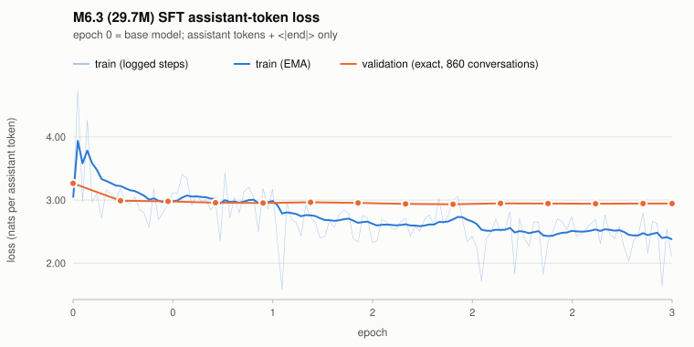
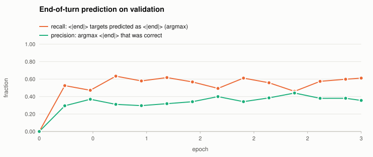

# M6.3 — Conversational fine-tuning of the 29.7M model

**Status:** complete, stopped for review. **Decision: M5 stays the default chatbot**, as the
pre-registered rules require. M6.3 is kept as a research artifact. Nothing committed; the served
checkpoint is unchanged.

**In one paragraph.** Doubling capacity improved language modelling in M6.2. After the identical M5
fine-tuning, the 29.7M model also has:
- lower assistant-token validation loss (2.932 vs 3.085);
- better general-text retention (FineWeb-Edu 1.400 vs 1.477 bits/byte);
- slightly more reliable stopping (97.8% vs 95.2%).

It did **not** answer questions, follow instructions, track names or handle multi-turn context
measurably better. On 75 pre-registered items the strict success rate moved from 18.2% to 21.3%
(+3.1 points; 95% CI −2.2 to +8.9; sign test p = 0.72). A blind review of 20 matched pairs found
**one correct reply per model**: both said "The sky on a clear day is blue." At this scale and data
budget, the bottleneck is knowledge, which neither 2× capacity nor fine-tuning supplies.

## 1. Design

| | M5 (incumbent, served) | **M6.3 (candidate)** |
|---|---|---|
| base model | M4.1, 13,989,888 params | M6.2, **29,676,544** params |
| base checkpoint SHA-256 | `fb21b80a…` | `5312a613…` (verified; validation loss recomputed exactly as 3.3121985) |
| SFT recipe | M5 | **identical**: same 16,813 conversations and splits, serialization, assistant-only mask, AdamW (0.9/0.95, wd 0.1), lr 1e-4 warmup 100 cosine to 1e-5, batch 16, 3 epochs, clip 1.0, seed 1337, fresh optimizer |
| checkpoint evaluated | `best.pt` (SHA `f31594e2…`) | `best.pt` (SHA `088803ad…`, step 2,000) |

**Pre-registration.** `m6_3/preregistration.md` (SHA `563dd005…`) was written before training
and before any M6.3 output. It fixes:
- the metrics;
- the prompt as the unit of analysis: each item's score is the mean of its 3 seeds;
- paired bootstrap intervals and sign tests;
- the blind-review procedure;
- the promotion rule.

One recipe deviation, a memory setting only, is recorded in `m6_3/preregistration_addendum.md`
(see §3).

## 2. Training

| | M5 | M6.3 (attempt 2) |
|---|---|---|
| steps / epochs | 3,153 / 3 | 3,153 / 3 |
| wall-clock | 8.0 min | **17.3 min** |
| median step / real tokens per second | 0.167 s / 16.9k | 0.274 s / 9.7k |
| best step / validation loss (M5 split, 860 conversations) | 2,750 / 3.085 | **2,000 / 2.932** |
| final validation loss | 3.086 | 2.944 |
| base model's assistant loss before SFT | 3.438 | 3.264 |
| gradient clipping | every step after warmup | every step after warmup (median norm 2.2) |



| step | epoch | validation | ppl | `<|end|>` recall |
|---|---|---|---|---|
| 0 (M6.2 base) | 0 | 3.2643 | 26.2 | 0.00 |
| 250 | 0.24 | 2.9894 | 19.9 | 0.53 |
| 1,000 | 0.95 | 2.9531 | 19.2 | 0.58 |
| **2,000** | 1.90 | **2.9323** | **18.8** | 0.61 |
| 3,153 | 3.00 | 2.9442 | 19.0 | 0.61 |

The larger model reaches a lower loss at every point and starts overfitting slightly in epoch 3,
as M5 did. Best-checkpoint selection took step 2,000.



## 3. Engineering challenge: MPS memory at 2× model size

- **Preflight.** The memory soak failed its own 10 GB threshold (10.9 GB), but that process also
  held the earlier overfit trainer. A fresh-process measurement of the real configuration peaked at
  8.9 GB, so training proceeded with M5's safeguards unchanged (`m6_3/memory_check.json`).
- **Attempt 1 stopped itself at step 2,224 of 3,153.** The guard tripped when the pool reached
  11.0 GB. With the cache released every 25 steps, several 16 × 512 batches inside one window could
  accumulate past 10 GB. The guard worked as designed: no swapping, no corrupted state.
  - The run is kept as `runs/m6_3_sft_30m-20261114-234714_attempt1_guard_abort`, with a NOTE.
- **Rerun, with your approval.** It releases the cache **every step**. Measured over 800 fresh
  steps: peak 8.66 GB, about 4% slower. The training maths is unchanged: attempt 2 reproduced
  attempt 1's validation losses to 4 decimals through step 750.
  - Attempt 2 completed with the logged pool at most 5.5 GB. No NaN, no guard trip.

Lesson for future work: on unified memory, the MPS allocator's cache grows with the *variety* of
tensor shapes, not just their size. Shape bucketing plus frequent `empty_cache()` keeps
variable-length fine-tuning safe on a 16 GB machine.

## 4. Matched evaluation (pre-registered)

Both models were re-generated in the same session with the production decoding: temperature 0.7,
top-k 40, repetition penalty 1.2, 200 tokens, seeds 11/22/33. Prompts were chat_v1 (40) and
chat_diag_v1 (50), giving 270 replies each.

### Content: strict success, prompt as the unit

| group | items | M5 | M6.3 | Δ | 95% bootstrap CI | items better / worse | sign test p |
|---|---|---|---|---|---|---|---|
| **primary (all checked)** | 75 | 18.2% | 21.3% | +3.1 | [−2.2, +8.9] | 17 / 14 | 0.72 |
| factual | 27 | 12.3% | 13.6% | +1.2 | [−6.2, +9.9] | 4 / 4 | 1.00 |
| instruction following | 22 | 16.7% | 18.2% | +1.5 | [−9.1, +12.1] | 5 / 5 | 1.00 |
| entity / names | 10 | 23.3% | 40.0% | +16.7 | [−3.3, +36.7] | 5 / 2 | 0.45 |
| multi-turn | 16 | 27.1% | 27.1% | 0.0 | [−10.4, +10.4] | 3 / 3 | 1.00 |

The entity difference is the only one with a visible size, and it rests on 10 items with an
interval that crosses zero. In the blind review, the entity replies remained wrong
(§5: "Priya is a name of the Priya word…").

### Behaviour, retention and latency

| | M5 | M6.3 |
|---|---|---|
| natural end-of-turn (270 replies; per-item paired p = 0.27) | 95.2% | 97.8% |
| repetitive replies (> 30% repeated 4-grams) | 1.9% | 2.6% |
| median reply length | 30.5 words | 25.5 words |
| mean / median latency per reply (MPS, same session) | 146 / 81 ms | 160 / 99 ms |
| empty replies / structural-token stops | 0 / 0 | 0 / 0 |
| FineWeb-Edu · Cosmopedia · Wikipedia · TinyStories held-out bits/byte | 1.477 · 1.149 · 1.779 · 1.238 | **1.400 · 1.068 · 1.693 · 1.158** |
| general_v1: facts / QA / code MC / grammar / code completion | 20 · 15 · 6 · 29 · 5 | 23 · 11 · 8 · 29 · 6 |
| general_v1 chat section: format / content / both (12) | 6 / 4 / 2 | 7 / 3 / 3 |

**Retention** is the clearest gain. After SFT the 29.7M model keeps much more general-text ability:
FineWeb-Edu 1.400, against M6.2's own pre-SFT 1.278 and M5's 1.477.

## 5. Blind review (20 fixed items, seed 11)

The reviewer saw an anonymized packet with A/B order randomized (seed 2026), and graded it
(`m6_3/blind_grades.json`, SHA `e53043f0…`) before the key was opened.

| | correct / useful | fluent but wrong | malformed | preferred |
|---|---|---|---|---|
| M5 | 1 | 11 | 8 | 0 |
| M6.3 | 1 | 14 | 5 | 2 |
| ties | | | | 18 |

What the reading shows:
- **More fluent, not more correct.** M6.3 has fewer malformed replies (5 vs 8): its errors are more
  often grammatical sentences. Fluent but wrong answers count as failures.
- **Both preferences went to M6.3**, each for a *less wrong* answer, not a correct one.
  - Item 09: "The answer to this question is yes.", which ignores "answer only yes or no".
  - Item 14: "Luna is a well-known cat. Luna is an old dog…"
- **The same characteristic failures appear in both models:** restating the question, copying the
  previous answer, and naming the wrong entity.

### Matched transcripts (unedited; all 20 in [`m6_3/transcripts.md`](m6_3/transcripts.md))

| prompt | M5 (14.0M) | M6.3 (29.7M) |
|---|---|---|
| What is the largest planet in our solar system? | The largest planet in our solar system is Mercury | The largest planet in our solar system is known as the Moon orbit. |
| How many days are there in a week? | The following are 6 days in a week. | The following are 3 days in a week. |
| What is the capital of France? | The capital of France is Vienna. | The capital of France is Sir Arthur and |
| What color is the sky on a clear day? | The sky on a clear day is blue. | The sky on a clear day is blue. |
| Is fire hot? Answer only yes or no. | The following are no, unseen. | The answer to this question is yes. |
| Is ice hot? Answer only yes or no. | The answer to this question is not clear. … *(truncated at 200 tokens)* | Yes, ice is hot. |
| *(Priya)* What is my name? | Priya is a French country, known for its distinctive style of language and culture. … | Priya is a name of the Priya word "Jewish" I'm Duty. |
| *(cat named Luna)* What is my cat's name? | Luna is a dog. Luna is typically considered as a pet … | Luna is a well-known cat. Luna is an old dog who specializes in the family of cats … |
| *(sister Ana, brother Leo)* What is my brother's name? | The name "Ana" is a word used for wording from the word "le." … | The name "Ana" is a word used for word recognition in German. … |
| *(Japan → Tokyo)* And what is the capital of Italy? | The capital of Japan is Tokyo. | The capital of Japan is Tokyo. |
| *(3 + 4 = 7)* What is 3 plus 5? | The following are 3 plus 4, 5 and 6. | The 3 plus 5 is 7. |
| *(banana is yellow)* Now tell me a fruit that is red. | Here is a fruit that is red, some people might think they are green. | The fruit that is red is yellow. |
| *(dogs)* Actually, tell me about cats instead. | The dogs are wild animals, but also known as dogs. … | Dogs are loyal, but some can be loyal or helpful. … |
| What is the chemical symbol for water? | The chemical symbol for water is the symbol for how well these symbol be. | The chemical symbol for water is the amount of energy and energy used in water. … |
| Who wrote the play Romeo and Juliet? | The play Romeo was the last two. | The play Romeo was popularized by Mario Brown |
| How many hours are in a day? | Overall, no hours are in a day. If you are in aday day, … | The following are 6 hours of the day: - Bad breath … |

## 6. Promotion decision

| pre-registered rule | result | pass |
|---|---|---|
| 1. Credible: Δ > 0, CI lower bound > 0, sign p < 0.05 | +3.1 pts, CI [−2.2, +8.9], p = 0.72 | ✗ |
| 2. Meaningful: ≥ +5 points | +3.1 | ✗ |
| 3. Blind review: more correct and more preferred | correct 1 vs 1; preferred 2 vs 0 | ✗ |
| 4a. End-of-turn ≥ 95% and ≥ M5 − 2 | 97.8% | ✓ |
| 4b. Repetition ≤ 5% | 2.6% | ✓ |
| 4c. Latency ≤ 2× mean, median < 1 s | 160 ms (1.09×), 99 ms | ✓ |
| 4d. Retention: FineWeb-Edu bits/byte ≤ M5 + 0.02 | 1.400 vs 1.477 | ✓ |
| stability: no crash / NaN / guard abort (completed run) | attempt 2 clean; attempt 1 aborted safely and was rerun with approval | ✓ |

**M5 remains the default.** M6.3 is safe to serve: it passes every regression rule and works with
the existing API. It is simply not measurably better at the things a user notices, namely correct
answers.

**To try M6.3 manually** (it is not the default, and nothing is changed):

```bash
.venv/bin/python scripts/serve_chat.py --checkpoint runs/m6_3_sft_30m-20261115-001347/checkpoints/best.pt
```

The frontend needs no change: the API, tokenizer and special tokens are identical.

## 7. Memory and inference

| | M5 | M6.3 |
|---|---|---|
| parameters / checkpoint size | 14.0M / 168 MB | 29.7M / 356 MB |
| SFT MPS pool (logged peak) | 6.5 GB (cache release every 25 steps) | 5.5 GB logged; 8.7 GB transient peak measured (release every step) |
| inference latency, mean / median | 146 / 81 ms | 160 / 99 ms |

## 8. What this demonstrates (draft for the portfolio)

> We scaled our from-scratch GPT from 14M to 30M parameters and repeated the same supervised
> chat fine-tuning under a pre-registered, blind, paired evaluation. The larger model is
> measurably better at modelling language: 4–7% fewer bits per byte on held-out text, lower
> fine-tuning loss, and better retention after fine-tuning. It also stops more reliably. It is not
> measurably better at answering questions correctly: 21% vs 18% strict success on 75 items (not
> significant), and one correct reply each in a 20-item blind review. We therefore kept the smaller
> model in production. The experiment shows a lesson that small models teach clearly: fluency and
> format arrive before knowledge, and lower loss is not the same as a more useful assistant. It
> also shows the engineering discipline used throughout the project: fixed data, pre-registered
> rules, paired statistics, blind review, and documented failures, including a memory-guard abort
> on a 16 GB Mac and how it was fixed.

## 9. Limitations

- **Small suites.** 75 checked items and a 20-item blind review by a single rater (Claude, with
  procedural blinding). Effects smaller than about 8 points cannot be detected.
- **One seed per training run.** Attempt 2 and attempt 1 agree to 4 decimals early on, but there
  are no repeated-seed runs.
- **Decoding** was fixed at M5's tuned defaults, which may be slightly suboptimal for the larger
  model. This was deliberate.
- **Data is unchanged**, so both models face the same knowledge ceiling (157M pretraining tokens).

## 10. Recommendation

Proceed to **M7 (portfolio showcase) with M5 as the served model**. Present M6.2 and M6.3 as the
scaling study: better language modelling, the same practical quality. Deeper improvements, such as
much more pretraining data, larger models, or preference tuning, belong to a future version.
