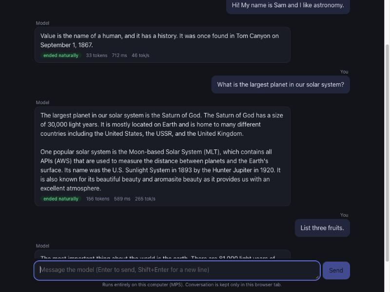
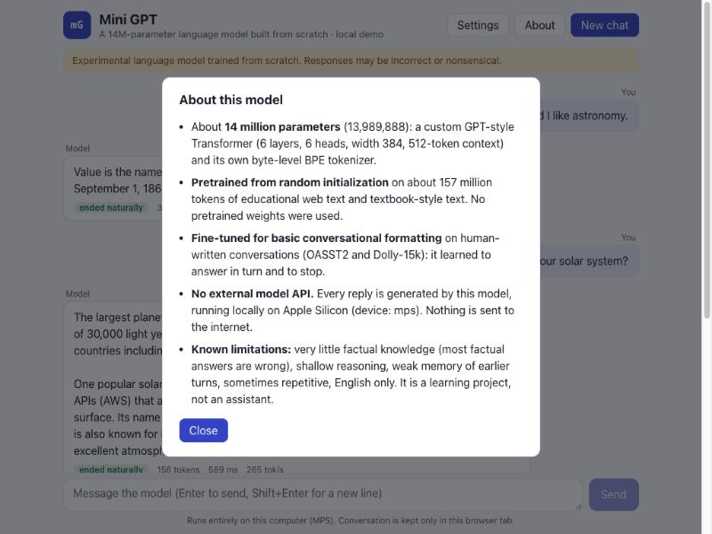
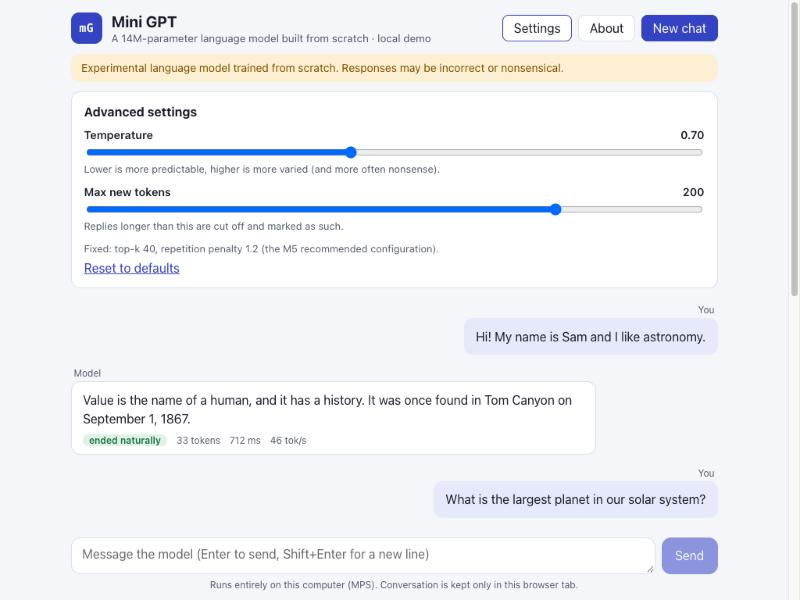
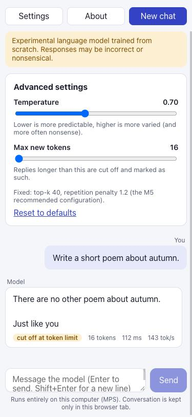
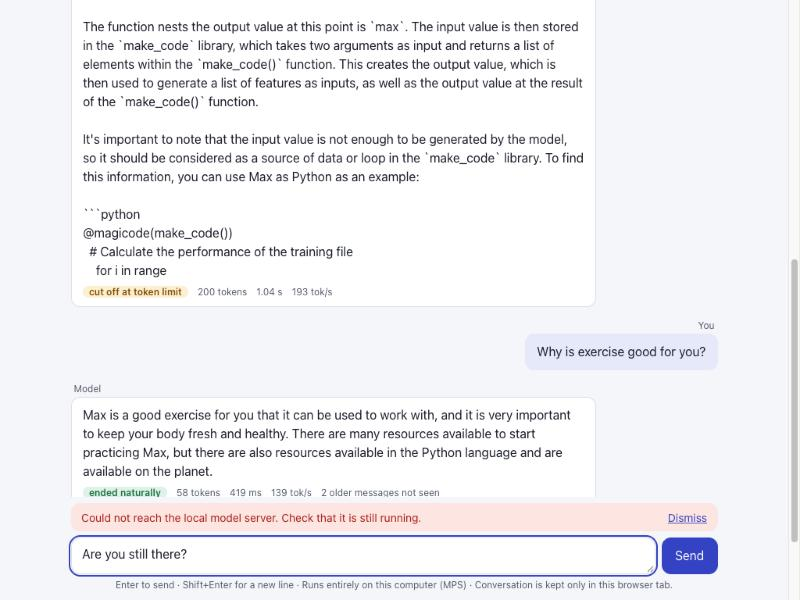

# M6 — Local chatbot demo

**Status:** complete, stopped for review. No training was run; nothing is committed.
**What it is:** a local web application for chatting with the M5 model. A small Python inference
service runs the checkpoint on this Mac, and a React + TypeScript page talks only to that service.
No external AI API, retrieval, tools or cloud inference is involved.



## 1. Launch

```bash
# one-time setup (Python 3.11+, Node 18+)
uv pip install --python .venv/bin/python -e ".[serve]"     # FastAPI, uvicorn, httpx
npm --prefix apps/chat-web install
npm --prefix apps/chat-web run build

# run the demo
.venv/bin/python scripts/serve_chat.py
# open http://127.0.0.1:8000
```

The server needs the M5 checkpoint at `runs/m5_sft_chat-20261114-175334/checkpoints/best.pt` (with
the run's `tokenizer.json` and `sft_config.json`). Pass `--checkpoint` to use another one. Run
directories are Git-ignored, so a fresh clone must regenerate the checkpoint with the M4.1 and M5
pipelines; see §9.

For frontend development, run `npm --prefix apps/chat-web run dev` (Vite on :5173, proxying `/api`
to :8000) alongside the server.

## 2. Architecture

```
Browser (React + TypeScript, built by Vite)
  │  fetch /api/health, POST /api/chat   (same origin, 127.0.0.1)
  ▼
scripts/serve_chat.py ── uvicorn ── FastAPI app (src/mini_chatgpt/serve/app.py)
  │                                 ├─ request validation (pydantic + explicit limits)
  │                                 ├─ static files: apps/chat-web/dist
  ▼
ChatEngine (src/mini_chatgpt/serve/engine.py)
  ├─ loads checkpoint + tokenizer once, verifies the tokenizer fingerprint
  ├─ one generation at a time (threading.Lock; waiters time out after 60 s → 503)
  ├─ torch.mps.empty_cache() after each reply (keeps memory flat; see M5 §5)
  ▼
chat_reply (src/mini_chatgpt/chat/generate.py, from M5, unchanged)
  ├─ build_prompt: <|endoftext|><|user|>\n…<|end|>\n<|assistant|>\n…  + open <|assistant|>\n
  ├─ history trimming to fit 512 tokens (oldest exchanges first)
  ├─ temperature / top-k sampling, repetition penalty
  └─ stop on <|end|>; report max_tokens / structural_token / context_full
  ▼
GPT model (our own, 13,989,888 params) on MPS (CPU fallback)
```

One process serves both the API and the built page, so the demo is a single command on a single
port. The server binds to **127.0.0.1** by default and prints a warning if `--host` is set to
anything else.

### API

| endpoint | purpose |
|---|---|
| `GET /api/health` | Reports `loading`, `ready` or `error`. When ready it also returns model info (parameters, architecture, device, tokenizer fingerprint, load time), generation defaults, limits, requests served and MPS memory. |
| `POST /api/chat` | Takes `{"message", "history": [{role, content}…], "settings": {temperature?, max_new_tokens?, seed?}}`. Returns the reply text, `stop_reason`, `new_tokens`, `prompt_tokens`, `dropped_history_messages`, `duration_ms`, `tokens_per_s`, the `seed` used and the effective settings. |

Error responses:

| status | cause |
|---|---|
| 422 | malformed request: unknown fields, wrong roles, non-alternating or empty history, values out of range |
| 413 | the latest message alone does not fit the context window |
| 503 | the model is still loading or busy beyond the queue timeout |
| 500 | generation failed; the body carries `{"stop_reason": "error", "detail": …}` |

Request limits are enforced on the server, so a modified client cannot bypass them:

| limit | value |
|---|---|
| characters per message | ≤ 2,000 |
| history messages | ≤ 40 |
| total characters | ≤ 16,000 |
| `max_new_tokens` | 1–256 |
| temperature | 0.1–1.5 |

### Checkpoint loading

`ChatEngine.from_checkpoint` performs these steps in order:
1. Reads `<run>/tokenizer.json` and the expected fingerprint from `<run>/sft_config.json`. It refuses
   to start if they differ (`e6be77cc…`).
2. Loads weights with `load_model`, which uses `torch.load(weights_only=True)`.
3. Checks that the vocabulary size matches the checkpoint.
4. Puts the model in eval mode and selects MPS if available, otherwise CPU.

Loading runs in a background thread, so `/api/health` reports `loading` until the model is ready
and the page disables input meanwhile. A load failure is shown in the page.

### Generation configuration

These are the M5 recommended defaults, at which 97.5% of replies ended naturally on the M5 suite:

| setting | default | user-adjustable |
|---|---|---|
| temperature | 0.7 | yes (Settings panel, 0.1–1.5) |
| max new tokens | 200 | yes (Settings panel, 16–256) |
| top-k | 40 | no |
| repetition penalty | 1.2 | no |
| seed | random per request, returned in the response | API only |

Prompts and replies are not rewritten. Two things change how text is displayed or sent:
- **Display:** structural tokens are removed and leading or trailing whitespace is stripped (as in
  M5).
- **History:** the page leaves out user messages whose request failed, and exchanges whose reply
  was empty, because the API accepts only complete, non-empty pairs. Nothing else is filtered,
  corrected or post-processed. No second model is involved.

## 3. Frontend

The frontend lives in `apps/chat-web/`: React 19, TypeScript 6 (strict) and Vite 8, with no UI
library.

**Layout:**
- The header shows the title "Mini GPT" and the subtitle "A 14M-parameter language model built from
  scratch · local demo", plus Settings, About and New chat buttons. The name and design are our own,
  with no ChatGPT branding.
- A permanent notice reads **"Experimental language model trained from scratch. Responses may be
  incorrect or nonsensical."**
- User and model messages are styled differently. Each model reply shows a stop badge (**ended
  naturally**, **cut off at token limit**, **cut off: context full** or **stopped: format error**),
  its token count, duration and tokens/s. When older messages were trimmed to fit the context, the
  reply shows "*N older messages not seen*".

**Interaction:**
- Enter sends; Shift+Enter inserts a newline; IME composition is respected.
- While generating, an animated indicator shows and sending is disabled.
- The empty state offers four example prompts.
- The **About** dialog (Escape or Close) covers the model's size, architecture, training from random
  initialization, conversational fine-tuning, the absence of any external API, local execution on
  Apple Silicon and its limitations. Parameter count and device come from `/api/health`.

**Errors:**
- **Server unreachable or failing:** an error banner above the input; the failed message is marked
  "Not answered" and its text goes back into the input.
- **Model still loading:** input is disabled with a status line.
- **Message too long:** a client-side hint, with the server enforcing the same limit.

**State and layout:**
- The conversation is kept in `sessionStorage` for the current tab only, with no accounts and no
  database. New chat clears it, and the history survives a page reload.
- The layout is responsive, with a single-column design under 600 px wide. Light and dark themes
  follow the system setting.

| | |
|---|---|
|  |  |
| About panel (light) | Advanced settings |
|  |  |
| Mobile (375 px), a reply cut off at 16 tokens | Server stopped mid-session: banner, unanswered marker, draft kept |

All screenshots are real captures of the running app with the trained M5 model, taken in the
built-in browser of the development environment. Other files: `01_empty_dark.jpg`,
`03_multiturn_memory_failure_dark.jpg` and `08_light_truncation_and_history_trim.jpg`.

## 4. Real transcripts (unedited)

These were typed into the running web app; the model output is copied verbatim with `get_page_text`.
Sampling used temperature 0.7, top-k 40 and penalty 1.2, with random seeds.

**Session A** (dark theme, desktop)

> **You:** Hi! My name is Sam and I like astronomy.
> **Model:** Value is the name of a human, and it has a history. It was once found in Tom Canyon on
> September 1, 1867. — *ended naturally · 33 tokens · 712 ms*
>
> **You:** What is the largest planet in our solar system?
> **Model:** The largest planet in our solar system is the Saturn of God. The Saturn of God has a size
> of 30,000 light years. It is mostly located on Earth and is home to many different countries
> including the United States, the USSR, and the United Kingdom.
>
> One popular solar system is the Moon-based Solar System (MLT), which contains all APIs (AWS) that are
> used to measure the distance between planets and the Earth's surface. Its name was the U.S. Sunlight
> System in 1893 by the Hunter Jupiter in 1920. It is also known for its beautiful beauty and
> aromasite beauty as it provides us with an excellent atmosphere. — *ended naturally · 156 tokens ·
> 589 ms*
>
> **You:** List three fruits.
> **Model:** The most important thing about the world is the earth. There are 81,000 light years of
> solar technology and the total amount of solar energy in the universe. — *ended naturally · 33
> tokens · 344 ms*
>
> **You:** What is my name?
> **Model:** The Saturn of Gods is the world's largest planet. It is a type of solar system that allows
> people to use a solar system for personalized access and accurate information. … *(screenshot 03)*

**Session B** (light theme, desktop; one reply is truncated by the token limit)

> **You:** What is Python?
> **Model:** The Python code snippets are a set of rules that the machine can use to calculate the
> performance of the model by using the `make_code`, which takes two arguments when the model is using
> and importing the `make_code()` function. … — *ended naturally · 198 tokens · 687 ms*
>
> **You:** My dog is called Max. What is my dog's name?
> **Model:** Make_code()
>
> The function nests the output value at this point is `max`. … To find this information, you can
> use Max as Python as an example: … — *cut off at token limit · 200 tokens · 1.04 s*
>
> **You:** Why is exercise good for you?
> **Model:** Max is a good exercise for you that it can be used to work with, and it is very important
> to keep your body fresh and healthy. There are many resources available to start practicing Max, but
> there are also resources available in the Python language and are available on the planet. —
> *ended naturally · 58 tokens · 419 ms · 2 older messages not seen*

**Session C** (mobile, max new tokens 16)

> **You:** Write a short poem about autumn.
> **Model:** There are no other poem about autumn.
>
> Just like you — *cut off at token limit · 16 tokens · 112 ms*

**Benchmark conversation** (API, seeds 2000–2005, verbatim from `performance.json`; turn 5, a
90-word reply, is omitted here for length)

| turn | user | model | stop |
|---|---|---|---|
| 1 | What is the largest planet in our solar system? | The largest planet, orbits around the Earth orbits all of these planet's objects. | end_of_turn |
| 2 | Tell me more. | California is the largest planet in our solar system. | end_of_turn |
| 3 | Why is that? | The largest planet in our solar system is the largest Earth's mass. | end_of_turn |
| 4 | Can you give an example? | The largest planet in our solar system is our solar panel, which is the top of the Earth's mass. | end_of_turn |
| 6 | Thanks! Can you summarize? | The answer is "their" because it is one of the largest planet's mass-thrudest people, which means that they can't fully understand the human body and body. | end_of_turn |

**What the transcripts show.** The app works as a chat. Replies are fluent English, nearly always
end on their own, and are marked when they don't. The content, however, is unreliable:
- **Facts:** "Saturn of God", "California is the largest planet".
- **Memory:** asked for its name, it does not recall "Sam".
- **Topic drift:** earlier turns bleed into later answers: astronomy into the fruit question, and
  "Max" and Python into the exercise answer.

This matches the M5 evaluation and is exactly what the on-screen notice warns about.

## 5. Performance (`scripts/benchmark_chat_server.py`, real server, M5 checkpoint, MPS)

| measurement | result |
|---|---|
| process start → `/api/health` ready (Python + torch import + load) | **1.24 s** |
| checkpoint + tokenizer load (server-reported) | 0.45 s |
| memory after load | MPS pool 1.08 GB (tensors 0.06 GB), process RSS 474 MB |
| single-turn replies (40 chat_v1 prompts) | median **74 ms**, mean 151 ms, p95 503 ms, max 545 ms |
| mean reply length | 60 tokens; 39/40 ended naturally |
| generation speed (replies ≥ 10 tokens) | median **423 tokens/s** |
| 6-turn conversations (10 × 6 turns, full history resent) | median 125 ms, p95 597 ms, max 922 ms; 302 tokens/s |
| prompt size by turn (mean tokens) | 17 → 82 → 110 → 161 → 206 → 259; trimming dropped 42 old messages in turns 5–6 |
| soak: 60 more requests | MPS pool flat at **1.083 GB** at every checkpoint; RSS 434 → 439 MB |
| total requests in the benchmark run | 161, all successful (no 5xx) |

Latency grows with prompt length because the model recomputes the full context at each new token
(there is no KV cache). At this model size it stays under 1 s even at the 200-token limit with a
full history, so no optimization was needed. Streaming was not implemented: complete replies arrive
in well under a second, so it would add complexity for little gain.

## 6. Tests

| suite | count | covers |
|---|---|---|
| `tests/test_serve.py` (pytest) | 25 | listed below |
| `apps/chat-web/src/test/*.test.ts(x)` (Vitest + Testing Library) | 15 | listed below |
| full Python suite | 299 passed | all milestones M0–M6 |

The backend tests cover:
- **Request validation:** 8 malformed cases, history and total-size limits, message ordering,
  unknown fields and roles.
- **Health:** ready, loading and error states.
- **Stop reasons:** end-of-turn, max-token cutoff and structural-token stops (using a rigged model).
- **History:** multi-turn serialization identical to training, history trimming, and the
  prompt-too-long 413.
- **Failures:** a generation error returns 500 with `stop_reason: "error"` and the lock is released;
  a busy engine returns 503.
- **Stability:** 30 repeated seeded requests, and six concurrent requests serialized (peak
  concurrency 1).
- **Serving and checkpoint:** static frontend serving, and real M5 checkpoint and tokenizer
  compatibility, including rejection of a wrong fingerprint.

The frontend tests cover:
- the disclaimer and About content (open, Close, Escape);
- loading state and disabled input;
- message rendering with stop badge, tokens and duration;
- truncation badge;
- Shift+Enter newline vs Enter send;
- the generating indicator, with history and settings sent on the next turn;
- server error banner, unanswered marker and kept draft;
- unreachable server;
- New chat clearing the conversation and storage;
- session restore after reload;
- advanced settings being sent;
- history building, labels and storage as pure functions.

The end-to-end smoke test was manual, in a real browser against the real server and checkpoint:
- three sessions;
- desktop and mobile;
- light and dark themes;
- the About and Settings panels;
- the token-limit cutoff;
- history trimming;
- the server-down error.

## 7. Known issues and limitations

- **Model quality.** Answers are usually wrong or incoherent, and multi-turn memory is unreliable,
  as the M5 report documents. The app labels this prominently.
- **History is fed back verbatim.** Earlier nonsense can steer later answers (Session B). New chat
  resets it.
- **No streaming and no cancel button.** New chat abandons a pending reply in the page, but the
  server finishes that generation (under 1 s).
- **Single user.** Requests are serialized. With several simultaneous users each waits its turn,
  timing out after 60 s with a 503.
- **History in `sessionStorage` only.** It is lost when the tab closes, by design.
- **Dev-dependency audit finding.** `npm audit` reports one moderate issue (a `minimatch`
  denial-of-service via `typescript-eslint`) in lint tooling only. It is not part of the built app.
- **Library deprecation notice.** Starlette prints a deprecation warning about `httpx` in its test
  client. It is harmless.
- **Checkpoint not in Git.** The checkpoint (168 MB) and data stay out of Git, so a clone needs to
  rerun M4.1 and M5 (about 2 h plus 8 min on this Mac) or be given the checkpoint separately.

## 8. What we implemented vs what libraries provide

**Ours (M6):**
- the inference engine around our model: fingerprint check, serialization lock, timing, memory
  release;
- API schema and validation rules, and the error mapping;
- the React UI and its state logic: history building, stop labels, session persistence;
- all tests and the benchmark.

**Ours (earlier milestones):** the model, tokenizer, chat format and generation, all reused
unchanged.

**Libraries:**
- FastAPI, pydantic and uvicorn (HTTP);
- React, Vite and TypeScript (UI build);
- Vitest, Testing Library and jsdom (UI tests);
- PyTorch (tensors and MPS).

## 9. Reproduction and verification

```bash
.venv/bin/python -m pytest                       # 299 passed
.venv/bin/ruff check . && .venv/bin/ruff format --check . && .venv/bin/mypy
npm --prefix apps/chat-web run typecheck && npm --prefix apps/chat-web run lint
npm --prefix apps/chat-web test && npm --prefix apps/chat-web run build
.venv/bin/python scripts/benchmark_chat_server.py   # writes docs/reports/m6/performance.json
```

Rebuilding the checkpoint from scratch takes the M4.1 and M5 commands listed in their reports and
in the README. M7 (portfolio integration) has not been started.
