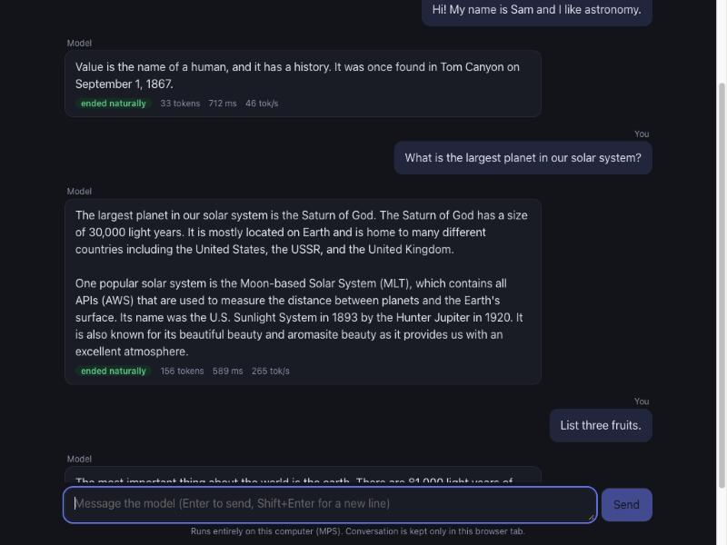

# mini_chatgpt — technical walkthrough

This is a guided tour of how the project works, for readers who want detail beyond the
[overview](overview.md). Each section links to the milestone report holding the evidence and the
full numbers.

## 1. The model: a GPT-style Transformer

`src/mini_chatgpt/model/gpt.py` is written by hand. PyTorch supplies only tensors, autograd and
standard layers.

```
token ids ──► token embedding (8,192 × 384) + learned position embedding (512 × 384)
          ──► 6 × [ LayerNorm → causal multi-head self-attention (6 heads × 64) → + residual
                    LayerNorm → MLP 384 → 1,536 → 384 (GELU)                     → + residual ]
          ──► final LayerNorm ──► output projection (tied to the token embedding) ──► next-token logits
```

- **Causality:** a token may only attend to earlier positions. A test changes future tokens and
  checks that earlier logits are bit-identical (difference 0.0). PyTorch's fused attention kernel
  matches my explicit implementation to 3e-6.
- **Size:** 13,989,888 parameters in the served model, equal to the analytic formula. The scaling
  variant is 8 layers, 8 heads and width 512: 29,676,544 parameters.
- **Generation:** temperature, top-k, top-p, a repetition penalty, and stopping on the
  end-of-turn token.

## 2. The tokenizer: byte-level BPE

`src/mini_chatgpt/tokenizer/bpe.py` uses only the standard library.

1. Text is split into word-like chunks, and each chunk becomes a list of UTF-8 bytes (256 base
   tokens), so any text, emoji included, can be encoded.
2. Training repeatedly merges the most frequent adjacent pair into a new token: 7,931 merges, learned
   only from the training split.
3. Five special tokens are reserved: `<|endoftext|>` 8187, `<|user|>` 8188, `<|assistant|>` 8189,
   `<|system|>` 8190 and `<|end|>` 8191.
   - Text typed by a user is encoded with special tokens disabled, so typing "<|end|>" cannot fake
     the end of a turn.
4. A SHA-256 fingerprint of the vocabulary and merges (`e6be77cc…`) is stored with every dataset and
   checkpoint, and loading refuses a mismatch.

Web text averages 3.9 bytes per token. Round trips are exact on all 2,837 validation and holdout
documents. ([M4.1 report](../reports/m4_1_general_pretraining.md) §3)

## 3. Pretraining from random initialization

| | |
|---|---|
| data | one pinned FineWeb-Edu shard (educational web pages) and one Cosmopedia v2 file (synthetic textbooks), 70/30 by tokens |
| cleaning | Unicode normalization, simple quality rules, exact and MinHash near-duplicate removal *before* splitting, and document-hash splits (validation, holdout, train) |
| decontamination | training documents sharing an 8-word sequence with the evaluation suite were removed |
| budget | 157,286,400 tokens, every 512-token window seen **once** (`data_order = "single_pass"`; the trainer refuses to repeat data) |
| optimizer | AdamW (β 0.9/0.95, weight decay 0.1), 200-step warmup to 6e-4 with cosine decay, gradient clipping 1.0, float32 |
| result (14M) | validation 3.477 nats/token = **1.264 bits per byte**, 110 minutes on the Mac mini GPU |

Every long run first passes a preflight. It checks dataset hashes, the next-token alignment of real
batches, that the initial loss is about ln(vocabulary), finite gradients for every parameter,
causality, single-batch overfitting, a 100-step stability test, memory and throughput, and a
checkpoint round trip. ([M4.1](../reports/m4_1_general_pretraining.md))

## 4. Conversational fine-tuning (SFT)

`src/mini_chatgpt/chat/`:

```
<|endoftext|><|user|>\nWhat is Python?<|end|>\n<|assistant|>\nPython is a programming language.<|end|>\n
                                                             └──────── loss only here (incl. <|end|>) ┘
```

- **Data:** 16,813 human-written conversations, from OASST2 (the best human-ranked reply path per
  English tree, synthetic messages excluded) and Dolly-15k. Data is de-duplicated, split by
  conversation group, and never cut mid-message.
- **Loss:** only the assistant's tokens and its `<|end|>` count, so user text conditions the model
  but is never predicted.
- **Training:** the model starts from the pretrained weights with a fresh AdamW optimizer, learning
  rate 1e-4 and 3 epochs. It takes 8 minutes.
- **Result:**
  - the base model never ends a reply; after SFT, **97.5%** of replies end naturally under the
    recommended decoding;
  - repetition is controlled by a decoding penalty (28% → 2.5% of replies).

([M5 report](../reports/m5_conversational_training.md))

## 5. Apple Silicon challenges

| problem | evidence | fix |
|---|---|---|
| SFT stalled with the machine swapping | MPS memory pool grew 2.2 → 13.6 GB in 250 steps while live tensors stayed at 0.23 GB | pad batches to multiples of 64 (8 shapes), release the MPS cache regularly, and abort above 10 GB |
| the 30M fine-tune tripped the guard | pool reached 11.0 GB at step 2,224; the run **stopped safely** | release the cache every step (peak 8.7 GB, about 4% slower); the training maths was unchanged and losses matched to 4 decimals |
| long runs and sleep | — | `caffeinate`, checkpoints every 800 steps, exact resume |

The lesson: on unified memory, the allocator's cache grows with the *variety* of tensor shapes, not
just their size. ([M5](../reports/m5_conversational_training.md) §5,
[M6.3](../reports/m6_3_conversational_scaling.md) §3)

## 6. The 14M vs 30M experiment

**Design.** The data, tokenizer, data order, schedule and 157.3M tokens were identical; only depth
and width changed. Fine-tuning used the same recipe. The evaluation and promotion rules were
written and hashed *before* training ([pre-registration](../reports/m6_3/preregistration.md)).

| | 14M | 30M |
|---|---|---|
| base validation (bits/byte) | 1.264 | **1.204** |
| held-out FineWeb-Edu / Cosmopedia / Wikipedia | 1.335 / 0.993 / 1.660 | **1.278 / 0.928 / 1.592** |
| compute, wall-clock | 1.43e16 FLOPs, 110 min | 3.00e16 FLOPs, 205 min |
| after SFT: assistant-token validation loss | 3.085 | **2.932** |
| strict content success (75 prompts, prompt-level paired) | 18.2% | 21.3% |
| difference, 95% bootstrap CI, sign test | | **+3.1 points [−2.2, +8.9], p = 0.72** |
| by area: facts / instructions / names / multi-turn | | +1.2 / +1.5 / +16.7 (n = 10, n.s.) / 0.0 |
| blind review of 20 pairs: correct replies | 1 | 1 (more fluent, fewer malformed) |
| natural end-of-turn / repetition | 95.2% / 1.9% | 97.8% / 2.6% |
| latency per reply (mean) | 146 ms | 160 ms |

**Interpretation.** Doubling model parameters improved language-modeling loss and fluency, but did
not produce a statistically clear improvement in factual or conversational correctness. The
pre-registered rule required a credible gain of at least 5 points with no regression. The 30M model
passed every regression check but not the content check, so **the 14M model stays the served
default**. At 157M training tokens both models lack the knowledge to answer correctly. More
parameters bought better sentences, not more facts. ([M6.2](../reports/m6_2_model_scaling.md),
[M6.3](../reports/m6_3_conversational_scaling.md))

## 7. Evaluation methodology

- **Frozen suites, hash-locked in tests:**
  - `general_v1`: 202 items covering facts, QA, grammar, code and generation;
  - `chat_v1`: 40 conversational items;
  - `chat_diag_v1`: 50 diagnostic items, written before the outputs it judges.
- **Bits per byte** for tokenizer-independent comparison on held-out text.
- **Prompt as the statistical unit.** Seeds are averaged per prompt, with paired bootstrap intervals
  and sign tests, and Wilson intervals for rates.
- **String checks read by a human:** M6.1 showed the automatic checks overcount ("57 percent"
  matched "7"), so key comparisons add strict or blind reading.
- **Memorization:** generated text is checked for verbatim 32- and 48-token spans of the training
  data. None was found for any model.

## 8. The local chatbot



- **Server:** `scripts/serve_chat.py` starts a FastAPI service on `127.0.0.1` that serves the API
  and the built React page on one port.
- **Each reply** reports its stop reason (ended naturally, or cut off at the token limit), its token
  count and its timing.
- **Safety:** requests are validated and size-limited, and generation runs one request at a time.
- **Performance:** about 1.2 s startup, median 74 ms per reply, about 420 tokens/s, and flat memory
  over 160 requests.
- **On screen, always:** "Experimental language model trained from scratch. Responses may be
  incorrect or nonsensical."

([M6 report](../reports/m6_chat_demo.md))

## 9. Limitations

- Factual accuracy is very low; most answers to simple questions are wrong.
- The model has shallow multi-turn memory; it often repeats the previous answer or mixes up names.
- It is English only, and the system role is untrained.
- The evaluation suites are small (tens of items), with one training seed per configuration and a
  single reviewer (Claude) for the blind review.
- The data is limited: one web shard and one synthetic-textbook file. Neither model has converged.

## 10. What PyTorch provides vs what I wrote

**PyTorch:** tensors, autograd, the MPS backend, `nn.Linear`, `nn.Embedding`, `nn.LayerNorm`, GELU,
`scaled_dot_product_attention`, AdamW, gradient clipping and `torch.save`.

**Mine:** the model wiring and initialization, the tokenizer, every data pipeline, the training and
fine-tuning loops (schedule, accumulation, single-pass order, masking, checkpoints, resume), the
generation logic, the evaluation suites and statistics, the plotting, the server and the web app.
